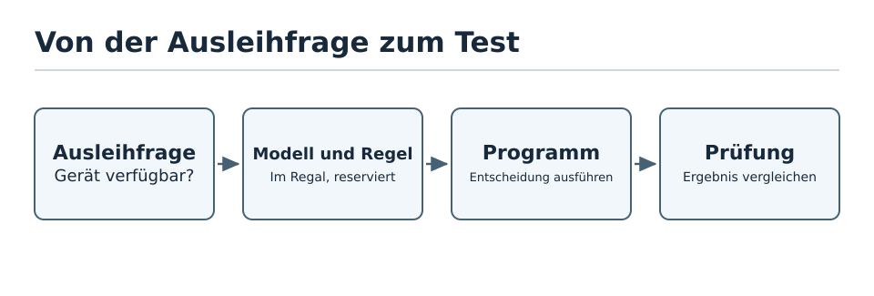

# M1-L1 – Wie Informatik Probleme modelliert {#L1}

**Kursbereich:** M1 – Orientierung und Informatiksysteme

**Niveau:** Einstieg / Brücke (etwa Klasse 5–6)

**Vorwissen:** Keine Programmiererfahrung erforderlich.

**Lernziel:** Problem, Modell, Algorithmus, Programm und Prüfkriterien an einer Ausleihe unterscheiden.

## Worum geht es? {#S1}

In der Schulbibliothek soll ein Tablet anzeigen, ob ein Gerät ausgeliehen werden kann. Die Anzeige ist einfach. Die eigentliche Frage lautet: Welche Tatsachen muss die Software kennen, um zuverlässig „verfügbar“ zu melden? Ein Gerät kann im Regal stehen und dennoch für eine andere Person reserviert sein.

## Wie ein Modell entsteht {#S2}

**Informatik** untersucht, wie sich Informationen so darstellen und verarbeiten lassen, dass Menschen und technische Systeme Aufgaben lösen können. Dazu gehört das Programmieren ebenso wie das Entwerfen und Prüfen der verwendeten Modelle. Ein **Modell** zeigt die für eine Fragestellung wichtigen Merkmale. Die Farbe des Tablets kann bei seinem Wiederfinden helfen. Für die Ausleihentscheidung ist sie unerheblich.

Ein **Algorithmus** beschreibt eindeutige Schritte für eine Klasse ähnlicher Eingaben. Ein **Programm** formuliert diese Schritte in einer ausführbaren Sprache. Eine **Prüfung** vergleicht das tatsächlich beobachtete Ergebnis mit einem begründeten erwarteten Ergebnis.

{alt="Vier Kästen verbinden Ausleihfrage, Merkmale und Regel, Programm und erwartetes Ergebnis mit Pfeilen."}

Wenn die Prüfung eine überraschende Antwort liefert, kann die Ursache im Modell, im Algorithmus oder in der Implementierung liegen. Deshalb hilft es, die drei Ebenen getrennt zu beschreiben.

## Beispiel: Darf das Tablet ausgegeben werden? {#S3}

Das Modell enthält zwei Ja-Nein-Merkmale, `im Regal` und `reserviert`. Der Algorithmus meldet „verfügbar“, wenn das Gerät im Regal und frei von einer Reservierung ist. Alle anderen Fälle ergeben „gesperrt“. Gemeint ist die spontane Ausleihe an eine beliebige Person.

| Im Regal | Reserviert | Erwartetes Ergebnis |
| --- | --- | --- |
| ja | nein | verfügbar |
| ja | ja | gesperrt |
| nein | nein | gesperrt |
| nein | ja | gesperrt |

Für das Modell gibt es nur vier Eingabekombinationen. Die Tabelle beschreibt für jede Kombination das überprüfbare Ergebnis. Wenn ein Programm in Zeile zwei „verfügbar“ meldet, prüfst du als Erstes, ob es die Reservierung überhaupt liest. Die Tabelle bleibt als Nachweis der Anforderung erhalten.

## Selbstkontrolle {#S4}

### Aufgaben

1. Ein Tablet ist reserviert und im Regal. Nenne die erwartete Ausgabe und den entscheidenden Test.
2. Die zuständige Bibliothek möchte eine Reservierung bei Abholung berücksichtigen. Welches zusätzliche Merkmal braucht das Modell? Begründe, ob die Gerätefarbe hilft.
3. Was müsste sich ändern, wenn ein beschädigtes Gerät im Regal liegen kann?

### Lösungen

1. Die Ausgabe lautet „gesperrt“. Der Test gibt beide Merkmale als „ja“ vor und verlangt als Ergebnis „gesperrt“. Er prüft genau den Fall, in dem Regal und Verfügbarkeit auseinanderfallen.
2. Die Entscheidung muss wissen, ob die anfragende Person zur Reservierung berechtigt ist. Ein zufälliger Buchungscode ohne Namensfeld kann für die Freigabe im Modell genügen. Die Farbe liefert keinen Hinweis auf diese Berechtigung.
3. Ergänze ein Merkmal wie `einsatzbereit`. Verfügbar ist das Gerät nach der neuen Regel nur bei Regalpräsenz, fehlender Reservierung und Einsatzbereitschaft. Ergänze mindestens einen Test für ein beschädigtes und sonst verfügbares Gerät.

## Typische Fehler und Grenzen {#S5}

„Ist im Regal“ ist eine Beobachtung. „Ist verfügbar“ ist eine aus Beobachtungen und Regeln abgeleitete Bewertung. Verwechselst du beides, fehlt ein Merkmal. Auch bei korrekter Regel können veraltete Eingaben eine falsche Auskunft ergeben. Bei fehlender oder unbestätigter Bestandsinformation braucht ein reales System daher einen eigenen Zustand wie „unbekannt“.

## Das nimmst du mit {#S6}

Ein nützliches Modell macht Voraussetzungen sichtbar. Ein Algorithmus lässt sich vor der Implementierung prüfen, wenn du Eingaben und erwartete Ausgaben festlegst.

## Quellen und weiterführende Hinweise {#S7}

### Weiterführend (intern)

- [M1-L2 – Hardware, Software und Betriebssystem](M1-L2.md)

### Quellen (extern)

- [Gesellschaft für Informatik e. V. – Bildungsstandards Informatik für die Sekundarstufe I](https://informatikstandards.de/fileadmin/FA/IBS/user_upload/GI-Bildungsstandards_Informatik_Sek_I__2025__-_blau.pdf) · Bezug zur Lektion: §4.1, §5.2 · Problem, Modell, Algorithmus, Programm und Prüfkriterien an einer Ausleihe unterscheiden · Zuletzt abgerufen: 2026-11-22 · Inhaltlich geprüft: 2026-11-22
