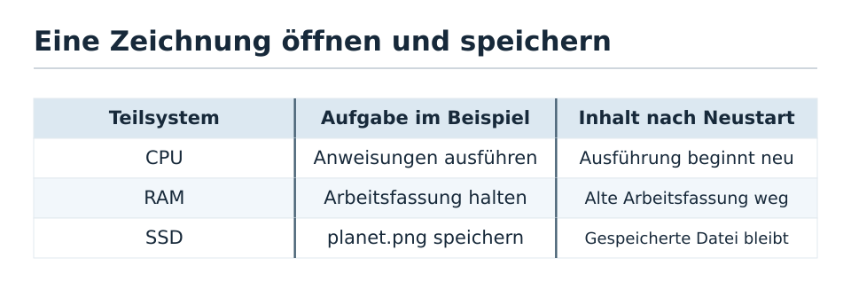

# M1-L2 – Hardware, Software und Betriebssystem {#L2}

**Kursbereich:** M1 – Orientierung und Informatiksysteme

**Niveau:** Einstieg / Brücke (etwa Klasse 5–6)

**Vorwissen:** [M1-L1 – Wie Informatik Probleme modelliert](M1-L1.md)

**Lernziel:** Eingabe, Verarbeitung, Ausgabe und Ablage auf CPU, RAM, SSD und Betriebssystem beziehen.

## Ein Bild, zwei Speicherorte {#S1}

Du änderst eine Zeichnung und möchtest sie am nächsten Tag weiterbearbeiten. Während der Arbeit siehst du das neue Bild sofort. Ob es morgen wieder erscheint, hängt davon ab, welche Fassung dauerhaft gespeichert wurde.

## Aufgaben der Komponenten {#S2}

Ein Informatiksystem verbindet **Hardware**, also die physischen Bauteile, mit **Software**, also Programmen und zugehörigen Daten. Eine Maus liefert Signale als Eingabe. Ein Programm legt fest, wie es auf die Signale reagiert. Eine **CPU** (Prozessor) führt Programmanweisungen aus. Sie kann unter anderem Werte vergleichen oder berechnen.

Im **RAM** liegen gerade benutzte Daten und Programmbestandteile. Üblicher Arbeitsspeicher verliert seinen Inhalt ohne Strom. Eine **SSD** kann Dateien dauerhaft aufbewahren. Sie ist ein Beispiel für nichtflüchtigen Speicher. Ein **Betriebssystem** verwaltet unter anderem Programme, Speicher, Dateizugriffe und Geräte. Die Zeichenanwendung bittet das Betriebssystem, eine Datei zu öffnen. Bildschirm und Lautsprecher sind Beispiele für Geräte, über die ein System Ergebnisse ausgibt.

{alt="Tabelle mit CPU für Anweisungen, RAM für die geöffnete Zeichnung und SSD für planet.png."}

## Beispiel: Zeichnen, speichern, neu starten {#S3}

1. Du öffnest die Datei `planet.png`. Das System liest die gespeicherten Daten von der SSD. Die Zeichenanwendung verarbeitet eine Arbeitsfassung im RAM.
2. Du ergänzt einen Ring. Die Anwendung verändert die Arbeitsfassung und zeigt den Ring auf dem Bildschirm.
3. Wenn du speicherst, wird eine Fassung der Änderung in die Datei geschrieben. Nach einem normalen Neustart lädt das Programm diese Fassung erneut.
4. Startest du ohne Speichern neu, erscheint in diesem vereinfachten Beispiel die vorige Dateifassung ohne Ring. Manche Programme haben eine automatische Sicherung, sofern diese eingerichtet ist und vor dem Neustart schon gegriffen hat.

Die CPU führt Anweisungen für all diese Verarbeitungsschritte aus. Die SSD bewahrt die Datei zwischen zwei Sitzungen auf. Das sind zwei verschiedene Aufgaben.

## Selbstkontrolle {#S4}

### Aufgaben

1. Ordne Tastatur, CPU, Bildschirm und SSD den Funktionen Eingabe, Verarbeitung, Ausgabe und dauerhafte Ablage zu.
2. Eine Skizze ist auf dem Bildschirm zu sehen, aber du hast seit der letzten Änderung noch nicht gespeichert. Was kannst du über die Fassung nach einem Stromausfall sagen?
3. Eine große Datei ist gespeichert, passt aber nicht komplett in den gerade verfügbaren RAM. Beschreibe eine Möglichkeit, wie ein Programm mit ihr arbeiten kann.

### Lösungen

1. Tastatur: Eingabe. CPU: Verarbeitung. Bildschirm: Ausgabe. SSD: dauerhafte Ablage. Ein Touchscreen vereint beispielsweise Ein- und Ausgabe, daher muss ein Gerät nicht genau eine Rolle haben.
2. Die zuletzt dauerhaft gespeicherte Fassung bleibt normalerweise erhalten. Die zuletzt nur im RAM vorhandene Änderung kann verloren gehen. Ob eine automatische Wiederherstellung greift, hängt vom Programm und der vorhandenen Sicherung ab.
3. Ein Programm kann Abschnitte nacheinander lesen und verarbeiten. Beispielsweise prüft es eine Textdatei Zeile für Zeile, statt die gesamte Datei gleichzeitig vorzuhalten. Das funktioniert, wenn die Aufgabe nur wenige frühere Werte benötigt.

## Typische Fehler und Grenzen {#S5}

Dauerhaft bezeichnet hier die Speicherung ohne laufende Stromversorgung. Auch eine SSD kann ausfallen und eine Datei lässt sich versehentlich überschreiben. Eine Anwendung kann außerdem gerade dabei sein, die Datei zu schreiben. Das Beispiel vereinfacht solche Fehlerfälle. Für wichtige Arbeit brauchst du eine getrennte, überprüfbare Sicherung.

## Das nimmst du mit {#S6}

RAM hält den aktuellen Arbeitszustand. Dauerhafte Ablage erhält Dateien über einen Neustart hinweg. Das Betriebssystem koordiniert die Zugriffe von Anwendungen auf Ressourcen und Geräte.

## Quellen und weiterführende Hinweise {#S7}

### Weiterführend (intern)

- [M1-L3 – Präzise Anweisungen, Ablaufpläne und Blöcke](M1-L3.md)

### Quellen (extern)

- [Gesellschaft für Informatik e. V. – Bildungsstandards Informatik für die Sekundarstufe I](https://informatikstandards.de/fileadmin/FA/IBS/user_upload/GI-Bildungsstandards_Informatik_Sek_I__2025__-_blau.pdf) · Bezug zur Lektion: §5.4 · Eingabe, Verarbeitung, Ausgabe und Ablage auf CPU, RAM, SSD und Betriebssystem beziehen · Zuletzt abgerufen: 2026-11-22 · Inhaltlich geprüft: 2026-11-22
