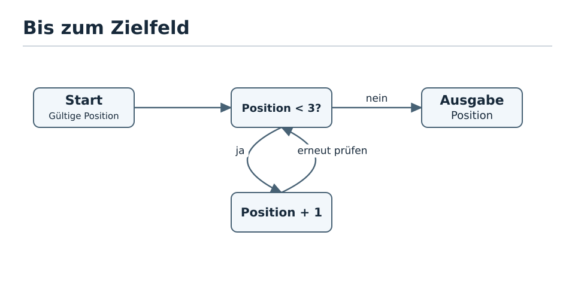

# M1-L3 – Präzise Anweisungen, Ablaufpläne und Blöcke {#L3}

**Kursbereich:** M1 – Orientierung und Informatiksysteme

**Niveau:** Einstieg / Brücke (etwa Klasse 5–6)

**Vorwissen:** [M1-L1 – Wie Informatik Probleme modelliert](M1-L1.md)

**Lernziel:** Ein einfaches Verfahren als Pseudocode, Ablaufplan und gedachte Blockfolge darstellen.

## Ein Weg, den ein Computer ausführen kann {#S1}

Auf einem Papierstreifen liegen vier Felder mit den Nummern 0 bis 3. Eine Spielfigur startet auf Feld 0 und soll das Zielfeld 3 erreichen. Menschen ergänzen bei „Geh bis ans Ziel“ meist stillschweigend Details. Ein Programm benötigt einen überprüfbaren Zustand, eine eindeutige Schrittregel und einen Abbruch.

## Darstellung desselben Algorithmus {#S2}

**Pseudocode** beschreibt Anweisungen mit vereinfachten Sprachmitteln. Ein **Ablaufplan** zeigt dieselben Anweisungen als Folge von Knoten. Pfeile zeigen die Richtung, eine Frage hat beschriftete Ausgänge. In einer visuellen Programmiersprache lassen sich dieselben Schritte mit Blöcken für Start, Prüfung und Zustandsänderung aufbauen.

{alt="Nach gültigem Start führt Position kleiner drei zum nächsten Feld und zurück zur Prüfung. Andernfalls folgt die Ausgabe."}

Die **Position** ist Teil des Zustands, also der gespeicherten Information über die aktuelle Situation. Prüfe vor der ersten Wiederholung, ob sie zwischen 0 und 3 liegt. Bei einer gültigen Position links vom Ziel verändert jeder Schritt genau einen Wert: Die Position wächst um eins.

## Beispiel: Erreichen von Feld 3 {#S3}

```text
EINGABE position
WENN position keine ganze Zahl ODER position < 0 ODER position > 3:
    AUSGABE "ungültig"
    ENDE
SOLANGE position < 3:
    position <- position + 1
AUSGABE position
```

So steckst du dieselbe Regel als gedankliche Blockfolge zusammen:

1. Unter **Beim Start** kommt **Eingabe lesen**.
2. In **Falls Eingabe ungültig** stecken **„ungültig“ ausgeben** und **Stopp**.
3. In **Wiederhole bis Position = 3** steckt **Erhöhe Position um 1**.
4. Hinter die Schleife kommt **Position ausgeben**.

Bei Start 0 sind die folgenden Positionen 1, 2 und 3. Auf Feld 3 ist die Bedingung falsch, also endet die Wiederholung. Die Differenz `3 − position` beschreibt die restliche Entfernung. Sie beginnt bei 3, sinkt in jedem Schritt um eins und kann innerhalb der Schleife nicht negativ werden. Das begründet die Beendigung.

Bei Start 3 endet der Algorithmus ohne einen Schritt. Bei Start 4 gibt er „ungültig“ aus. Dieselbe Logik lässt sich auf Papier mit einer Spielfigur simulieren. Verwende dabei einen beweglichen Zettel als Speicher für `position`.

## Selbstkontrolle {#S4}

### Aufgaben

1. Beginne auf Feld 2. Welche Bedingungen werden wann geprüft und wie viele Bewegungsschritte erfolgen?
2. Ersetze die Schleifenbedingung durch `position <= 3`. Zeige einen Eingabewert, bei dem ein Fehler sichtbar wird.
3. Das Ziel soll nun wahlweise Feld 1, 2 oder 3 sein. Nenne die Eingaben und eine passende Regel für den Fall, dass der Start rechts vom Ziel liegt.

### Lösungen

1. Die Bereichsprüfung akzeptiert 2. `2 < 3` ist wahr, also geht die Figur einmal auf Feld 3. `3 < 3` ist falsch, daher wird 3 ausgegeben.
2. Bei Eingabe 3 ist `3 <= 3` wahr. Der Algorithmus setzt die Position auf 4 und gibt damit ein Feld außerhalb des Streifens aus. Die ursprüngliche strikte Grenze erhält das gültige Ende.
3. Eingaben sind Start und Ziel. Prüfe beide vorab auf zulässige Felder. Wenn der Start rechts vom Ziel liegt, gehe jeweils ein Feld nach links bis zur Gleichheit. Alternativ darf das Verfahren solche Eingaben ablehnen, sofern die eingeschränkte Aufgabe das ausdrücklich vorsieht.

## Typische Fehler und Grenzen {#S5}

Ein Pfeil zurück zur Prüfung allein sorgt für keine Beendigung. Der Schleifenrumpf muss den Zustand in Richtung eines erreichbaren Endes verändern. Der Streifen hat keine Hindernisse. Für eine Route mit Wänden muss das Modell zusätzlich enthalten, welche Schritte zulässig sind.

## Das nimmst du mit {#S6}

Pseudocode, Ablaufplan und Blöcke sind verschiedene Darstellungen derselben Logik. Beim Test helfen ein normaler Start, ein Start auf dem Ziel und ein Start außerhalb des erlaubten Bereichs.

## Quellen und weiterführende Hinweise {#S7}

### Weiterführend (intern)

- [M1-L4 – Dateien sicher organisieren](M1-L4.md)

### Quellen (extern)

- [Gesellschaft für Informatik e. V. – Bildungsstandards Informatik für die Sekundarstufe I](https://informatikstandards.de/fileadmin/FA/IBS/user_upload/GI-Bildungsstandards_Informatik_Sek_I__2025__-_blau.pdf) · Bezug zur Lektion: §5.2 · Ein einfaches Verfahren als Pseudocode, Ablaufplan und gedachte Blockfolge darstellen · Zuletzt abgerufen: 2026-11-22 · Inhaltlich geprüft: 2026-11-22
- [Bildungsserver Berlin-Brandenburg · Senatsverwaltung Berlin und MBJS Brandenburg – Rahmenlehrplan Teil C – Informatik, Wahlpflichtfach, Jahrgangsstufen 7–10](https://bildungsserver.berlin-brandenburg.de/fileadmin/bbb/unterricht/rahmenlehrplaene/Rahmenlehrplanprojekt/amtliche_Fassung/Teil_C_Informatik_2015_11_10.pdf) · Bezug zur Lektion: §3.5 · Ein einfaches Verfahren als Pseudocode, Ablaufplan und gedachte Blockfolge darstellen · Zuletzt abgerufen: 2026-11-22 · Inhaltlich geprüft: 2026-11-22
