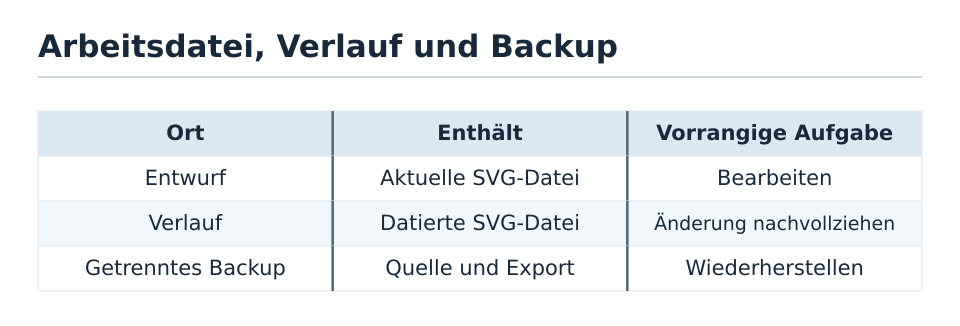

# M1-L4 – Dateien sicher organisieren {#L4}

**Kursbereich:** M1 – Orientierung und Informatiksysteme

**Niveau:** Einstieg / Brücke (etwa Klasse 5–6)

**Vorwissen:** [M1-L2 – Hardware, Software und Betriebssystem](M1-L2.md)

**Lernziel:** Relative Pfade, Formate, Versionen und getrennte Sicherungen unterscheiden.

## Die Datei ist da. Welche Fassung? {#S1}

Du bearbeitest ein Plakat im Team. Drei Dateien heißen „final“. Kurz vor der Präsentation ist unklar, welche die freigegebene Fassung ist und wo die bearbeitbare Vorlage liegt. Eine verlässliche Ablage beantwortet beide Fragen.

## Pfade, Dateiformate und Sicherung {#S2}

Ein **Pfad** benennt einen Ort in einer Ordnerstruktur. Ein relativer Pfad benötigt einen Ausgangspunkt. Vom Projektordner `schulfest/` aus führt `export/plakat.pdf` in den Ordner `export` zur Datei `plakat.pdf`. Vom Elternordner des Projektordners aus lautet der relative Pfad `schulfest/export/plakat.pdf`.

Eine **Dateiendung** ist Teil des Namens und gibt oft einen Hinweis auf das Format. Das Format beschreibt, wie der Inhalt gespeichert ist. Eine Textdatei wird durch Umbenennen in `.pdf` nicht zu einem gültigen PDF. Eine Vorlage und ein exportiertes Ansichtsformat erfüllen unterschiedliche Aufgaben.

{alt="Arbeitsquelle und Verlauf liegen im Projekt, eine Sicherung liegt getrennt und ist testweise wiederherstellbar."}

**Versionierung** hält nachvollziehbare Arbeitsstände fest. Ein **Backup** ist eine getrennt aufbewahrte Kopie für die Wiederherstellung. Ein Versionsordner und die Arbeitsdatei auf demselben Datenträger können gemeinsam verloren gehen. Ein Backup mit einer veralteten Fassung kann brauchbar sein, wenn sein Stand bekannt ist und die Wiederherstellung funktioniert.

## Beispiel: Eine Übergabe vorbereiten {#S3}

| Ort relativ zum Projekt | Inhalt | Zweck |
| --- | --- | --- |
| `entwurf/plakat.svg` | aktuell bearbeitbare Vektordatei | Weiterarbeit |
| `export/plakat.pdf` | freigegebene Fassung | Ansicht oder Druck |
| `verlauf/plakat-2026-11-20.svg` | Entwurf vom 20. November | frühere Fassung prüfen |

Das Team speichert nach der Freigabe von Entwurf und Export eine getrennte Kopie. Zur Kontrolle stellt ein Mitglied die beiden Dateien in einem Testordner wieder her. Es öffnet das PDF und vergleicht das Datum der erwarteten Version. Ein anderes Teammitglied öffnet die SVG-Datei im Editor und überprüft, ob sie sich weiterbearbeiten lässt.

## Selbstkontrolle {#S4}

### Aufgaben

1. Du befindest dich im Ordner `verlauf`. Wie lautet der relative Pfad zum Export eine Ebene höher und dann in dessen Ordner?
2. Ein Gruppenmitglied hat nur die Zieldatei `plakat.pdf` kopiert. Was gelingt bei Verlust des Projektordners und was fehlt?
3. Warum solltest du probeweise eine Kopie wiederherstellen, obwohl die Sicherung die Datei bereits auflistet?

### Lösungen

1. `../export/plakat.pdf`. `..` wechselt zum Projektordner, von dort führt der Pfad in `export`.
2. Die veröffentlichte Fassung lässt sich bei einer intakten Kopie noch ansehen oder erneut ausliefern. Die bearbeitbare Quelle und die dokumentierten Zwischenversionen fehlen.
3. Die Anzeige belegt nur, dass ein Eintrag vorhanden ist. Beim Öffnen erkennst du zum Beispiel eine beschädigte Kopie. Der Versionsvergleich deckt einen falschen Stand auf, der optisch ähnlich aussieht.

## Typische Fehler und Grenzen {#S5}

Synchronisation zwischen Geräten kann Löschungen weiterreichen. Eine Synchronisation ist als Sicherung nur brauchbar, wenn eine unabhängige Wiederherstellung möglich bleibt. Absolute Pfade lassen sich oft nicht auf einen anderen Rechner übertragen. Relative Links funktionieren bei einer Übergabe weiter, wenn die Ordnerstruktur erhalten bleibt.

## Das nimmst du mit {#S6}

Benenne die aktive Quelle und das Freigabeformat eindeutig. Schreibe den Ausgangspunkt eines relativen Pfades dazu und prüfe getrennte Sicherungen durch eine echte Wiederherstellung.

## Quellen und weiterführende Hinweise {#S7}

### Weiterführend (intern)

- [M2-L1 – Daten, Bedeutung und Datenqualität](M2-L1.md)

### Quellen (extern)

- [Gesellschaft für Informatik e. V. – Bildungsstandards Informatik für die Sekundarstufe I](https://informatikstandards.de/fileadmin/FA/IBS/user_upload/GI-Bildungsstandards_Informatik_Sek_I__2025__-_blau.pdf) · Bezug zur Lektion: §5.4 · Relative Pfade, Formate, Versionen und getrennte Sicherungen unterscheiden · Zuletzt abgerufen: 2026-11-22 · Inhaltlich geprüft: 2026-11-22
- [Bildungsserver Berlin-Brandenburg · Senatsverwaltung Berlin und MBJS Brandenburg – Rahmenlehrplan Teil C – Informatik, Wahlpflichtfach, Jahrgangsstufen 7–10](https://bildungsserver.berlin-brandenburg.de/fileadmin/bbb/unterricht/rahmenlehrplaene/Rahmenlehrplanprojekt/amtliche_Fassung/Teil_C_Informatik_2015_11_10.pdf) · Bezug zur Lektion: §3.2 · Relative Pfade, Formate, Versionen und getrennte Sicherungen unterscheiden · Zuletzt abgerufen: 2026-11-22 · Inhaltlich geprüft: 2026-11-22
