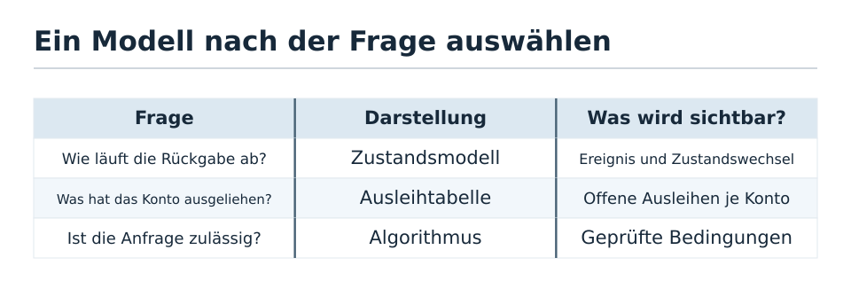

# M10-L1 – Operatoren und begründete Modellwahl {#L1}

**Kursbereich:** M10 – Abiturtraining und Abschlussprojekt

**Niveau:** Sekundarstufe II (grundlegend)

**Vorwissen:** [M5-L3 – SQL-Joins, Gruppen und fehlende Werte](M5-L3.md), [M7-L2 – Zustände und endliche Automaten](M7-L2.md)

**Lernziel:** Eine Anwendung anhand von Operatoren beschreiben, modellieren und beurteilen.

## Einstieg {#S1}

Die Medien-AG verleiht Kameras. In einer Klausur sollst du einmal die Ausleihregel beschreiben und einmal ein Modell begründet auswählen. Beide Aufgaben verwenden dieselbe Situation. Die erste verlangt eine klare Wiedergabe, die zweite eine Entscheidung anhand von Kriterien. Lies vor dem Schreiben, welches Ergebnis der Operator von dir verlangt.

## Von der Fragestellung zum Modell {#S2}

**Beschreiben** verlangt eine geordnete Darstellung des beobachteten Sachverhalts. Beim **Modellieren** legst du fest, welche Teile der Situation du mit welchen Elementen abbildest und welche Regeln gelten. Beim **Beurteilen** wählst du geeignete Kriterien, prüfst die Alternativen daran und kommst zu einem begründeten Urteil.

Die Anforderungsbereiche stehen für Wiedergabe und geübte Verfahren (I), selbstständige Anwendung in vergleichbaren Situationen (II) und eigenständiges Entwerfen oder Bewerten in komplexeren neuen Situationen (III). Ob eine Teilaufgabe welchem Bereich zugeordnet wird, hängt auch vom vorausgesetzten Unterricht, den Hilfen und dem Grad der Selbstständigkeit ab.

{alt="Für die Reihenfolge von Ereignissen zeigt ein Zustandsmodell Übergänge. Für Fragen zu einem Konto ordnet eine Ausleihtabelle diesem Konto seine offenen Ausleihen zu. Ein Algorithmus prüft die Bedingungen einer einzelnen Leihanfrage."}

Ein **Zustandsmodell** eines Geräts zeigt, welche Ereignisse einen Übergang auslösen. Ein **relationales Modell** zeigt, welche Daten zusammengehören, und unterstützt Fragen über mehrere Datensätze. Ein **Algorithmus** kann eine konkrete Buchungsanfrage anhand dieser Daten entscheiden. Wähle anhand der Frage, welche Darstellung die Beziehungen am klarsten und vollständigsten ausdrückt.

## Eine Leihanfrage nachvollziehen {#S3}

Die Regel lautet: Ein freies Gerät darf ausgeliehen werden, wenn das Konto weniger als zwei offene Ausleihen hat. Ein Gerät ist frei, wenn keine offene Ausleihe auf dieses Gerät verweist. Eine ausgefüllte Rückgabezeit schließt eine Ausleihe.

| Ausleihe | Gerät | Konto | Rückgabezeit |
| --- | --- | --- | --- |
| 31 | CAM-1 | A | fehlt |
| 32 | CAM-2 | A | fehlt |
| 33 | CAM-3 | B | erfasst |

Konto A möchte CAM-3 ausleihen. Die Zeile 33 ist geschlossen, also ist das Gerät frei. Die Zeilen 31 und 32 zählen für A. Da die Anzahl 2 beträgt, wird die Anfrage abgelehnt. Ein Zustandsdiagramm mit den Zuständen „frei“ und „ausgeliehen“ zeigt, dass CAM-3 für eine Ausleihe infrage kommt. Für die Entscheidung braucht der Übergang aber zusätzlich die aus den Kontodaten ermittelte Anzahl.

## Selbstkontrolle {#S4}

### Aufgaben

1. **Beschreibe** den Zustand von CAM-1 und CAM-3 anhand der Tabelle. Nenne für beide deinen Beleg. (4 Punkte)
2. **Modelliere** die Entscheidung für Konto B und CAM-3. Gib einen passenden Ausdruck und das Ergebnis an. (4 Punkte)
3. **Beurteile** für zwei Ziele die Eignung des reinen Gerätezustandsmodells und der Ausleihtabelle. Ziele sind die Erklärung der Rückgabe eines Geräts und die Kontrolle der Kontogrenze. (4 Punkte)

### Lösungen

1. CAM-1 ist ausgeliehen (1), weil Zeile 31 offen ist (1). CAM-3 ist frei (1), weil Zeile 33 geschlossen ist und keine weitere offene Zeile für CAM-3 vorliegt (1).
2. Die Anforderung ist `Gerät ist frei UND Anzahl offener Ausleihen < 2` (2). Für B ist die Anzahl 0 (1) und CAM-3 frei. Die Anfrage ist zulässig (1).
3. Das Zustandsmodell zeigt die Rückgabe als Übergang von „ausgeliehen“ nach „frei“ (1) und eignet sich daher für die Erklärung des Ablaufs (1). Die Tabelle enthält alle offenen Ausleihen und ihre Kontozuordnung (1). Dadurch lässt sich die Kontogrenze prüfen, was das isolierte Gerätemodell allein nicht leistet (1).

## Typische Fehler und Grenzen {#S5}

Ein Urteil ohne Kriterium lässt sich kaum überprüfen. Benenne etwa „Übergänge verständlich machen“ oder „offene Ausleihen pro Konto zählen“. Vergangene Leihvorgänge sind keine offenen Vorgänge. Die Aufgabe setzt außerdem voraus, dass höchstens eine Anfrage gleichzeitig bearbeitet wird. Gleichzeitige Anfragen erfordern eine gemeinsame Sicherung der Regeln. Die 12 Punkte sind ein Übungsraster. Für deine Prüfung gelten die Vorgaben deines Landes und deines Prüfungsjahrgangs.

## Zusammenfassung {#S6}

Operatoren geben vor, welche Art von Antwort erwartet wird. Nutze ein Modell, das die entscheidenden Merkmale der Frage sichtbar macht, und erkläre, woran du seine Eignung erkennst.

## Quellen und weiterführende Hinweise {#S7}

### Weiterführend (intern)

- [M10-L2 – Klausurtraining: einen unbekannten Algorithmus analysieren](M10-L2.md)

### Quellen (extern)

- [Kultusministerkonferenz (KMK) – Einheitliche Prüfungsanforderungen in der Abiturprüfung Informatik (EPA)](https://www.kmk.org/fileadmin/Dateien/veroeffentlichungen_beschluesse/1989/1989_12_01_EPA_Informatik.pdf) · Bezug zur Lektion: §§2–3 · Eine Anwendung anhand von Operatoren beschreiben, modellieren und beurteilen · Zuletzt abgerufen: 2026-11-22 · Inhaltlich geprüft: 2026-11-22
- [Gesellschaft für Informatik e. V. – Bildungsstandards Informatik für die Sekundarstufe II](https://informatikstandards.de/fileadmin/GI/Projekte/Informatikstandards/Dokumente/Bildungsstandards_SII.pdf) · Bezug zur Lektion: §2.2 · Eine Anwendung anhand von Operatoren beschreiben, modellieren und beurteilen · Zuletzt abgerufen: 2026-11-22 · Inhaltlich geprüft: 2026-11-22
