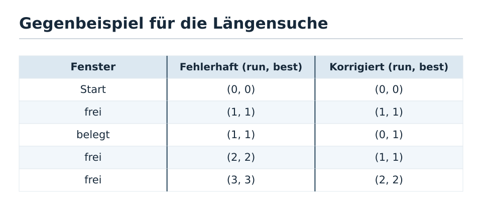

# M10-L2 – Klausurtraining: einen unbekannten Algorithmus analysieren {#L2}

**Kursbereich:** M10 – Abiturtraining und Abschlussprojekt

**Niveau:** Sekundarstufe II (grundlegend)

**Vorwissen:** [M6-L3 – Sortieren, Korrektheit und Aufwand](M6-L3.md), [M10-L1 – Operatoren und begründete Modellwahl](M10-L1.md)

**Lernziel:** Unbekannten Pseudocode testen, Invariante formulieren und Fehler korrigieren.

## Einstieg {#S1}

Ein Verleih reserviert Geräte in aufeinanderfolgenden Zeitfenstern. Ein Verfahren soll aus einer Folge von freien und belegten Fenstern den längsten zusammenhängenden freien Abschnitt bestimmen. Ein Blick auf den Namen des Verfahrens verrät wenig. Leite sein tatsächliches Verhalten aus den Zuweisungen ab.

## Unbekannten Pseudocode lesen {#S2}

Die Eingabe enthält ausschließlich `free` und `busy`. Beide Zählvariablen starten bei 0. Die erwartete Rückgabe ist eine Länge, bei leerer Eingabe also 0. Im Pseudocode bezeichnet `←` eine Zuweisung, `max(a, b)` den größeren der beiden Werte.

```text
run ← 0
best ← 0
FOR EACH slot IN slots:
    IF slot = free:
        run ← run + 1
    best ← max(best, run)
RETURN best
```

`run` soll die Länge des freien Abschnitts am Ende der bereits betrachteten Eingabe festhalten. `best` soll über alle bis dahin betrachteten Abschnitte das Maximum speichern. Eine **Invariante** beschreibt, was nach jedem Durchlauf für diese Größen gelten muss. Formuliere diese Eigenschaft so genau, dass eine einzige Tabellenzeile zeigen kann, wann sie verletzt wird.

{alt="Für frei, belegt, frei, frei liefert die fehlerhafte Variante 3. In der Zeile belegt bleibt run fälschlich bei 1. Die korrigierte Variante setzt run dort auf 0 und liefert am Ende 2."}

## Einen Defekt durch einen Ablaufbeleg eingrenzen {#S3}

Für `[free, busy, free, free]` ist das Soll-Ergebnis 2. Nach dem ersten `free` stehen beide Größen auf 1. Bei `busy` bleibt `run` auf 1, obwohl das betrachtete Stück jetzt auf ein belegtes Fenster endet. Nach den beiden restlichen freien Fenstern gibt das Verfahren 3 zurück. Als Korrektur braucht der Test auf `free` einen `ELSE`-Zweig, der `run` auf 0 setzt. Jetzt lauten die Zwischenpaare für `(run, best)` in derselben Reihenfolge `(1, 1)`, `(0, 1)`, `(1, 1)` und `(2, 2)`.

```python
def longest_free_run(slots):
    run = 0
    best = 0
    for slot in slots:
        if slot == "free":
            run += 1
        else:
            run = 0
        best = max(best, run)
    return best

assert longest_free_run(["free", "busy", "free", "free"]) == 2
assert longest_free_run(["free", "busy", "free"]) == 1
assert longest_free_run([]) == 0
assert longest_free_run(["busy", "busy"]) == 0
```

## Selbstkontrolle {#S4}

### Aufgaben

1. **Verfolge** die fehlerhafte Fassung für `[free, busy, free]`. Notiere die drei Zwischenpaare und vergleiche die Rückgabe mit dem Sollwert. (4 Punkte)
2. **Erkläre** anhand des ersten Fehlers in der Tabelle, warum zwei getrennte Abschnitte gezählt werden. Ergänze eine präzise Korrektur. (4 Punkte)
3. **Begründe**, dass die Korrektur für eine beliebige zulässige Folge richtig ist. Nenne den Aufwand in Abhängigkeit von ihrer Länge. (6 Punkte)

### Lösungen

1. Die Zwischenpaare lauten `(1, 1)`, `(1, 1)` und `(2, 2)` (je 1). Rückgabe 2, Soll 1 (1).
2. Nach `busy` ist `run` noch 1 (1). Das nächste `free` wird daher zum früheren Abschnitt addiert (1). Der `ELSE`-Zweig (1) setzt `run` auf 0 (1).
3. Für die leere verarbeitete Folge sind beide Längen 0 (1). Bei `free` wächst der Endabschnitt um 1 (1), bei `busy` wird er leer (1). Ein neu gefundenes Maximum kann nur durch einen Abschnitt entstehen, der am aktuellen Ende endet. `max` behält damit das bisherige Maximum oder aktualisiert es passend (1). Am Ende ist die gesamte Eingabe verarbeitet, also ist `best` das gesuchte Ergebnis (1). Pro Wert fällt ein konstanter Arbeitsschrittblock an, insgesamt linearer Aufwand (1).

## Typische Fehler und Grenzen {#S5}

Teste gemischte Folgen. Eine Folge aus ausschließlich freien Fenstern bestätigt die fehlerhafte Version scheinbar. Ein Gegenbeispiel widerlegt eine Korrektheitsaussage, während mehrere bestandene Beispiele noch keine allgemeine Begründung ergeben. Die Lösung liefert nur die Länge. Wolltest du auch die Startposition und bei Gleichstand die früheste Serie finden, müsstest du zusätzliche Größen führen. Die 14 Punkte sind für deine Selbstkontrolle gedacht.

## Zusammenfassung {#S6}

Vergleiche tatsächliche Tabellenwerte mit der Eigenschaft, die gelten soll. Die erste verletzte Stelle zeigt, wo du den Code prüfen solltest. Die Invariante begründet nach der Korrektur, warum das Ergebnis auch für andere Eingaben stimmt.

## Quellen und weiterführende Hinweise {#S7}

### Weiterführend (intern)

- [M10-L3 – Klausurtraining: Transfer und begründetes Urteil](M10-L3.md)

### Quellen (extern)

- [Kultusministerkonferenz (KMK) – Einheitliche Prüfungsanforderungen in der Abiturprüfung Informatik (EPA)](https://www.kmk.org/fileadmin/Dateien/veroeffentlichungen_beschluesse/1989/1989_12_01_EPA_Informatik.pdf) · Bezug zur Lektion: §§2–4 · Unbekannten Pseudocode testen, Invariante formulieren und Fehler korrigieren · Zuletzt abgerufen: 2026-11-22 · Inhaltlich geprüft: 2026-11-22
- [Gesellschaft für Informatik e. V. – Bildungsstandards Informatik für die Sekundarstufe II](https://informatikstandards.de/fileadmin/GI/Projekte/Informatikstandards/Dokumente/Bildungsstandards_SII.pdf) · Bezug zur Lektion: §4 · Unbekannten Pseudocode testen, Invariante formulieren und Fehler korrigieren · Zuletzt abgerufen: 2026-11-22 · Inhaltlich geprüft: 2026-11-22
- [Ministerium für Bildung Rheinland-Pfalz, Rundschreiben zur Abiturprüfungsordnung – Rundschreiben zur Abiturprüfungsordnung – Informatik](https://mss.rlp.de/fileadmin/mss/Downloads/Rundschreiben-AbiPrO-2026.pdf) · Bezug zur Lektion: §4.11 · Unbekannten Pseudocode testen, Invariante formulieren und Fehler korrigieren · Zuletzt abgerufen: 2026-11-22 · Inhaltlich geprüft: 2026-11-22
