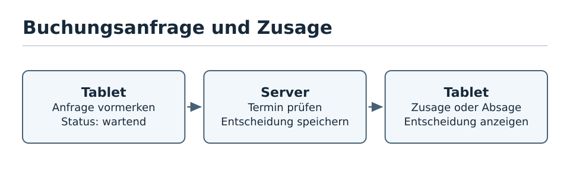

# M10-L3 – Klausurtraining: Transfer und begründetes Urteil {#L3}

**Kursbereich:** M10 – Abiturtraining und Abschlussprojekt

**Niveau:** Sekundarstufe II (erhöht)

**Vorwissen:** [M7-L5 – Wachstumsordnungen, P und NP](M7-L5.md), [M8-L3 – Nebenläufigkeit und konsistente Änderungen](M8-L3.md), [M10-L2 – Klausurtraining: einen unbekannten Algorithmus analysieren](M10-L2.md)

**Lernziel:** Eine neue vernetzte Datenanwendung mit Begründung, Fehleranalyse und Transfer lösen.

## Einstieg {#S1}

Für eine Reparaturwerkstatt gibt es noch einen Termin. Zwei Tablets zeigen ihn als frei an. Beide können bei einem Netzausfall eine Buchung vormerken. Die Werkstatt soll am Ende höchstens eine bestätigte Buchung führen. Das ist eine andere Anforderung als „Jedes Tablet reagiert sofort“.

## Daten, Zustände und Verantwortlichkeiten {#S2}

Modelliere einen Termin mit `slot_id` und eine Anfrage mit `request_id`, `slot_id` sowie `decision`. Eine eindeutige Anfragekennung steht für genau dieselbe Buchungsanfrage, auch wenn das Tablet sie wiederholt sendet. Die Tablets halten „wartend“ als lokalen Zustand. Nur der Server kann einen Termin verbindlich von „frei“ nach „reserviert“ wechseln lassen. Eine Abfrage der Anzeige sagt, was zuletzt bekannt war.

{alt="Das Tablet hält eine Anfrage mit Kennung als wartend. Der Server entscheidet für den gemeinsamen Termin und speichert bei Zusage die Reservierung. Die Anwendung zeigt anschließend Zusage oder Absage."}

Die zentrale Regel lautet, dass es pro Termin höchstens eine bestätigte Buchung gibt. Prüfen und Reservieren müssen auf dem Server so zusammen ausgeführt werden, dass keine zweite Anfrage dazwischen einen scheinbar freien Platz bestätigen kann. Die Anfrageentscheidung und die Reservierung werden bei Erfolg gemeinsam dauerhaft festgeschrieben. Der Server liefert bei derselben Anfragekennung und denselben Daten nach einem Timeout die bereits gespeicherte Entscheidung zurück. Eine identische Wiederholung erzeugt dadurch keine neue Buchung. Veränderte Daten unter derselben Kennung behandelt der Server als widersprüchliche Anfrage.

## Zwei Anfragen und eine verlorene Antwort {#S3}

Der Termin `R4` ist frei. Tablet A legt Anfrage `701` offline in die Warteschlange. Tablet B sendet `702` online. Der Server verarbeitet `702`, reserviert `R4` und speichert „bestätigt“. Die Antwort geht verloren. B zeigt daher zunächst „wartend“ an. Nun sendet A die vorgemerkte Anfrage. Der Server findet `R4` reserviert und speichert für `701` „abgelehnt“. B sendet `702` erneut. Der Server liest die gespeicherte Entscheidung und bestätigt sie B erneut. Die Buchungstabelle enthält genau eine bestätigte Buchung für `R4`.

## Selbstkontrolle {#S4}

### Aufgaben

1. **Entwirf** einen Serverzustand für den Termin und die minimalen Anfragefelder. Gib an, welche Bedingung geprüft wird und was gemeinsam gespeichert werden muss. (5 Punkte)
2. **Analysiere** eine fehlerhafte Variante. Beide Tablets dürfen nach einem Blick auf „frei“ selbst bestätigen. Konstruiere eine Ereignisfolge mit zwei Bestätigungen und entwirf einen Test für den Fall einer verlorenen Serverantwort. (6 Punkte)
3. **Beurteile** den Vorschlag „Auch offline sofort verbindlich bestätigen“. Verwende die Kriterien Verfügbarkeit der Bedienung und Konsistenz der Buchungen. Übertrage dein Urteil auf eine Schulmensa mit genau einer letzten Portion je Gericht. (5 Punkte)

### Lösungen

1. Ein Termin mit Kennung und Zustand „frei“ oder „reserviert“ (1). Je Anfrage genügen eine eindeutige Kennung und ein Terminverweis (1). Die Entscheidung wird je Anfrage gespeichert (1). Der Server prüft „frei“ (1) und schreibt Reservierung und Entscheidung atomar fest (1).
2. A und B lesen „frei“, bevor eines eine Buchung erfasst (1). A bestätigt (1), B bestätigt aufgrund seiner alten Kopie ebenfalls (1). Für den Test wird die Antwort nach erfolgreichem Speichern verworfen (1). Sende dieselbe Anfrage mit denselben Daten erneut (1). Erwarte dieselbe Entscheidung und genau eine bestätigte Buchung (1).
3. Eine Offline-Vormerkung ermöglicht eine Eingabe bei Netzausfall (1). Sofortige beidseitige Bestätigung kann den letzten Platz zweimal zusagen (1). Ohne eine vorher exklusiv verteilte Zusage darf die Anzeige bis zur zentralen Entscheidung nur „wartend“ melden (1). In der Mensa entspricht die letzte Portion dem knappen Termin (1). Zwei Bestellanfragen müssen über denselben Bestand entschieden werden (1).

## Typische Fehler und Grenzen {#S5}

Eine abgelaufene Wartezeit beweist nicht, dass der Server nichts gespeichert hat. Die Annahme eines gemeinsamen Bestands ist wichtig. Bei vorher exklusiv aufgeteiltem Bestand wäre eine andere Lösung möglich, könnte aber verfügbare Restplätze auf einem anderen Gerät vorübergehend unbrauchbar machen. Für das Übungsmodell reichen Zeitfenster und fiktive Kennungen. Eine öffentliche Anzeige braucht keine Namen. Die 16 Punkte sind ein Übungsraster.

## Zusammenfassung {#S6}

Unterscheide den lokalen Kenntnisstand und die verbindliche Entscheidung. Entwirf Daten und Zustände gemeinsam. Prüfe die Regel an einer Ereignisfolge, die den Fehler gezielt auslösen kann.

## Quellen und weiterführende Hinweise {#S7}

### Weiterführend (intern)

- [M10-L4 – Projektbericht und mündliche Prüfung](M10-L4.md)

### Quellen (extern)

- [Kultusministerkonferenz (KMK) – Einheitliche Prüfungsanforderungen in der Abiturprüfung Informatik (EPA)](https://www.kmk.org/fileadmin/Dateien/veroeffentlichungen_beschluesse/1989/1989_12_01_EPA_Informatik.pdf) · Bezug zur Lektion: §§2–4 · Eine neue vernetzte Datenanwendung mit Begründung, Fehleranalyse und Transfer lösen · Zuletzt abgerufen: 2026-11-22 · Inhaltlich geprüft: 2026-11-22
- [Gesellschaft für Informatik e. V. – Bildungsstandards Informatik für die Sekundarstufe II](https://informatikstandards.de/fileadmin/GI/Projekte/Informatikstandards/Dokumente/Bildungsstandards_SII.pdf) · Bezug zur Lektion: §4 · Eine neue vernetzte Datenanwendung mit Begründung, Fehleranalyse und Transfer lösen · Zuletzt abgerufen: 2026-11-22 · Inhaltlich geprüft: 2026-11-22
