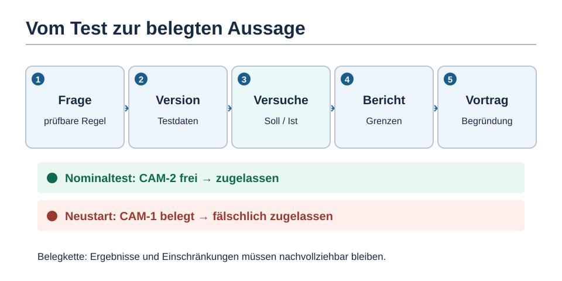

# M10-L4 – Projektbericht und mündliche Prüfung {#L4}

**Kursbereich:** M10 – Abiturtraining und Abschlussprojekt

**Niveau:** Sekundarstufe II (grundlegend)

**Vorwissen:** [M8-L4 – Teamprojekt: ein prüfbares Ausleihsystem](M8-L4.md), [M10-L1 – Operatoren und begründete Modellwahl](M10-L1.md)

**Lernziel:** Entscheidungen, Belege und Grenzen eines Projekts schriftlich und mündlich darstellen.

## Einstieg {#S1}

Ein Ausleihprototyp meldet „Ausleihe erlaubt“ für eine freie Kamera. Im Projektbericht kommt es darauf an, welche Regel nachgewiesen wurde und unter welchen Bedingungen der Nachweis gilt. In einer mündlichen Prüfung musst du diese Bedingungen bei einer Rückfrage erklären oder dein Modell auf eine abgewandelte Situation anwenden können.

## Eine Aussage mit überprüfbaren Belegen verbinden {#S2}

Beginne mit einer Fragestellung, die sich am Prototyp prüfen lässt. Für jede wichtige Entscheidung braucht der Bericht die betrachtete Alternative, das gewählte Kriterium und einen Beleg. Gib zu einem Test den Startzustand, die Aktion, das erwartete und das beobachtete Ergebnis an. Zeige bei einer Abweichung die Auswirkung und benenne den nächsten nötigen Test oder Entwicklungsschritt.

{alt="Fünf Schritte verbinden die Fragestellung, das Archiv mit Daten und Prüfergebnissen, die Befunde, den Bericht mit Geltungsgrenzen und die mündliche Präsentation."}

Die Darstellung nennt einen üblichen Ablauf unter normalen Bedingungen einen **Nominaltest**. Im Beispiel ist das die Ausleihe einer freien Kamera. Das **Rechenarchiv** ist hier der Projektordner mit dem verwendeten Programmstand, den Testdaten und den Ergebnissen. Damit kann jemand den Versuch wiederholen und die Aussage prüfen.

## Eine kurze Demonstration vorbereiten {#S3}

Die fiktive Medien-AG möchte pro Kamera höchstens eine offene Ausleihe haben. Der kleine Prototyp führt ein Wörterbuch im Arbeitsspeicher. Zu Beginn ist nur `CAM-1` an Konto `A` verliehen. Es geht um bekannte Kameras und eine einzelne laufende Programminstanz, die Anfragen nacheinander verarbeitet.

```python
def lend(active_loans, camera, account):
    if camera in active_loans:
        return False
    active_loans[camera] = account
    return True

active_loans = {"CAM-1": "A"}
assert lend(active_loans, "CAM-2", "B") is True
assert lend(active_loans, "CAM-1", "C") is False
assert active_loans == {"CAM-1": "A", "CAM-2": "B"}

after_restart = {}
assert lend(after_restart, "CAM-1", "C") is True
```

| Versuch | Soll bei durchgängig geführten Ausleihen | Beobachtung |
| --- | --- | --- |
| Freie Kamera CAM-2 an B ausleihen | zulassen | zugelassen |
| Belegte Kamera CAM-1 an C ausleihen | ablehnen | abgelehnt |
| CAM-1 nach simuliertem Neustart an C ausleihen | ablehnen | zugelassen |

Die letzte Prüfzeile hält das **tatsächlich beobachtete** Verhalten fest. Die fachliche Anforderung bleibt dort offen. Für eine Demonstration genügen diese drei Schritte und ein kurzer Satz zur Einschränkung. Nach der Demo erklärst du, warum dauerhaftes Speichern den Startzustand ändern würde und welche Prüfung dann wiederholt werden muss.

## Selbstkontrolle {#S4}

### Aufgaben

1. Formuliere eine Ergebnispassage für den Bericht mit Aussage, zwei Belegen und einer Grenze. (4 Punkte)
2. Plane einen dreiminütigen Übungsvortrag. Benenne, was du zeigst und wie du den fehlgeschlagenen Fall einordnest. (4 Punkte)
3. Antworte auf die Rückfragen „Warum reicht eine fortlaufende Liste von Namen nicht?“ und „Wie würdest du die nächste Version abnehmen?“ (4 Punkte)

### Lösungen

1. Bei Verarbeitung nacheinander begrenzt die Einzelinstanz offene Ausleihen je Kamera (1). CAM-2 wird angenommen (1) und CAM-1 vor dem Neustart abgelehnt (1). Der Zustand geht beim Neustart verloren, da die Daten nur im Arbeitsspeicher liegen (1).
2. Minute 1: Regel und Modell aus Kamera-Kennung und Konto erklären (1). Minute 2: eine gültige und eine abgelehnte Anfrage mit Soll und Ist zeigen (1). Minute 3: Neustart simulieren (1) und seine Folge für den Geltungsbereich benennen (1).
3. Die Namen allein identifizieren das betroffene Gerät nicht eindeutig (1). Die Kamera-Kennung muss mit der offenen Ausleihe verbunden sein (1). Eine nächste Version lädt den zuletzt gespeicherten Zustand (1). Der Neustarttest muss dann dieselbe Anfrage zu CAM-1 ablehnen (1).

## Typische Fehler und Grenzen {#S5}

Trenne Demonstration, Prototyp und Einsatzsystem. Ein bestandener Test in einer Einzelinstanz erlaubt kein Urteil über mehrere gleichzeitig arbeitende Geräte. Ist eine Rückfrage unklar, kläre erst die Annahme und beziehe die Antwort auf Daten oder Verhalten. Zeit und Punkte oben sind Übungswerte. Verbindliche Prüfungsformate hängen vom Land, der Schule und dem Prüfungsjahrgang ab.

## Zusammenfassung {#S6}

Stütze eine Projektentscheidung mit einem wiederholbaren Beleg. Weise Grenzen im Bericht aus und zeige im Gespräch, welche Änderung und welcher Test daraus folgen.

## Quellen und weiterführende Hinweise {#S7}

### Quellen (extern)

- [Kultusministerkonferenz (KMK) – Einheitliche Prüfungsanforderungen in der Abiturprüfung Informatik (EPA)](https://www.kmk.org/fileadmin/Dateien/veroeffentlichungen_beschluesse/1989/1989_12_01_EPA_Informatik.pdf) · Bezug zur Lektion: §4 · Entscheidungen, Belege und Grenzen eines Projekts schriftlich und mündlich darstellen · Zuletzt abgerufen: 2026-11-22 · Inhaltlich geprüft: 2026-11-22
- [Gesellschaft für Informatik e. V. – Bildungsstandards Informatik für die Sekundarstufe II](https://informatikstandards.de/fileadmin/GI/Projekte/Informatikstandards/Dokumente/Bildungsstandards_SII.pdf) · Bezug zur Lektion: §4 · Entscheidungen, Belege und Grenzen eines Projekts schriftlich und mündlich darstellen · Zuletzt abgerufen: 2026-11-22 · Inhaltlich geprüft: 2026-11-22
