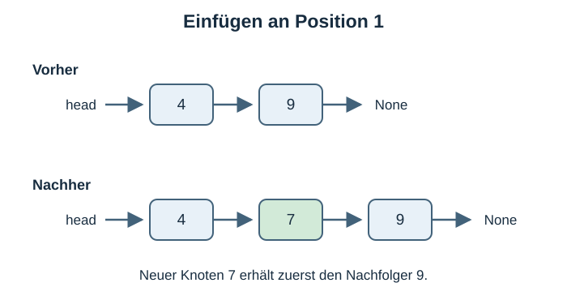

# M11-L1 – Einfach verkettete Listen {#L1}

**Kursbereich:** M11 – Verkettete Strukturen und Graphensuche

**Niveau:** Sekundarstufe II (grundlegend)

**Vorwissen:** [M6-L1](M6-L1.md); [M6-L4](M6-L4.md)

**Einordnung:** Ergänzung des Grundniveaus nach LehrplanPLUS Bayern, Informatik 12; keine bundesweit einheitliche Pflicht.

## Lernziele {#S1}

Du modellierst eine einfach verkettete Liste als Folge von Objekten, unterscheidest Daten und Referenzen, implementierst Suchen, Einfügen, Entfernen und Längenbestimmung rekursiv und begründest den Aufwand. Du kannst leere Listen, Kopfwechsel und ungültige Positionen testen.

## Knoten und Listeninvariante {#S2}

Ein Knoten speichert einen Nutzwert und eine Referenz auf den nächsten Knoten. Die Kopfvariable `head` verweist auf den ersten Knoten; `None` bezeichnet die leere Liste oder das Listenende. In unserem Modell ist die von `head` erreichbare Kette endlich und zyklenfrei. Ein Knoten mit Wert 4 und Nachfolger mit Wert 9 repräsentiert die Folge [4, 9], nicht zwei benachbarte Speicheradressen. Referenzen verbinden Objekte unabhängig von ihrem physischen Speicherort. Die Trennung von Nutzwert und Verkettung erlaubt es, später statt Zahlen etwa Buchdatensätze zu speichern.

Die leere Liste ist zugleich der Basisfall einer rekursiven Struktur: Eine nichtleere Liste besteht aus dem Kopf und dem Rest, der wieder eine Liste ist.

## Einfügen und Entfernen {#S3}

Einfügen an Position 1 in [4, 9] erzeugt zuerst einen neuen Knoten mit Wert 7 und Nachfolger 9. Anschließend verweist der Knoten 4 auf den neuen Knoten. Würde man die alte Referenz zuerst überschreiben, ohne sie zu sichern, könnte der Rest verloren gehen. Positionen beginnen bei 0; bei Länge n ist n eine gültige Einfügeposition. Beim Entfernen des ersten passenden Werts 4 wird der bisherige Nachfolger zum neuen Kopf. Der aufrufende Code muss den zurückgegebenen Kopf übernehmen. Mehrfach vorkommende Werte sind erlaubt; Entfernen betrifft nur den ersten Treffer.

{alt="Vorher Kopf → 4 → 9 → None; nachher Kopf → 4 → 7 → 9 → None."}

## Rekursive Operationen in Python {#S4}

Die Klasse stellt die Objektstruktur dar; die Funktionen implementieren die Listenoperationen. `insert_at` liefert den eventuell geänderten Kopf zurück. Bei ungültigem Index wird eine Ausnahme ausgelöst. `remove_first` liefert die unveränderte Kette zurück, wenn der Wert fehlt. Kopiere den gesamten Block und führe ihn in Python 3 aus. Die Assertions schlagen bei einem falschen Ergebnis fehl.

```python
class Node:
    def __init__(self, value, next_node=None):
        self.value = value
        self.next = next_node


def contains(node, value):
    if node is None:
        return False
    return node.value == value or contains(node.next, value)


def length(node):
    return 0 if node is None else 1 + length(node.next)


def insert_at(node, index, value):
    if index < 0:
        raise IndexError(index)
    if index == 0:
        return Node(value, node)
    if node is None:
        raise IndexError(index)
    node.next = insert_at(node.next, index - 1, value)
    return node


def remove_first(node, value):
    if node is None:
        return None
    if node.value == value:
        return node.next
    node.next = remove_first(node.next, value)
    return node


def values(node):
    result = []
    while node is not None:
        result.append(node.value)
        node = node.next
    return result


head = None
head = insert_at(head, 0, 4)
head = insert_at(head, 1, 9)
head = insert_at(head, 1, 7)
assert values(head) == [4, 7, 9]
assert contains(head, 7) and length(head) == 3
head = remove_first(head, 4)
assert values(head) == [7, 9]
```

## Warum die Verfahren korrekt sind {#S5}

Für `contains` ist die leere Liste ein erfolgloser Basisfall. Andernfalls trifft der Kopf zu oder die Suche wird auf die kürzere Restliste verlagert. Für `insert_at` gilt: An Position 0 entsteht die neue Kette unmittelbar. Bei Position i > 0 wird an Position i−1 im Rest eingefügt; der zurückgegebene Restkopf wird wieder angeschlossen. Der gleiche Gedanke gilt für `remove_first`: Bei einem Treffer wird der Rest zurückgegeben, andernfalls bleibt der Kopf erhalten und der Rest wird bearbeitet. `length` addiert pro Knoten eins. Die abnehmende Restlänge garantiert bei endlichen zyklenfreien Listen Terminierung; zyklische Referenzen verletzen die Invariante.

Eine objektorientierte Variante könnte eine abstrakte Listenkomponente mit zwei Implementierungen verwenden: leere Liste und Datenknoten mit Restliste. Dieses Kompositum ermöglicht rekursive Methoden ohne `None` als expliziten Abschluss. Unser kleiner Entwurf nutzt stattdessen `None`; er ist kein vollständiges Beispiel des Entwurfsmusters.

## Aufwand, Tests und Alternativen {#S6}

Bei n Knoten kostet eine erfolglose Suche n Wertvergleiche, also O(n) Zeit. Der Zugriff auf die i-te Position kostet O(i+1); Einfügen am Kopf benötigt O(1) Zeit. Nach bereits bekanntem Vorgängerknoten lassen sich Referenzen ebenfalls in O(1) Zeit ändern. In der Implementierung beanspruchen tiefe rekursive Aufrufe O(n) zusätzlichen Stapelspeicher und können die Rekursionsgrenze von Python erreichen. Eine iterative Suche benötigt nur O(1) Zusatzspeicher. Im Gegensatz dazu bietet eine Python-Liste direkten Indexzugriff und kann bei Einfügen in der Mitte viele Referenzen verschieben. Sie ist keine einfach verkettete Liste.

Teste vor allem `None`, Position 0, Position n, Position n+1, doppelte Werte und Entfernen eines fehlenden Werts. Beim Testen kann `values` die verkettete Struktur in eine Python-Liste übersetzen; in einem großen Programm sollte die Liste selbst nicht von dieser Prüfoperation abhängen.

## Selbstkontrolle {#S7}

### Aufgaben

1. Zeichne die Liste [4, 9] und füge 7 an Position 1 ein. Welche Referenzen ändern sich?
2. Was liefern `length(None)` und `contains(None, 4)`?
3. Entferne aus [2, 2, 5] einmal den Wert 2. Was bleibt?
4. Wie viele Wertvergleiche benötigt eine erfolglose Suche in einer Liste mit 20 Knoten?
5. Warum ist `head = insert_at(head, 0, 8)` notwendig, wenn die Liste leer ist?

::: {.lc-solutions data-lc-section="S7"}
1. Der neue Knoten 7 verweist auf 9, Knoten 4 verweist anschließend auf 7; der Kopf bleibt unverändert.
2. 0 und False.
3. [2, 5]; nur der erste Treffer wird entfernt.
4. 20; jeder Knoten wird einmal geprüft.
5. Der Rückgabewert ist die Referenz auf den neuen Kopf. Ohne Zuweisung bleibt `head` weiterhin `None`.
:::

## Quellen {#S8}

- [LehrplanPLUS Bayern – Informatik 12 (gA)](https://www.lehrplanplus.bayern.de/fachlehrplan/gymnasium/12/informatik/grundlegend) · Inf12 Lernbereich 2 · Zuletzt abgerufen: 2026-11-24 · Inhaltlich geprüft: 2026-11-24
- [Runestone – Implementing an Unordered List](https://runestone.academy/ns/books/published/pythonds3/BasicDS/ImplementinganUnorderedListLinkedLists.html) · 3.21 · Zuletzt abgerufen: 2026-11-24 · Inhaltlich geprüft: 2026-11-24
