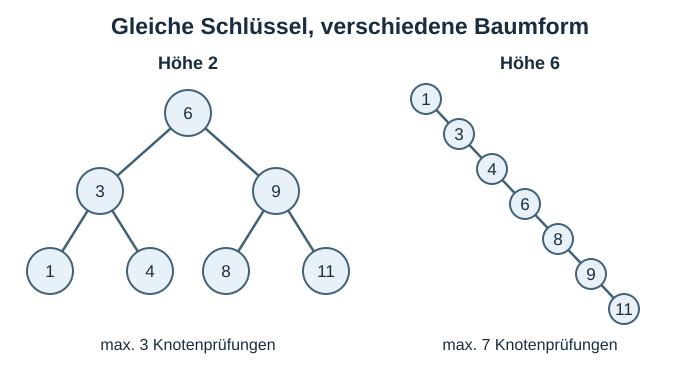

# M11-L2 – Geordnete Binärbäume und Traversierung {#L2}

**Kursbereich:** M11 – Verkettete Strukturen und Graphensuche

**Niveau:** Sekundarstufe II (grundlegend)

**Vorwissen:** [M11-L1](M11-L1.md); [M6-L5](M6-L5.md)

**Einordnung:** Ergänzung des Grundniveaus nach LehrplanPLUS Bayern, Informatik 12; keine bundesweit einheitliche Pflicht.

## Lernziele {#S1}

Du unterscheidest Binärbaum und binären Suchbaum, formulierst die Suchbauminvariante, implementierst Einfügen und Suchen und wendest Preorder, Inorder und Postorder an. Du vergleichst die Anzahl der Schlüsselvergleiche mit einer verketteten Liste und erkennst den Einfluss der Baumhöhe.

## Baumstruktur und Ordnung {#S2}

Ein Binärbaum besteht aus Knoten mit höchstens zwei geordneten Kindpositionen, links und rechts. Die Wurzel besitzt keinen Elternknoten; ein Blatt besitzt keine Kinder. Die Höhe h messen wir als maximale Anzahl von Kanten auf einem Pfad von der Wurzel zu einem Blatt; ein einzelner Knoten hat Höhe 0. Für einen Suchbaum mit verschiedenen Schlüsseln gilt für jeden Knoten: Alle Schlüssel im linken Teilbaum sind kleiner, alle im rechten Teilbaum größer. Nicht nur die direkten Kinder müssen diese Regel erfüllen. Nutzdaten können getrennt vom Schlüssel gespeichert werden. Ein beliebiger Binärbaum ist noch kein Suchbaum.

## Einfügen, Suchen und Baumform {#S3}

Die Folge 6, 3, 9, 1, 4, 8, 11 ergibt einen Baum mit Höhe 2. Bei der Suche nach 8 vergleichen wir nacheinander mit 6, 9 und 8. Bei der Suche nach 5 führt der Weg 6 → 3 → 4 → leer. Einfügen verwendet dieselbe Entscheidung und ersetzt an der freien Position die leere Referenz durch einen neuen Knoten. Doppelte Schlüssel werden in diesem Modell ignoriert. Andere Anwendungen könnten eine Anzahl oder Nutzdaten aktualisieren.

Bei Einfügung der sortierten Folge 1, 3, 4, 6, 8, 9, 11 entsteht hingegen eine reine Rechtskette mit Höhe 6. Keine dieser Einfügeregeln balanciert den Baum automatisch.

{alt="Links perfekt gefüllter Baum mit Wurzel 6 und Höhe 2; rechts sortiert eingefügte Rechtskette mit Höhe 6."}

## Implementierung und Traversierung {#S4}

Die Funktion `insert` gibt wie bei verketteten Listen eine eventuell neue Teilbaumwurzel zurück. `search` arbeitet hier iterativ; ein rekursiver Aufruf könnte jeweils denselben kleineren Teilbaum bearbeiten. Bei `walk` bestimmt die Position des Besuchs im Verhältnis zu den beiden rekursiven Aufrufen die Reihenfolge. `order` muss pre, in oder post sein. Der Akkumulator `result` vermeidet wiederholtes Kopieren von Teillisten.

```python
class TreeNode:
    def __init__(self, key):
        self.key = key
        self.left = None
        self.right = None


def insert(node, key):
    if node is None:
        return TreeNode(key)
    if key < node.key:
        node.left = insert(node.left, key)
    elif key > node.key:
        node.right = insert(node.right, key)
    return node


def search(node, key):
    while node is not None:
        if key == node.key:
            return True
        node = node.left if key < node.key else node.right
    return False


def walk(node, order, result):
    if node is None:
        return
    if order == "pre":
        result.append(node.key)
    walk(node.left, order, result)
    if order == "in":
        result.append(node.key)
    walk(node.right, order, result)
    if order == "post":
        result.append(node.key)


root = None
for key in [6, 3, 9, 1, 4, 8, 11]:
    root = insert(root, key)
for order, expected in [
    ("pre", [6, 3, 1, 4, 9, 8, 11]),
    ("in", [1, 3, 4, 6, 8, 9, 11]),
    ("post", [1, 4, 3, 8, 11, 9, 6]),
]:
    result = []
    walk(root, order, result)
    assert result == expected
assert search(root, 8) and not search(root, 5)
```

## Korrektheit und Anwendungen {#S5}

Die Suchbauminvariante schließt bei jedem Vergleich einen gesamten Teilbaum aus. Wird die neue Wurzel eines Teilbaums wieder an derselben Kindposition angeschlossen, bleiben die Schranken der Vorfahren erhalten. Ein leerer Teilbaum ist der Abbruchfall. Inorder besucht zuerst links, dann den Knoten, dann rechts: Nach der Invariante ist die Ausgabe streng aufsteigend. Preorder besucht den Knoten vor beiden Teilbäumen, etwa für eine hierarchische Übersicht. Postorder besucht ihn nach beiden Teilbäumen, beispielsweise um einen Ausdrucksbaum von seinen Operanden aus auszuwerten. Für den Wiederaufbau eines beliebigen Binärbaums genügt Preorder allein ohne Strukturinformation nicht.

Wie in [M11-L1](M11-L1.md) kann eine Kompositum-Variante leere und nichtleere Teilbäume als gemeinsame Schnittstelle modellieren; hier steht `None` für leere Teilbäume.

## Aufwand und Grenzen {#S6}

Zählen wir einen Schlüsselvergleich pro geprüftem Knoten (eine abstrakte Dreiwegeentscheidung), sind maximal h+1 Knoten zu prüfen. Ein perfekt gefüllter Binärbaum mit Höhe h besitzt $2^{h+1}-1$ Knoten. Bei einer entsprechend balancierten Struktur wächst h logarithmisch mit n; Suchen und Einfügen kosten dann O(log n). Eine entartete Kette benötigt im schlimmsten Fall n Prüfungen, wie eine verkettete Liste. Der Code zählt keine einzelnen Python-Vergleichsoperatoren; diese können je Knoten mehrfach ausgeführt werden. Jede vollständige Traversierung besucht n Knoten, benötigt O(n) Zeit und O(h+1) Aufrufstapel zusätzlich zur Ausgabe. Für große Datenmengen kommen selbstbalancierende Suchbäume oder andere Indexstrukturen in Betracht. Ein gewöhnlicher Suchbaum verspricht keine logarithmische Worst-Case-Zeit.

## Selbstkontrolle {#S7}

### Aufgaben

1. Füge 5 in den Beispielbaum ein. Wo landet der Knoten?
2. Gib die Inorder- und Preorder-Folge für den Beispielbaum an.
3. Ein Baum hat Wurzel 6, linkes Kind 3 und dessen rechtes Kind 7. Ist er ein Suchbaum?
4. Vergleiche die maximalen Knotenprüfungen für die zwei gezeichneten Bäume und eine Liste mit sieben Knoten.
5. Warum kann das Einfügen sortierter Schlüssel in einen gewöhnlichen Suchbaum ungünstig sein?

::: {.lc-solutions data-lc-section="S7"}
1. Rechtes Kind von 4; Pfad 6 → 3 → 4 → rechts.
2. Inorder: 1, 3, 4, 6, 8, 9, 11; Preorder: 6, 3, 1, 4, 9, 8, 11.
3. Nein. 7 liegt im linken Teilbaum von 6, muss dort aber kleiner als 6 sein.
4. 3 im perfekt gefüllten Baum, 7 in der Rechtskette und bis zu 7 in der Liste.
5. Jeder neue Schlüssel landet rechts vom bisherigen Maximum. Die Höhe wächst linear, sodass die Suche im Worst Case linear wird.
:::

## Quellen {#S8}

- [LehrplanPLUS Bayern – Informatik 12 (gA)](https://www.lehrplanplus.bayern.de/fachlehrplan/gymnasium/12/informatik/grundlegend) · Inf12 Lernbereich 3 · Zuletzt abgerufen: 2026-11-24 · Inhaltlich geprüft: 2026-11-24
- [Runestone – Tree Traversals](https://runestone.academy/ns/books/published/pythonds3/Trees/TreeTraversals.html) · 6.8 · Zuletzt abgerufen: 2026-11-24 · Inhaltlich geprüft: 2026-11-24
- [Runestone – Search Tree Analysis](https://runestone.academy/ns/books/published/pythonds3/Trees/SearchTreeAnalysis.html) · 6.15 · Zuletzt abgerufen: 2026-11-24 · Inhaltlich geprüft: 2026-11-24
