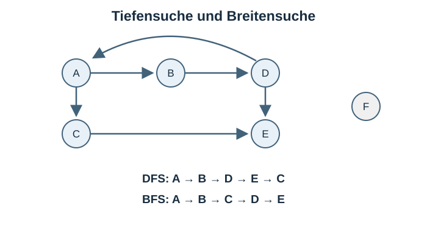

# M11-L3 – Tiefensuche und erreichbare Knoten {#L3}

**Kursbereich:** M11 – Verkettete Strukturen und Graphensuche

**Niveau:** Sekundarstufe II (grundlegend)

**Vorwissen:** [M6-L4](M6-L4.md); [M6-L5](M6-L5.md)

**Einordnung:** Ergänzung des Grundniveaus nach LehrplanPLUS Bayern, Informatik 12; keine bundesweit einheitliche Pflicht.

## Lernziele {#S1}

Du repräsentierst gerichtete Graphen durch Adjazenzlisten, führst Tiefensuche (DFS) mit einer Besuchsmenge aus, erklärst das Zurückkehren zu offenen Nachbarn und vergleichst DFS mit Breitensuche (BFS). Du kannst erreichbare Knoten auswählen, Zyklen sicher behandeln und den Aufwand begründen.

## Graph und Erreichbarkeit {#S2}

Ein gerichteter Graph besteht aus einer Knotenmenge V und einer Menge gerichteter Kanten E. Eine Kante A → B erlaubt einen Schritt von A nach B, aber nicht automatisch zurück. Ein Knoten ist vom Start s erreichbar, wenn ein gerichteter Pfad von s zu ihm existiert; s selbst ist über einen Pfad der Länge null erreichbar. Wir speichern für jeden Knoten eine Liste seiner ausgehenden Nachbarn in einer festen Reihenfolge. Jeder Nachbar muss ebenfalls als Schlüssel vorkommen, auch wenn seine eigene Liste leer ist. Im Beispiel sind die Kanten A → B, A → C, B → D, C → E, D → A und D → E vorhanden; F ist isoliert.

## Tiefensuche Schritt für Schritt {#S3}

Wir beginnen bei A und markieren A sofort als besucht. Der erste Nachbar ist B, danach D. D hat A als Nachbarn, doch A ist bereits markiert; D besucht stattdessen E. E besitzt keine Nachbarn. Die rekursiven Aufrufe kehren nacheinander zurück, bis A den nächsten noch offenen Nachbarn C verarbeitet. C verweist auf das schon besuchte E. Die Besuchsreihenfolge lautet A, B, D, E, C. F wird nicht erreicht. Die Kante D → A erzeugt einen Zyklus, ohne dass der Algorithmus in eine Endlosschleife gerät.

{alt="Gerichteter Graph mit Zyklus A–B–D–A und isoliertem F. DFS A B D E C; BFS A B C D E."}

## Rekursive und iterative Implementierung {#S4}

Im folgenden Python-3-Beispiel müssen Start und alle Nachbarn gültige Schlüssel sein. Knoten sind Zeichenketten, `None` kommt nicht als Knoten vor. Die explizite Stapelvariante speichert für jede aktive Ebene einen Iterator über ihre noch offenen Nachbarn; damit ahmt sie die rekursive Reihenfolge genau nach. Die Warteschlange der BFS markiert Knoten bereits beim Einreihen.

```python
from collections import deque

graph = {
    "A": ["B", "C"], "B": ["D"], "C": ["E"],
    "D": ["A", "E"], "E": [], "F": []
}


def dfs(graph, start):
    seen, order = set(), []
    def visit(v):
        seen.add(v)
        order.append(v)
        for w in graph[v]:
            if w not in seen:
                visit(w)
    visit(start)
    return order


def dfs_stack(graph, start):
    seen, order = {start}, [start]
    stack = [iter(graph[start])]
    while stack:
        w = next(stack[-1], None)
        if w is None:
            stack.pop()
        elif w not in seen:
            seen.add(w)
            order.append(w)
            stack.append(iter(graph[w]))
    return order


def bfs(graph, start):
    seen, order = {start}, []
    queue = deque([start])
    while queue:
        v = queue.popleft()
        order.append(v)
        for w in graph[v]:
            if w not in seen:
                seen.add(w)
                queue.append(w)
    return order


assert dfs(graph, "A") == ["A", "B", "D", "E", "C"]
assert dfs_stack(graph, "A") == dfs(graph, "A")
assert bfs(graph, "A") == ["A", "B", "C", "D", "E"]
```

## Korrektheit und Aufwand {#S5}

Jeder neu markierte Knoten wird über eine Kante von einem bereits erreichbaren Knoten entdeckt, ist also ebenfalls erreichbar. Wäre nach Ende ein erreichbarer Knoten unbesucht, gäbe es auf einem Pfad vom Start eine erste Kante von einem besuchten zu einem unbesuchten Knoten; diese Kante wäre beim Abarbeiten des besuchten Knotens geprüft worden. Widerspruch. Die Besuchsmenge verhindert erneute Besuche; die endliche Zahl von Knoten und Kanten sichert die Terminierung. Für V_r erreichbare Knoten und E_r von ihnen ausgehende Kanten beträgt die erwartete Zeit O(V_r+E_r), sofern Mengen- und Wörterbuchzugriffe im Mittel konstant sind. Bei beiden DFS-Varianten beträgt der Zusatzspeicher einschließlich Besuchsmenge und Stapel O(V_r), ohne den Eingabegraphen. Rekursion kann in Python an der Aufruftiefengrenze scheitern; der explizite Stapel umgeht diese Grenze.

## Vergleich mit Breitensuche und Anwendung {#S6}

BFS bearbeitet die Nachbarn zuerst und liefert hier A, B, C, D, E. In einem ungewichteten Graphen entdeckt BFS Knoten in nicht abnehmender Entfernung (Anzahl Kanten) vom Start. BFS kann mit Vorgängerinformationen kürzeste Wege rekonstruieren; DFS garantiert keinen kürzesten Weg. DFS eignet sich z. B. dazu, alle von einer Seite aus erreichbaren verlinkten Seiten zu ermitteln. `selected = [v for v in dfs(graph, "A") if v in {"C", "F"}]` liefert nur C: Erst wird Erreichbarkeit bestimmt, dann die Eigenschaft geprüft. Eine vorzeitige Filterung während der Traversierung könnte notwendige Zwischenknoten überspringen. Die Reihenfolge beider Suchen hängt von der Adjazenzreihenfolge ab. Für eine vollständige Traversierung aller Komponenten kann man mit einer gemeinsamen Besuchsmenge an jedem noch unbesuchten Knoten starten. Bei gerichteten Graphen bedeutet eine bereits besuchte Nachbarkante allein noch nicht, dass ein Zyklus vorliegt; hierfür braucht man zusätzliche Zustandsinformationen.

## Selbstkontrolle {#S7}

### Aufgaben

1. Welche Knoten besucht DFS ab A in welcher Reihenfolge?
2. Welche Knoten sind von C erreichbar?
3. Was passiert, wenn man die Besuchsmenge bei DFS im Beispiel weglässt?
4. Welche Reihenfolge ergibt BFS ab A? Welche Methode garantiert bei ungewichteten Kanten die kürzeste Entfernung?
5. Ändere die Nachbarliste von A zu [C, B]. Gib die neue DFS-Reihenfolge und die Menge der erreichbaren Knoten an.

::: {.lc-solutions data-lc-section="S7"}
1. A, B, D, E, C.
2. C und E.
3. A → B → D → A wiederholt sich; rekursiv endet das Programm gegebenenfalls mit einem Rekursionsfehler.
4. A, B, C, D, E; BFS garantiert bei Ersterreichung die kürzeste Entfernung in Kantenzahl.
5. A, C, E, B, D; dieselbe Menge {A, B, C, D, E}.
:::

## Quellen {#S8}

- [LehrplanPLUS Bayern – Informatik 12 (gA)](https://www.lehrplanplus.bayern.de/fachlehrplan/gymnasium/12/informatik/grundlegend) · Inf12 Lernbereich 1 · Zuletzt abgerufen: 2026-11-24 · Inhaltlich geprüft: 2026-11-24
- [Cornell CS 2110 – Graph Traversals](https://courses.cs.cornell.edu/cs2110/2025fa/lectures/lec22/) · DFS, BFS, Complexity Analysis · Zuletzt abgerufen: 2026-11-24 · Inhaltlich geprüft: 2026-11-24
