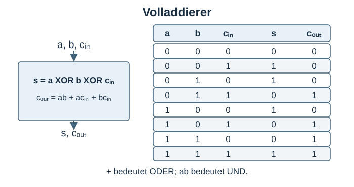

# M12-L1 – Binäre Addition, Zweierkomplement und Überlauf {#L1}

**Kursbereich:** M12 – Rechnerarithmetik und Registermaschinen

**Niveau:** Sekundarstufe II (erhöht)

**Vorwissen:** [M2-L2](M2-L2.md); [M7-L1](M7-L1.md)

**Einordnung:** Ergänzung des erhöhten Niveaus nach LehrplanPLUS Bayern, Informatik 12; keine bundesweit einheitliche Pflicht.

## Lernziele {#S1}

Du rechnest mit Binärwörtern fester Breite, interpretierst sie vorzeichenlos und im Zweierkomplement, entwirfst Halb- und Volladdierer aus Wahrheitstabellen und unterscheidest Übertrag und vorzeichenbehafteten Überlauf. Du überprüfst deine Rechnungen durch eine Simulation.

## Bitmuster und Zahlenbereich {#S2}

Ein Bitwort mit n Stellen besitzt 2^n verschiedene Muster. Ohne Vorzeichen ist sein Wert die Summe der gesetzten Stellengewichte 2^i; der Bereich reicht von 0 bis 2^n−1. Im Zweierkomplement hat nur das höchstwertige Bit ein negatives Gewicht: −2^(n−1). Der Bereich ist damit −2^(n−1) bis 2^(n−1)−1. Bei vier Bits bedeutet 1010 vorzeichenlos 10, mit Vorzeichen jedoch −8+2=−6. Die Bitfolge allein entscheidet nicht über die Interpretation. Um beispielsweise −3 darzustellen, invertiert man 0011 zu 1100 und addiert 1: 1101. Allgemein kodiert man eine darstellbare Zahl x durch den Rest x modulo 2^n. Das kleinste darstellbare negative Wort hat kein positives Gegenstück gleicher Breite; 1000 bleibt bei Invertieren und Addieren von 1 unverändert. Eine Vorzeichenerweiterung wiederholt das höchste Bit, z. B. 1101 → 111101 (weiterhin −3).

## Addition und Überlauf {#S3}

Bei fester Breite behält ein Addierer nur die n niederwertigen Bits. Das Ergebnis entspricht der Summe modulo 2^n. Beispiel: 0111+0011=1010. Vorzeichenlos ist 7+3=10 korrekt; im Zweierkomplement ist −6 statt 10 entstanden. Ein vorzeichenbehafteter Überlauf liegt genau dann vor, wenn beide Operanden dasselbe Vorzeichen haben, das Ergebnis aber das andere Vorzeichen. Äquivalent ist das XOR des Übertrags in die höchste Stelle und aus dieser Stelle. Der ausgehende Übertrag C kennzeichnet dagegen den vorzeichenlosen Überlauf. Bei 1111+0001=1|0000 gilt C=1, aber V=0: −1+1=0 ist korrekt. Bei 1000+1111=1|0111 gilt C=1 und V=1: −8−1 liegt außerhalb des Bereichs. Unterschiedliche Vorzeichen verursachen bei Addition keinen vorzeichenbehafteten Überlauf. In Programmen muss man beachten, ob die Sprache Überlauf meldet, modulo rechnet oder andere Regeln verwendet; Python-Ganzzahlen haben keine solche feste Maschinenwortbreite.

## Vom Halbaddierer zum Volladdierer {#S4}

Ein Halbaddierer verarbeitet a und b: Summe s=a XOR b, Übertrag c=a AND b. Ein Volladdierer verarbeitet zusätzlich den eingehenden Übertrag c_in. Seine Ausgänge sind s=a XOR b XOR c_in und c_out=(a AND b) OR ((a XOR b) AND c_in). In der Grafik steht jede Zeile für eine vollständige Belegung. Für eine disjunktive Normalform (DNF) wählt man alle Zeilen mit Ausgang 1, bildet je Zeile eine UND-Verknüpfung der passenden (gegebenenfalls negierten) Eingänge und verbindet die Terme durch ODER. Für s sind das die Belegungen 001, 010, 100 und 111; für c_out die Belegungen 011, 101, 110 und 111. Die DNF für c_out lässt sich zu (a AND b) OR (a AND c_in) OR (b AND c_in) vereinfachen.

{alt="Volladdierer mit drei Eingängen, zwei Ausgängen und allen acht Wahrheitswertzeilen."}

NAND(a,b)=NOT(a AND b). Damit ist NOT(a)=NAND(a,a), AND(a,b)=NAND(t,t) mit t=NAND(a,b), und OR(a,b)=NAND(NAND(a,a),NAND(b,b)). Weil NOT, AND und OR jede DNF ausdrücken können, reicht NAND allein aus. Ein CMOS-NAND realisiert den Ausgang beispielsweise mit zwei seriellen nMOS-Transistoren nach Masse und zwei parallelen pMOS-Transistoren zur Versorgung: Nur bei zwei hohen Eingängen wird der Ausgang aktiv nach unten gezogen. Diese Schaltungsbeschreibung ist ein idealisiertes Logikmodell, keine Anleitung zur Dimensionierung.

## Simulation in Python {#S5}

Ein Ripple-Carry-Addierer verbindet die Übertragsausgabe jeder Stufe mit dem Übertragseingang der nächsten. Wir beginnen mit dem niederwertigsten Bit und c=0. Der Rückgabewert enthält das Ergebniswort, C und V. Bitoperatoren in Python simulieren die Gatter; die Schleife begrenzt das Ergebnis auf n Bits.

```python
def signed(word, n):
    return word - (1 << n) if word & (1 << (n - 1)) else word


def full_adder(a, b, c):
    return a ^ b ^ c, (a & b) | ((a ^ b) & c)


def add_words(a, b, n):
    if n < 1 or not (0 <= a < 2**n and 0 <= b < 2**n):
        raise ValueError("invalid word or width")
    result, carry = 0, 0
    for i in range(n):
        incoming = carry
        bit, carry = full_adder((a >> i) & 1, (b >> i) & 1, carry)
        result |= bit << i
    return result, carry, incoming ^ carry


assert add_words(7, 3, 4) == (10, 0, 1)
assert add_words(15, 1, 4) == (0, 1, 0)
assert signed(10, 4) == -6
```

## Grenzen und Anwendungen {#S6}

Ein realer Addierer benötigt Zeit: Der Übertrag kann sich durch alle Stufen ausbreiten. Die längste Kette wächst beim Ripple-Carry-Entwurf mit der Wortbreite; andere Schaltungen berechnen Überträge parallel oder in Gruppen. Ein größerer Zahlenbereich verhindert nur bestimmte Überläufe, nicht alle. Bei einer 8-Bit-Anzeige kann ein vorzeichenloser Zähler von 255 auf 0 springen. Soll eine Anzeige bei 255 stehenbleiben, ist stattdessen eine Sättigungsregel erforderlich. Teste insbesondere die Grenzen, null, negative Werte und die Fälle mit C ungleich V.

## Selbstkontrolle {#S7}

### Aufgaben

1. Interpretiere 1011 als vorzeichenlose Zahl und als vierstelliges Zweierkomplement.
2. Kodiere −5 mit vier Bits und erweitere das Vorzeichen auf sechs Bits.
3. Berechne 0101+0100 mit vier Bits. Gib Ergebnis, C und V an.
4. Bestimme s und c_out für a=1, b=0, c_in=1. Schreibe den zugehörigen DNF-Term für c_out.
5. Warum ist bei 1110+0010 der Übertrag kein Beweis für vorzeichenbehafteten Überlauf?

::: {.lc-solutions data-lc-section="S7"}
1. 11 und −5.
2. 1011; 111011.
3. 1001, C=0, V=1. Vorzeichenlos 9, vorzeichenbehaftet −7 statt 9.
4. s=0, c_out=1; a AND NOT(b) AND c_in.
5. C=1, Ergebnis 0000; −2+2=0 und V=0.
:::

## Quellen {#S8}

- [LehrplanPLUS Bayern – Informatik 12 (eA)](https://www.lehrplanplus.bayern.de/fachlehrplan/gymnasium/12/informatik/erhoeht) · Inf12 Lernbereich 4 · Zuletzt abgerufen: 2026-11-24 · Inhaltlich geprüft: 2026-11-24
- [Universität Marburg – Technical Computer Science, Part 2, Chapter 2](https://www.mathematik.uni-marburg.de/~thormae/lectures/ti1/ti_2_2_eng_web.html) · Two’s Complement; overflow · Zuletzt abgerufen: 2026-11-24 · Inhaltlich geprüft: 2026-11-24
- [University of Iowa – CS:2630, Chapter 8](https://homepage.cs.uiowa.edu/~dwjones/assem/notes/08arith.shtml) · Full adder and switching theory · Zuletzt abgerufen: 2026-11-24 · Inhaltlich geprüft: 2026-11-24
