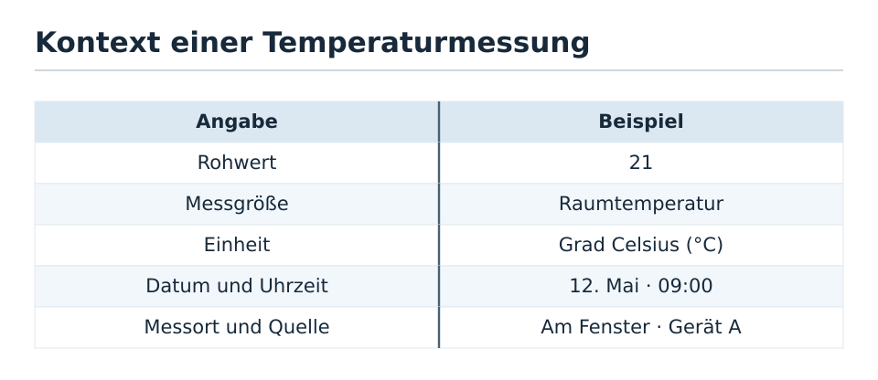

# M2-L1 – Daten, Bedeutung und Datenqualität {#L1}

**Kursbereich:** M2 – Daten, Kodierung und Repräsentation

**Niveau:** Sekundarstufe I (Kern)

**Vorwissen:** [M1-L1 – Wie Informatik Probleme modelliert](M1-L1.md)

**Lernziel:** Rohwerte mit Einheit, Herkunft und Erhebungszeit interpretieren und Qualitätsprobleme erkennen.

## Einstieg {#S1}

Eine Wetter-AG erhält für denselben Raum die Werte `21`, `69.8` und ein leeres Feld. Aus den gespeicherten Zeichen allein lässt sich kaum schließen, ob zwei Thermometer voneinander abweichen oder ob eine Messung fehlt. Ein Wert wird erst mit seinem Zusammenhang aussagekräftig.

## Was ein Messwert bedeutet {#S2}

**Daten** sind festgehaltene Werte oder Zeichen. **Information** entsteht, wenn jemand sie im passenden Zusammenhang deutet. Der Eintrag `21` kann eine Temperatur, eine Zimmernummer oder eine Anzahl sein. Ein Messprotokoll ergänzt deshalb **Metadaten**. Sie beschreiben zum Beispiel, welches Gerät wann und an welchem Ort gemessen hat und welche Einheit gilt. Eine Spaltenüberschrift kann den Zweck und die Einheit für eine ganze Spalte festlegen.

{alt="Der Rohwert 21 wird als Raumtemperatur in Grad Celsius gedeutet. Die Messung stammt von Gerät A am Messplatz Fenster und wurde am 12. Mai um 09:00 erfasst."}

Bei der Prüfung eines Protokolls hilft es, mehrere Qualitätsfragen zu unterscheiden. **Vollständigkeit** betrifft fehlende Angaben. **Plausibilität** fragt, ob ein Wert zum vereinbarten Wertebereich und zur Situation passt. **Konsistenz** betrifft Widersprüche innerhalb der Daten, etwa zwei unterschiedliche Werte für denselben Protokolleintrag. Die **Genauigkeit** einer Messung lässt sich daraus allein nicht ableiten. Dafür braucht man zum Beispiel einen Vergleich mit einem geeigneten Referenzgerät.

## Ein Protokoll bereinigen {#S3}

Die Tabelle enthält fiktive Berichte zur Raumtemperatur. Die Geräte A und B messen an derselben Stelle. Die Zeitangaben beziehen sich auf denselben Tag. Der Eintrag aus Gerät A um 09:05 wurde aus einem Speicher und einer Abschrift importiert. Die beiden Zeilen sollen nach Auskunft der AG dieselbe Messung wiedergeben.

| Zeit | Quelle | Eingetragener Wert | Einheit |
| --- | --- | ---: | --- |
| 09:00 | Gerät A | 21 | °C |
| 09:00 | Gerät B | 69,8 | °F |
| 09:05 | Gerät A, Speicher | 22 | °C |
| 09:05 | Gerät A, Abschrift | 32 | °C |
| 09:05 | Gerät B | fehlt | °F |

Die Umrechnung für Gerät B lautet $(69{,}8 - 32) \cdot 5/9 = 21$. Beide Geräte meldeten um 09:00 also 21 °C. Das sind zwei Beobachtungen, weil zwei Geräte gemessen haben. Bei Gerät A um 09:05 bleibt die Zahl bis zum Abgleich mit dem ursprünglichen Geräteprotokoll als widersprüchlich markiert. Die fehlende Meldung von B bleibt als fehlend markiert. Eine bereinigte Kopie verwendet eine einheitliche Spalte für Grad Celsius und bewahrt Quelle, Rohwert und Bearbeitungsstatus auf.

## Selbstkontrolle {#S4}

### Aufgaben

1. Ein Thermometer meldet `0 °C`. Beim zweiten fehlt der Wert. Welche Mitteltemperatur für beide Geräte lässt sich daraus bestimmen?
2. Beide Zeilen von Gerät A um 09:05 wirken plausibel. Welche Information kann den Widerspruch auflösen?
3. Eine Exportdatei enthält nur `09:00,21`. Ergänze mindestens drei Angaben, damit der Wert geprüft und sinnvoll interpretiert werden kann.

### Lösungen

1. Eine Mitteltemperatur für beide Geräte ist unbekannt. `0 °C` ist eine Beobachtung. Der zweite Wert fehlt. Der Mittelwert der vorhandenen Beobachtung ist 0 °C und umfasst genau einen Messwert.
2. Vergleiche die beiden Importe mit dem ursprünglichen Geräteprotokoll derselben Messung. Ist der Originalwert belegbar, verwende ihn und dokumentiere die Abweichung in der Abschrift. Andernfalls bleibt der Widerspruch offen.
3. Zum Beispiel Datum, Messgröße „Raumtemperatur“, Einheit °C, Raum oder Messort und Gerätekennung. Das Datum identifiziert den Messtag. Ort und Gerätekennung erleichtern die Prüfung an der Quelle.

## Typische Fehler und Grenzen {#S5}

Ein leerer Eintrag zählt nicht als Null. Zwei nahe Werte beweisen auch keine genaue Messung. Beide Geräte können beispielsweise durch eine ungünstige Platzierung ähnlich beeinflusst werden. Eine begründete Bereinigung erhält das Original und hält fest, ob sie Werte umgerechnet, ausgeschlossen oder bestätigt hat.

## Zusammenfassung {#S6}

Ein Messwert braucht Kontext. Prüfe Einheit, Messzeit und Herkunft, bevor du vergleichst. Halte fehlende oder widersprüchliche Werte erkennbar und dokumentiere belegte Änderungen.

## Quellen und weiterführende Hinweise {#S7}

### Weiterführend (intern)

- [M2-L2 – Bits, Bytes und Binärzahlen](M2-L2.md)

### Quellen (extern)

- [Gesellschaft für Informatik e. V. – Bildungsstandards Informatik für die Sekundarstufe I](https://informatikstandards.de/fileadmin/FA/IBS/user_upload/GI-Bildungsstandards_Informatik_Sek_I__2025__-_blau.pdf) · Bezug zur Lektion: §5.1 · Rohwerte mit Einheit, Herkunft und Erhebungszeit interpretieren und Qualitätsprobleme erkennen · Zuletzt abgerufen: 2026-11-22 · Inhaltlich geprüft: 2026-11-22
- [Bildungsserver Berlin-Brandenburg · Senatsverwaltung Berlin und MBJS Brandenburg – Rahmenlehrplan Teil C – Informatik, Wahlpflichtfach, Jahrgangsstufen 7–10](https://bildungsserver.berlin-brandenburg.de/fileadmin/bbb/unterricht/rahmenlehrplaene/Rahmenlehrplanprojekt/amtliche_Fassung/Teil_C_Informatik_2015_11_10.pdf) · Bezug zur Lektion: §3.4 · Rohwerte mit Einheit, Herkunft und Erhebungszeit interpretieren und Qualitätsprobleme erkennen · Zuletzt abgerufen: 2026-11-22 · Inhaltlich geprüft: 2026-11-22
