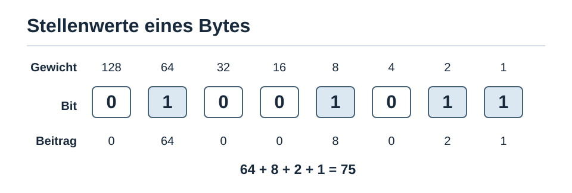

# M2-L2 – Bits, Bytes und Binärzahlen {#L2}

**Kursbereich:** M2 – Daten, Kodierung und Repräsentation

**Niveau:** Sekundarstufe I (Kern)

**Vorwissen:** [M2-L1 – Daten, Bedeutung und Datenqualität](M2-L1.md)

**Lernziel:** Stellenwerte, Bitmuster und Größenangaben reproduzierbar umrechnen.

## Einstieg {#S1}

Eine Anzeigetafel hat acht Lampen. Eine eingeschaltete Lampe steht für 1, eine ausgeschaltete für 0. Liegen die Lampen in einer festen Reihenfolge, kann die Tafel Zahlen anzeigen. Dafür brauchen alle, die sie lesen, dieselbe Zuordnung der Stellen.

## Bits, Stellenwerte und Einheiten {#S2}

Ein **Bit** ist eine binäre Stelle mit den möglichen Werten 0 und 1. Ein **Byte** besteht aus acht Bits. Für eine vorzeichenlose Binärzahl hat die Stelle ganz rechts das Gewicht 1. Jede weitere Stelle links trägt das doppelte Gewicht. Die acht Gewichte lauten von links nach rechts 128, 64, 32, 16, 8, 4, 2 und 1.

{alt="Von links nach rechts stehen über den Bits 0, 1, 0, 0, 1, 0, 1, 1 die Gewichte 128, 64, 32, 16, 8, 4, 2 und 1. Addiert werden 64, 8, 2 und 1."}

Setzt du ein Bit auf 1, zählt sein Gewicht zur Summe. Ein Bit mit dem Wert 0 trägt nichts bei. Das Muster `00000000` ergibt so 0, und `11111111` ergibt 255. Ein Byte hat $2^8=256$ mögliche Muster. Dieselben Muster können je nach vereinbartem Format auch anderes darstellen, etwa einen Teil eines Zeichens oder eine Helligkeitsstufe.

Dateigrößen verwenden oft größere Einheiten. `1 kB` sind 1000 Byte. `1 KiB` sind 1024 Byte. In der binären Einheit steckt die zehnte Potenz der Zahl 2, also $2^{10}=1024$. Das große `B` in beiden Symbolen steht für Byte.

## Hin- und zurückrechnen {#S3}

Das Muster `01001011` hat Einsen bei den Gewichten 64, 8, 2 und 1. Addiere diese Gewichte. Das ergibt $64 + 8 + 2 + 1 = 75$.

Für die Gegenrichtung zerlegen wir 75 in die Gewichte des Bytes. 128 passt noch nicht in 75. Das erste Bit ist 0. Ziehe 64 ab, dann bleiben 11. Weder 32 noch 16 passen. Ziehe 8 ab, dann bleiben 3. 4 passt nicht mehr. Ziehe 2 ab, sodass 1 übrig bleibt. Ziehe zuletzt 1 ab. In der ursprünglichen Reihenfolge der Gewichte ergibt das wieder `01001011`.

Eine Datei von genau 2048 Byte hat `2 KiB` und `2,048 kB`. Bei `1 KiB` entsprechen die 1024 Byte wegen der acht Bits pro Byte genau 8192 Bits.

## Selbstkontrolle {#S4}

### Aufgaben

1. Wandle `00110100` in eine Dezimalzahl um. Zeige die verwendeten Gewichte.
2. Stelle 130 als vorzeichenlose Binärzahl in einem Byte dar. Begründe, warum 256 nicht mehr in ein solches Byte passt.
3. Vergleiche zwei Dateien mit `3 kB` und `3 KiB`. Um wie viele Byte unterscheiden sie sich bei exakten Größenangaben?

### Lösungen

1. Die Einsen stehen bei 32, 16 und 4. $32 + 16 + 4 = 52$.
2. $130=128+2$. Das Muster lautet `10000010`. Die höchste Zahl mit acht vorzeichenlosen Stellen ist $128+64+32+16+8+4+2+1=255$. Der nächste Stellenwert wäre 256 und erfordert ein neuntes Bit.
3. `3 kB` sind 3000 Byte, `3 KiB` sind 3072 Byte. Die zweite Datei ist 72 Byte größer.

## Typische Fehler und Grenzen {#S5}

Das linke Bit eines Bytes darf nicht automatisch als Vorzeichen gelesen werden. Zuerst muss feststehen, welche Darstellung gilt. Führende Nullen ändern den Zahlenwert hier nicht, verdeutlichen aber eine feste Breite. Vergleiche bei unklaren Größenangaben nach Möglichkeit die genaue Zahl an Byte, denn manche Programme verwenden `kB` uneinheitlich oder zeigen gerundete Werte.

## Zusammenfassung {#S6}

In einer vorzeichenlosen Binärzahl addierst du die Gewichte aller Einsen. Ein Byte besteht aus acht Bits. Unterscheide bei Größenangaben Byte, Kilobyte und Kibibyte.

## Quellen und weiterführende Hinweise {#S7}

### Weiterführend (intern)

- [M2-L3 – Zeichen, Unicode und Dateiformate](M2-L3.md)

### Quellen (extern)

- [Gesellschaft für Informatik e. V. – Bildungsstandards Informatik für die Sekundarstufe I](https://informatikstandards.de/fileadmin/FA/IBS/user_upload/GI-Bildungsstandards_Informatik_Sek_I__2025__-_blau.pdf) · Bezug zur Lektion: §5.1 · Stellenwerte, Bitmuster und Größenangaben reproduzierbar umrechnen · Zuletzt abgerufen: 2026-11-22 · Inhaltlich geprüft: 2026-11-22
- [Bildungsserver Berlin-Brandenburg · Senatsverwaltung Berlin und MBJS Brandenburg – Rahmenlehrplan Teil C – Informatik, Wahlpflichtfach, Jahrgangsstufen 7–10](https://bildungsserver.berlin-brandenburg.de/fileadmin/bbb/unterricht/rahmenlehrplaene/Rahmenlehrplanprojekt/amtliche_Fassung/Teil_C_Informatik_2015_11_10.pdf) · Bezug zur Lektion: §3.4 · Stellenwerte, Bitmuster und Größenangaben reproduzierbar umrechnen · Zuletzt abgerufen: 2026-11-22 · Inhaltlich geprüft: 2026-11-22
