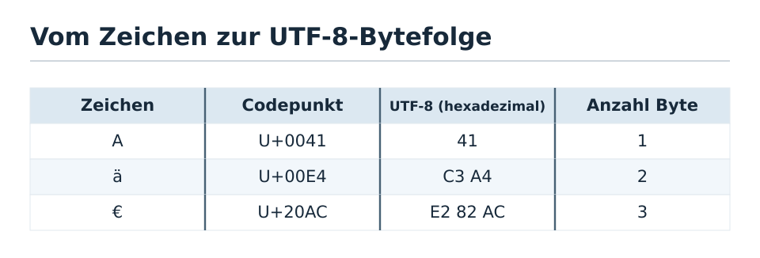

# M2-L3 – Zeichen, Unicode und Dateiformate {#L3}

**Kursbereich:** M2 – Daten, Kodierung und Repräsentation

**Niveau:** Sekundarstufe I (Kern)

**Vorwissen:** [M2-L2 – Bits, Bytes und Binärzahlen](M2-L2.md)

**Lernziel:** Codepunkt, UTF-8-Bytefolge und Dateiformat auseinanderhalten.

## Einstieg {#S1}

Die Wetter-AG speichert den Text `Aä€` in einer Datei. Der Text erscheint als drei sichtbare Zeichen. Die Textdatei kann trotzdem sechs Byte für diese Zeichen benötigen. Um den Unterschied zu erklären, verfolgen wir den Weg von den Zeichen über Zahlen zu den gespeicherten Byte.

## Zeichen, Codepunkte und Bytefolgen {#S2}

**Unicode** ordnet abstrakten Zeichen **Codepunkte** zu. Ein Codepunkt ist eine Nummer. Wir schreiben sie oft in hexadezimaler Darstellung mit dem Präfix `U+`. Hexadezimal verwendet die Ziffern 0–9 und A–F für Werte von 0 bis 15. `U+0041` bezeichnet das große lateinische A.

**UTF-8** ist eine Kodierung, die jedem darstellbaren Codepunkt eine Folge von einem bis vier Byte zuordnet. Zahlen wie `41` in einer Bytefolge werden hier ebenfalls hexadezimal angezeigt. Die Zeichenfolge `Aä€` enthält drei Codepunkte. Das `ä` belegt in UTF-8 zwei Byte, das Eurozeichen drei. Ein sichtbares Zeichen kann auch aus mehreren Codepunkten zusammengesetzt sein.

{alt="A entspricht U+0041 und Byte 41. Das ä entspricht U+00E4 und den Bytes C3 A4. Das Eurozeichen entspricht U+20AC und den Bytes E2 82 AC."}

Ein **Dateiformat** beschreibt, nach welchen Regeln die Inhalte einer Datei aufgebaut sind. Eine CSV-Datei legt tabellarische Daten als Text ab, zum Beispiel mit Kommas als Feldtrenner. UTF-8 ordnet dem Text Byte zu. Es legt keine Bedeutung für Zeilen und Tabellenfelder fest. Ein PNG-Bild hat eine andere Struktur und ist keine CSV-Tabelle in einer anderen Zeichenkodierung.

## Text in Byte umwandeln und zurücklesen {#S3}

Für `Aä€` lauten die Codepunkte `U+0041`, `U+00E4` und `U+20AC`. In UTF-8 entstehen daraus der Reihe nach `41`, `C3 A4` und `E2 82 AC`. Ohne weitere Zeichen sind das $1+2+3=6$ Byte. Der folgende Block ist beim Lesen eines Python-Programms hilfreich. `encode` wandelt Text in Byte und `decode` liest die Byte mit der angegebenen Kodierung zurück.

```python
label = "Aä€"
encoded = label.encode("utf-8")
assert [ord(char) for char in label] == [0x0041, 0x00E4, 0x20AC]
assert encoded.hex(" ").upper() == "41 C3 A4 E2 82 AC"
assert len(encoded) == 6
assert encoded.decode("utf-8") == label
```

`ord` liefert den Codepunkt eines einzelnen Zeichens im Python-String. `0x` kennzeichnet im Programm eine hexadezimal geschriebene Zahl. Die Gleichheitsprüfungen mit `assert` bleiben ohne Ausgabe, wenn alle tatsächlichen Werte mit den erwarteten übereinstimmen.

## Selbstkontrolle {#S4}

### Aufgaben

1. Wie viele UTF-8-Byte benötigt `AA€` ohne zusätzliche Zeichen? Begründe.
2. Vergleiche `é` als vorgefertigten Codepunkt `U+00E9` mit `e` (`U+0065`) plus kombinierendem Akut `U+0301`. Die Bytefolgen sind `C3 A9` und `65 CC 81`. Wie viele Codepunkte und Byte enthalten die Varianten?
3. Eine Datei heißt `messung.png`. Ein Texteditor zeigt nach dem Öffnen die Kopfzeile `time,reading` und darunter `09:00,21`. Welche Austauschform vermutest du und was solltest du noch prüfen?

### Lösungen

1. Jedes `A` benötigt ein Byte und `€` drei. Insgesamt sind es $1+1+3=5$ Byte.
2. Die erste Variante enthält einen Codepunkt und zwei Byte. Die zweite enthält zwei Codepunkte und drei Byte. Beide können in der Anzeige wie dasselbe einzelne `é` aussehen.
3. Die Zeilen deuten auf eine CSV-Tabelle mit Komma als Trennzeichen. Prüfe, ob die übrigen Zeilen dem erwarteten Tabellenaufbau folgen und ob die Kodierung richtig gelesen wird. Der Name allein entscheidet das Format nicht.

## Typische Fehler und Grenzen {#S5}

Ein Programm kann falsche Zeichen anzeigen, wenn es die falsche Zeichenkodierung verwendet. Bei einer realen Datei zählen auch Zeilenenden, weitere Zeichen und gegebenenfalls eine Dateimarkierung zur Größe. Darum gilt die Rechnung mit sechs Byte genau für den Beispieltext ohne Zusätze. Um die Zahl von sichtbaren Zeichen in beliebigem Text zu bestimmen, ist eine reine Zählung der Codepunkte zu grob.

## Zusammenfassung {#S6}

Codepunkte identifizieren Zeichen in Unicode. UTF-8 legt ihre Bytefolgen fest. Das Dateiformat gibt vor, wie gespeicherte Inhalte strukturiert sind.

## Quellen und weiterführende Hinweise {#S7}

### Weiterführend (intern)

- [M2-L4 – Vom Messsignal zur Tabelle](M2-L4.md)

### Quellen (extern)

- [Gesellschaft für Informatik e. V. – Bildungsstandards Informatik für die Sekundarstufe I](https://informatikstandards.de/fileadmin/FA/IBS/user_upload/GI-Bildungsstandards_Informatik_Sek_I__2025__-_blau.pdf) · Bezug zur Lektion: §5.1 · Codepunkt, UTF-8-Bytefolge und Dateiformat auseinanderhalten · Zuletzt abgerufen: 2026-11-22 · Inhaltlich geprüft: 2026-11-22
- [Bildungsserver Berlin-Brandenburg · Senatsverwaltung Berlin und MBJS Brandenburg – Rahmenlehrplan Teil C – Informatik, Wahlpflichtfach, Jahrgangsstufen 7–10](https://bildungsserver.berlin-brandenburg.de/fileadmin/bbb/unterricht/rahmenlehrplaene/Rahmenlehrplanprojekt/amtliche_Fassung/Teil_C_Informatik_2015_11_10.pdf) · Bezug zur Lektion: §3.4 · Codepunkt, UTF-8-Bytefolge und Dateiformat auseinanderhalten · Zuletzt abgerufen: 2026-11-22 · Inhaltlich geprüft: 2026-11-22
- [Python Software Foundation – Unicode HOWTO](https://docs.python.org/3.13/howto/unicode.html) · Bezug zur Lektion: Introduction · Codepunkt, UTF-8-Bytefolge und Dateiformat auseinanderhalten · Zuletzt abgerufen: 2026-11-22 · Inhaltlich geprüft: 2026-11-22
- [The Unicode Consortium – The Unicode Standard 17.0.0, Chapter 3: Conformance](https://www.unicode.org/versions/Unicode17.0.0/core-spec/chapter-3/) · Bezug zur Lektion: §3.9, D92, Tables 3-6 and 3-7 · Codepunkt, UTF-8-Bytefolge und Dateiformat auseinanderhalten · Zuletzt abgerufen: 2026-11-22 · Inhaltlich geprüft: 2026-11-22
