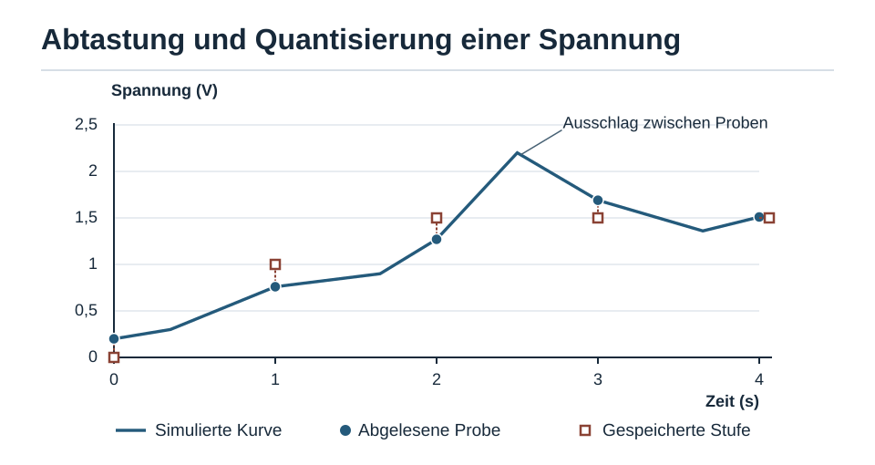

# M2-L4 – Vom Messsignal zur Tabelle {#L4}

**Kursbereich:** M2 – Daten, Kodierung und Repräsentation

**Niveau:** Sekundarstufe I (Kern)

**Vorwissen:** [M2-L2 – Bits, Bytes und Binärzahlen](M2-L2.md)

**Lernziel:** Abtastung, Quantisierung und tabellarischen Datenfluss erklären.

## Einstieg {#S1}

Ein Lichtsensor liefert eine Spannung, die sich im Verlauf eines Experiments ändert. Die AG schreibt nur einmal pro Sekunde einen Wert auf und verwendet Stufen von 0,5 V. In der fertigen Tabelle können mehrere Werte gleich aussehen. Die Spannung dazwischen kann sich dennoch verändert haben.

## Abtastung und Quantisierung {#S2}

Ein **Signal** beschreibt hier eine Spannung in Abhängigkeit von der Zeit. Bei der **Abtastung** wählen wir Zeitpunkte aus und lesen dort den Signalwert ab. Bei regelmäßigem Abstand von einer Sekunde erhalten wir eine Abtastrate von einer Probe pro Sekunde beziehungsweise 1 Hz. Eine rasche Änderung zwischen zwei Abtastzeitpunkten kann unbemerkt bleiben.

Bei der **Quantisierung** ordnen wir jedem abgetasteten Wert eine Stufe aus einer festgelegten Skala zu. Für dieses vereinfachte Beispiel verwenden wir nichtnegative Spannungen und runden auf die nächste Stufe mit 0,5 V Abstand. Liegt ein Wert genau in der Mitte, wählen wir die höhere Stufe. Der **Code** ist die Nummer der Stufe. Code 3 steht bei einem Stufenabstand von 0,5 V für den gespeicherten Stufenwert 1,5 V.

{alt="Bei 0 bis 4 Sekunden stehen Messpunkte bei 0,20, 0,76, 1,27, 1,69 und 1,51 V. Quadrate zeigen die Stufen 0, 1, 1,5, 1,5 und 1,5 V. Die Kurve erreicht bei 2,5 Sekunden einen nicht abgetasteten Gipfel von 2,2 V."}

Eine Tabellenzeile kann Zeit, Code, Einheit und Quelle enthalten. Um die Stufennummer später zu interpretieren, brauchen wir außerdem die Zuordnung zwischen Code und Spannung, zum Beispiel im Kopf des Messprotokolls.

## Eine simulierte Reihe protokollieren {#S3}

Diese fiktive Reihe verwendet ganzzahlige Millivolt als abgelesene Werte. So sind auch Werte genau zwischen zwei Stufen eindeutig berechenbar. Addiere 250 mV und teile durch 500 mV mit Ganzzahldivision, um die Nummer der nächsten Stufe zu erhalten. Bei 1270 mV sind es nach der Addition 1520 mV. Die Ganzzahldivision ergibt Code 3 und damit 1500 mV.

| Zeit (s) | Abgelesen (mV) | Code | Gespeicherte Stufe (mV) |
| ---: | ---: | ---: | ---: |
| 0 | 200 | 0 | 0 |
| 1 | 760 | 2 | 1000 |
| 2 | 1270 | 3 | 1500 |
| 3 | 1690 | 3 | 1500 |
| 4 | 1510 | 3 | 1500 |

```python
samples_mv = [200, 760, 1270, 1690, 1510]
codes = [(value + 250) // 500 for value in samples_mv]
levels_mv = [code * 500 for code in codes]
assert codes == [0, 2, 3, 3, 3]
assert sum(levels_mv) == 5500
assert max(levels_mv) == 1500
```

`//` liefert bei diesen nichtnegativen Werten die Anzahl ganzer Gruppen. Die gespeicherten Stufen haben den Mittelwert $5500/5=1100$ mV. Der größte gespeicherte Wert ist 1500 mV. Er ist weder der größte abgelesene Wert noch der größte Wert der ursprünglichen Kurve.

## Selbstkontrolle {#S4}

### Aufgaben

1. Bestimme Code und gespeicherte Stufe für 1249 mV und 1250 mV.
2. Berechne den Mittelwert der fünf abgelesenen Werte und vergleiche ihn mit dem Mittelwert aus der Tabelle.
3. Könnte es zwischen 2 s und 3 s einen höheren Wert als 1690 mV gegeben haben? Was ändert eine kürzere Zeit zwischen den Proben?

### Lösungen

1. 1249 mV liegt näher an 1000 mV und ergibt Code 2. 1250 mV liegt genau dazwischen. Die Rundungsregel ergibt 1500 mV und Code 3.
2. Die abgelesenen Werte ergeben in Summe 5430 mV und damit 1086 mV im Mittel. Der Mittelwert der Stufen liegt in diesem Beispiel um 14 mV höher.
3. Ja. Das Beispielbild enthält sogar einen solchen Ausschlag. Mit kürzeren Abständen erhältst du mehr Werte pro Sekunde. Dadurch steigt die Chance, eine kurze Änderung zu erfassen. Die Auflösung der Spannungsstufen ändert sich dadurch nicht.

## Typische Fehler und Grenzen {#S5}

Mehr Abtastwerte und feinere Spannungsstufen beheben unterschiedliche Ungenauigkeiten. Unser Modell rundet bereits abgelesene Werte und enthält weder einen Messfehler noch eine obere Sättigungsgrenze. Die abgelesenen Millivoltwerte bilden nur die Eingabe des Modells. Sie sind keine Genauigkeitsangabe für einen echten Sensor.

## Zusammenfassung {#S6}

Die Abtastung legt die erfassten Zeitpunkte fest. Die Quantisierung legt fest, welcher Stufe ein Wert zugeordnet wird. Dokumentiere Zeitabstand, Einheit und Stufenregel, damit andere die Tabelle sinnvoll auswerten können.

## Quellen und weiterführende Hinweise {#S7}

### Weiterführend (intern)

- [M3-L1 – Variablen, Werte und Datentypen](M3-L1.md)

### Quellen (extern)

- [Gesellschaft für Informatik e. V. – Bildungsstandards Informatik für die Sekundarstufe I](https://informatikstandards.de/fileadmin/FA/IBS/user_upload/GI-Bildungsstandards_Informatik_Sek_I__2025__-_blau.pdf) · Bezug zur Lektion: §5.1 · Abtastung, Quantisierung und tabellarischen Datenfluss erklären · Zuletzt abgerufen: 2026-11-22 · Inhaltlich geprüft: 2026-11-22
- [Bildungsserver Berlin-Brandenburg · Senatsverwaltung Berlin und MBJS Brandenburg – Rahmenlehrplan Teil C – Informatik, Wahlpflichtfach, Jahrgangsstufen 7–10](https://bildungsserver.berlin-brandenburg.de/fileadmin/bbb/unterricht/rahmenlehrplaene/Rahmenlehrplanprojekt/amtliche_Fassung/Teil_C_Informatik_2015_11_10.pdf) · Bezug zur Lektion: §3.4 · Abtastung, Quantisierung und tabellarischen Datenfluss erklären · Zuletzt abgerufen: 2026-11-22 · Inhaltlich geprüft: 2026-11-22
- [MathWorks – Analog Input Subsystem](https://www.mathworks.com/help/daq/analog-input-subsystem.html) · Bezug zur Lektion: Convert Analog Signals to Digital Data · Abtastung, Quantisierung und tabellarischen Datenfluss erklären · Zuletzt abgerufen: 2026-11-22 · Inhaltlich geprüft: 2026-11-22
