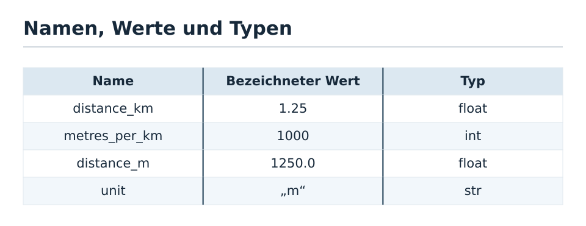

# M3-L1 – Variablen, Werte und Datentypen {#L1}

**Kursbereich:** M3 – Algorithmen programmieren

**Niveau:** Sekundarstufe I (Kern)

**Vorwissen:** [M2-L3 – Zeichen, Unicode und Dateiformate](M2-L3.md)

**Lernziel:** Ein reproduzierbares Python-Programm mit Zuweisungen, Typen und Ausgaben schreiben.

## Einstieg {#S1}

Eine Schulweg-App zeigt eine Strecke von 1,25 km an. Eine Karte für dieselbe Strecke verwendet Meter. Falsche Einheiten können eine richtige Rechnung zu einer falschen Anzeige machen. Wir schreiben ein kurzes Programm, das den Ausgangswert und das Ergebnis getrennt aufbewahrt und die Umrechnung überprüfbar macht.

## Namen, Werte und Typen {#S2}

Eine **Zuweisung** mit `=` bindet einen Namen an einen Wert. Python wertet zuerst die rechte Seite aus. In `distance_m = distance_km * 1000` liest Python den Wert des Namens `distance_km`, multipliziert ihn mit 1000 und bindet den neuen Namen an das Ergebnis. Die Namen tragen die Einheit. Für Python sind das gewöhnliche Namen, aus denen es keine Umrechnungsregel ableitet.

| Typ | Beispiel | Bedeutung |
| --- | --- | --- |
| `int` | `1000` | Ganze Zahl |
| `float` | `1.25` | Gleitkommazahl |
| `str` | `"km"` | Zeichenkette |
| `bool` | `True` | Wahrheitswert, alternativ `False` |

Der Typ gehört zum Wert und beeinflusst, welche Operationen möglich sind. `+` addiert zwei Zahlen und verknüpft zwei Zeichenketten. Eine Zeichenkette mit den Ziffern `"1.25"` lässt sich mit `float("1.25")` ausdrücklich in eine Gleitkommazahl umwandeln. Python verwendet in Zahlenliteralen einen Punkt als Dezimaltrennzeichen.

{alt="distance_km bezeichnet 1.25 vom Typ float, metres_per_km bezeichnet 1000 vom Typ int, distance_m bezeichnet 1250.0 vom Typ float und unit bezeichnet die Zeichenkette m."}

## Kilometer in Meter umrechnen {#S3}

Speichere den Block als `distance.py` und starte die Datei mit `python distance.py` oder `python3 distance.py`, je nachdem, unter welchem Namen Python 3 installiert ist. Der Block benötigt keine Zusatzpakete und keine Eingabe. `print` gibt den Wert und die Einheit durch ein Leerzeichen getrennt aus.

```python
distance_km = 1.25
metres_per_km = 1000
distance_m = distance_km * metres_per_km
unit = "m"
print(distance_m, unit)
assert distance_m == 1250.0
```

Die Ausgabe lautet `1250.0 m`. Die Rechnung verwendet $1{,}25 \cdot 1000 = 1250$. Das Ergebnis ist vom Typ `float`, daher gibt Python hier auch die Nachkommastelle aus. Die Zeile mit `assert` prüft Gleichheit mit dem erwarteten Zahlenwert. Bei erfüllter Bedingung gibt `assert` nichts aus.

## Selbstkontrolle {#S4}

### Aufgaben

1. Ändere `distance_km` auf `0.75`. Welche Ausgabe und welchen Erwartungswert brauchst du?
2. Eine Strecke kommt als Text `"1.25"` an. Was bewirkt ihre Multiplikation mit `1000`? Wie berechnest du stattdessen die Strecke?

### Lösungen

1. $0{,}75 \cdot 1000 = 750$. Die Ausgabe lautet `750.0 m`. Passe die Prüfung auf `assert distance_m == 750.0` an.
2. Die Multiplikation wiederholt die Zeichenkette 1000-mal. `float("1.25") * 1000` rechnet mit dem Zahlenwert und ergibt `1250.0`.

## Typische Fehler und Grenzen {#S5}

`distance_km = 1,25` ergibt in Python ein Paar von Werten, also den Wert `(1, 25)`. Schreibe im Programm `1.25`. `"1.25" + 1` führt zu einem `TypeError`, weil Python für diese Typkombination keine Addition definiert. Viele Dezimalzahlen lassen sich als `float` nur näherungsweise darstellen. Die gewählten Werte `1.25` und `0.75` sind binär exakt darstellbar. Für spätere Messwertvergleiche können sachlich begründete Toleranzen erforderlich sein.

## Zusammenfassung {#S6}

Mit einer Zuweisung gibst du einem Wert einen Namen. Der Wert bestimmt die zulässigen Operationen. Aussagekräftige Namen, eine sichtbare Einheit und ein bekannter Testwert machen eine Umrechnung nachvollziehbar.

## Quellen und weiterführende Hinweise {#S7}

### Weiterführend (intern)

- [M3-L2 – Bedingungen und Verzweigungen](M3-L2.md)

### Quellen (extern)

- [Gesellschaft für Informatik e. V. – Bildungsstandards Informatik für die Sekundarstufe I](https://informatikstandards.de/fileadmin/FA/IBS/user_upload/GI-Bildungsstandards_Informatik_Sek_I__2025__-_blau.pdf) · Bezug zur Lektion: §5.2 · Ein reproduzierbares Python-Programm mit Zuweisungen, Typen und Ausgaben schreiben · Zuletzt abgerufen: 2026-11-22 · Inhaltlich geprüft: 2026-11-22
- [Python Software Foundation – Python Tutorial – An Informal Introduction to Python](https://docs.python.org/3.13/tutorial/introduction.html) · Bezug zur Lektion: §3.1 · Ein reproduzierbares Python-Programm mit Zuweisungen, Typen und Ausgaben schreiben · Zuletzt abgerufen: 2026-11-22 · Inhaltlich geprüft: 2026-11-22
