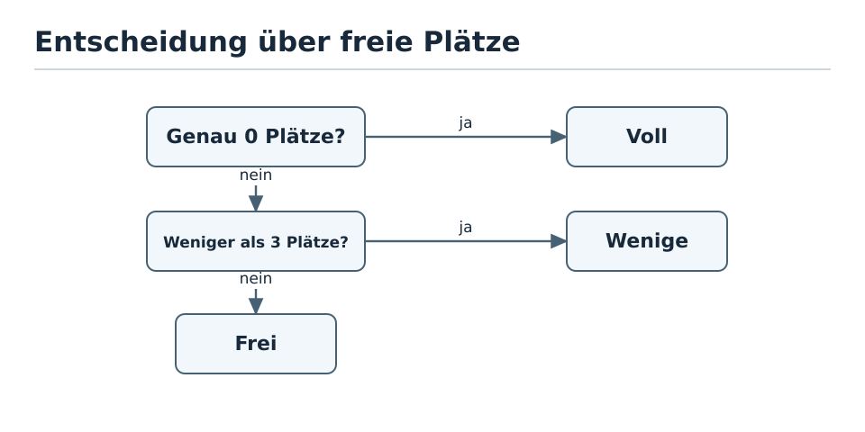

# M3-L2 – Bedingungen und Verzweigungen {#L2}

**Kursbereich:** M3 – Algorithmen programmieren

**Niveau:** Sekundarstufe I (Kern)

**Vorwissen:** [M3-L1 – Variablen, Werte und Datentypen](M3-L1.md)

**Lernziel:** Vergleiche und boolesche Ausdrücke in Fallunterscheidungen einsetzen.

## Einstieg {#S1}

In der Ausgabe für ein Schulstück liegt eine Liste der freien Sitzplätze vor. Bei keinem Platz soll „voll“ erscheinen. Bei ein oder zwei Plätzen steht „wenige“, ab drei freien Plätzen „frei“. Die Liste enthält nur nichtnegative ganze Zahlen. Wie lassen sich alle drei Bereiche ohne Lücke in ein Programm übertragen?

## Bedingungen als Fragen an einen Wert {#S2}

Ein **Vergleich** liefert einen Wahrheitswert. `seats == 0` prüft Gleichheit. `seats < 3` fragt, ob der Wert kleiner als 3 ist. Das Symbol `=` ist in Python die Zuweisung und `==` der Gleichheitsvergleich. Mit `and` müssen beide Teilaussagen wahr sein. Für `or` genügt eine wahre Teilaussage. `not` kehrt einen Wahrheitswert um.

`if` prüft die erste Bedingung. Python prüft ein `elif` nur, wenn kein bisheriger Zweig gewählt wurde. Trifft keine Bedingung zu, wird gegebenenfalls `else` ausgeführt. Eine Zeile mit Doppelpunkt eröffnet den Zweig. Gleich eingerückte Zeilen gehören zum selben Zweig, hier mit vier Leerzeichen.

{alt="Bei null freien Plätzen lautet die Meldung voll. Andernfalls führt die Prüfung auf weniger als drei zu wenige, wenn sie wahr ist, und zu frei, wenn sie falsch ist."}

## Sitzplatzanzeige entwickeln {#S3}

Wir verwenden zuerst zwei freie Plätze. `seats == 0` ist falsch. `seats < 3` ist wahr. Die zweite Zuweisung setzt die Anzeige. Das abschließende `print` steht außerhalb der Verzweigung und wird auch bei den anderen Eingaben erreicht.

```python
seats = 2
if seats == 0:
    status = "full"
elif seats < 3:
    status = "few"
else:
    status = "available"
print(status)
assert status == "few"
```

| Freie Plätze | `seats == 0` | Prüfung `seats < 3` | Ausgabe |
| --- | --- | --- | --- |
| 0 | wahr | übersprungen | `full` |
| 2 | falsch | wahr | `few` |
| 3 | falsch | falsch | `available` |

Die Wörter im Programm sind englische Ausgabelabels. Ihre Bedeutung entspricht „voll“, „wenige“ und „frei“. Weil der erste Test die Null schon abfängt, muss der zweite Test die Untergrenze 1 hier nicht wiederholen. Als einzeln gelesene Frage wäre `seats >= 1 and seats < 3` genauer.

## Selbstkontrolle {#S4}

### Aufgaben

1. Probiere die Eingaben 0, 1, 2 und 3 gedanklich aus. Benenne für jeden Wert den ersten gewählten Zweig.
2. Eine Schülerin prüft zuerst `seats < 3` und erst im `elif` die Null. Welche Eingabe zeigt den Unterschied?
3. Ergänze als erste Bedingung eine Meldung für negative Anzahlen. Erkläre, warum sie zuerst stehen muss.

### Lösungen

1. 0 geht in `if` und ergibt `full`. 1 und 2 gehen in `elif` und ergeben `few`. 3 geht in `else` und ergibt `available`.
2. Bei 0 ist `seats < 3` wahr. Python wählt sofort `few` und überspringt den anderen Zweig.
3. Prüfe mit `if seats < 0:` auf eine ungültige Anzahl und mache den bisherigen ersten Test zu `elif seats == 0:`. Sonst würde zum Beispiel −1 als „wenige“ gewertet.

## Typische Fehler und Grenzen {#S5}

Eine zweite selbständige `if`-Anweisung kann auch nach einem ausgeführten Zweig wahr werden. Bei einer Kette aus `if`, `elif` und `else` wird höchstens ein Zweig ausgeführt. Die Tabelle enthält absichtlich Werte direkt an den Grenzen. Ein Test nur mit 10 Plätzen würde einen Fehler bei genau 3 übersehen. Textwerte wie `"3"` müssen für Zahlenvergleiche separat eingelesen und passend umgewandelt werden.

## Zusammenfassung {#S6}

Schreibe zuerst die Fachregel in Worten und prüfe ihre Grenzen. Vergleiche liefern Wahrheitswerte. Die Reihenfolge der Bedingungen entscheidet, welcher Zweig ausgeführt wird.

## Quellen und weiterführende Hinweise {#S7}

### Weiterführend (intern)

- [M3-L3 – Schleifen und Ablaufverfolgung](M3-L3.md)

### Quellen (extern)

- [Gesellschaft für Informatik e. V. – Bildungsstandards Informatik für die Sekundarstufe I](https://informatikstandards.de/fileadmin/FA/IBS/user_upload/GI-Bildungsstandards_Informatik_Sek_I__2025__-_blau.pdf) · Bezug zur Lektion: §5.2 · Vergleiche und boolesche Ausdrücke in Fallunterscheidungen einsetzen · Zuletzt abgerufen: 2026-11-22 · Inhaltlich geprüft: 2026-11-22
- [Python Software Foundation – Python Tutorial – More Control Flow Tools](https://docs.python.org/3.13/tutorial/controlflow.html) · Bezug zur Lektion: §4.1 · Vergleiche und boolesche Ausdrücke in Fallunterscheidungen einsetzen · Zuletzt abgerufen: 2026-11-22 · Inhaltlich geprüft: 2026-11-22
