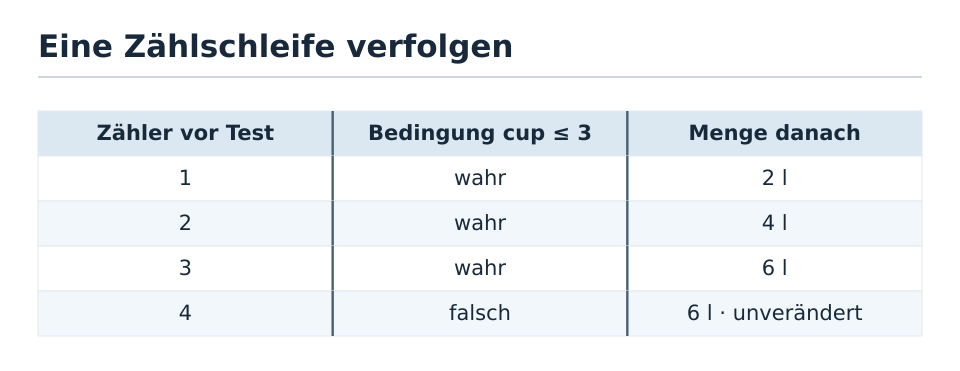

# M3-L3 – Schleifen und Ablaufverfolgung {#L3}

**Kursbereich:** M3 – Algorithmen programmieren

**Niveau:** Sekundarstufe I (Kern)

**Vorwissen:** [M3-L2 – Bedingungen und Verzweigungen](M3-L2.md)

**Lernziel:** Iteration mit for, while, Zustandsfortschritt und Abbruch nachvollziehen.

## Einstieg {#S1}

Eine Sammelstation soll drei Becher mit je 2 Litern Wasser füllen. Nach jedem Becher wird die bisher abgefüllte Menge notiert. Drei fast gleiche Anweisungen ließen sich abschreiben. Eine Schleife beschreibt denselben Arbeitsschritt einmal und macht sichtbar, wann er wiederholt wird.

## Wiederholung und Zustandsfortschritt {#S2}

Mit einer **for-Schleife** durchläufst du in Python die Elemente einer Folge. `range(1, 4)` liefert nacheinander 1, 2 und 3. Die untere Grenze gehört dazu, die obere nicht. Der Wert von `cup` wird bei jedem Durchlauf von der Schleife gesetzt.

Eine **while-Schleife** prüft eine Bedingung vor jedem Durchlauf. Wenn sie schon beim ersten Prüfen falsch ist, läuft der Schleifenrumpf kein einziges Mal. Bei einer Zählschleife braucht es einen Anfangswert und eine Änderung, die die Schleife ihrer Abbruchgrenze näherbringt. Eine **Ablauftabelle** hält nach jedem Durchlauf die relevanten Werte fest. Sie hilft, vergessene Aktualisierungen und Fehler um eins zu erkennen.

{alt="Bei den Zählerwerten 1, 2 und 3 ist die Bedingung wahr. Die Menge steigt nach diesen Durchläufen auf 2, 4 und 6 Liter. Beim Zähler 4 scheitert die Bedingung, und die Menge bleibt bei 6 Litern."}

## Drei Becher protokollieren {#S3}

Der anfängliche Wert von `total_l` ist 0. Mit `total_l = total_l + 2` liest Python den bisherigen Wert, addiert 2 und weist das Ergebnis zurück. Die Variable sammelt die Teilmengen. Im `while`-Block beginnt der Zähler bei 1 und wird nach jedem Durchlauf um 1 erhöht. Bei 4 ist die Bedingung `cup <= 3` falsch. Beide Schleifen erzeugen die Paare (1, 2), (2, 4) und (3, 6).

```python
total_l = 0
for cup in range(1, 4):
    total_l = total_l + 2
    print(cup, total_l)
assert total_l == 6

total_l = 0
cup = 1
while cup <= 3:
    total_l = total_l + 2
    print(cup, total_l)
    cup = cup + 1
assert cup == 4
assert total_l == 6
```

```text
1 2
2 4
3 6
1 2
2 4
3 6
```

## Selbstkontrolle {#S4}

### Aufgaben

1. Erstelle eine Ablauftabelle für `range(1, 5)` bei unveränderten 2 Litern pro Becher. Nenne alle abgefüllten Zwischenmengen.
2. Eine Version startet mit `cup = 1` und verwendet `while cup < 3:`. Was fehlt in der Ausgabe? Wie änderst du die Bedingung?
3. Was passiert bei `while cup <= 3:`, wenn der Rumpf `cup` nie verändert?

### Lösungen

1. Die Werte für `cup` sind 1, 2, 3 und 4. Dazu gehören die Mengen 2, 4, 6 und 8 Liter.
2. Es fehlt der dritte Durchlauf mit 6 Litern, da `3 < 3` falsch ist. Mit `cup <= 3` ist der dritte Durchlauf eingeschlossen.
3. `cup` bleibt 1 und `cup <= 3` bleibt wahr. Die Schleife endet unter diesen Annahmen nicht von selbst.

## Typische Fehler und Grenzen {#S5}

Der Zähler und die aufsummierte Menge erfüllen verschiedene Aufgaben. Den Zähler auf `total_l` zu setzen, würde Becher überspringen. Ist eine Wiederholungszahl bekannt, übernimmt `for` mit `range` die Zählerfolge. `while` eignet sich, wenn eine Bedingung fachlich im Vordergrund steht. Bei unklarem Zustandsfortschritt prüfe auf Papier, ob jeder mögliche Durchlauf die Bedingung irgendwann falsch werden lässt.

## Zusammenfassung {#S6}

Die `for`-Schleife durchläuft Werte, die `while`-Schleife prüft eine Bedingung. Eine kurze Ablauftabelle zeigt die Zwischenstände, den letzten tatsächlich ausgeführten Durchlauf und den Endwert.

## Quellen und weiterführende Hinweise {#S7}

### Weiterführend (intern)

- [M3-L4 – Listen, Funktionen und Zerlegung](M3-L4.md)

### Quellen (extern)

- [Gesellschaft für Informatik e. V. – Bildungsstandards Informatik für die Sekundarstufe I](https://informatikstandards.de/fileadmin/FA/IBS/user_upload/GI-Bildungsstandards_Informatik_Sek_I__2025__-_blau.pdf) · Bezug zur Lektion: §5.2 · Iteration mit for, while, Zustandsfortschritt und Abbruch nachvollziehen · Zuletzt abgerufen: 2026-11-22 · Inhaltlich geprüft: 2026-11-22
- [Python Software Foundation – Python Tutorial – More Control Flow Tools](https://docs.python.org/3.13/tutorial/controlflow.html) · Bezug zur Lektion: §§4.2–4.4 · Iteration mit for, while, Zustandsfortschritt und Abbruch nachvollziehen · Zuletzt abgerufen: 2026-11-22 · Inhaltlich geprüft: 2026-11-22
