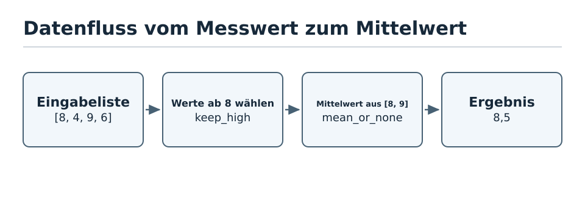

# M3-L4 – Listen, Funktionen und Zerlegung {#L4}

**Kursbereich:** M3 – Algorithmen programmieren

**Niveau:** Sekundarstufe I (Kern)

**Vorwissen:** [M3-L3 – Schleifen und Ablaufverfolgung](M3-L3.md)

**Lernziel:** Eine Liste als Eingabe in Teilfunktionen mit Rückgabewert verarbeiten.

## Einstieg {#S1}

Eine Wetter-AG notiert Messwerte. Für einen Bericht interessieren nur Werte ab 8. Der Bericht soll den Mittelwert dieser Auswahl anzeigen. Enthält das Protokoll keinen passenden Wert, soll es keinen scheinbaren Mittelwert geben. Die Aufgabe lässt sich in Auswahl und Auswertung zerlegen.

## Listen und überschaubare Teilaufgaben {#S2}

Eine **Liste** speichert Werte in einer Reihenfolge und darf leer sein. Der erste Wert von `[8, 4, 9, 6]` steht am Index `0`. Mit `for reading in readings` können wir die Werte nacheinander lesen. `append` fügt einen Wert am Ende einer Liste hinzu. Wir bauen bei der Auswahl eine neue Liste auf, während wir die ursprüngliche Liste durchlaufen.

Eine **Funktion** erhält beim Aufruf Argumente und liefert über `return` einen Rückgabewert. In `def keep_high(readings, floor):` sind `readings` und `floor` die Namen der Parameter. Sie bezeichnen beim Aufruf die übergebenen Werte. Wir definieren für jede Funktion einen klaren Auftrag. `keep_high` behält alle Werte ab einer Untergrenze in ihrer ursprünglichen Reihenfolge. `mean_or_none` berechnet für eine nicht leere Liste den arithmetischen Mittelwert und gibt bei einer leeren Liste `None` zurück. `None` steht hier für das Fehlen eines berechenbaren Ergebnisses.

{alt="Die Liste 8, 4, 9, 6 wird mit einer Untergrenze von 8 gefiltert. Die gefilterte Liste 8, 9 geht an die zweite Funktion, die 8,5 als Mittelwert liefert."}

## Zwei Funktionen verbinden {#S3}

Die Werte 8 und 9 erfüllen die Bedingung `reading >= floor`. Die Werte 4 und 6 fallen weg. Der Mittelwert der Auswahl ist $(8+9)/2=8{,}5$. Die zweite Funktion verwendet `sum` für die Summe und `len` für die Anzahl.

```python
def keep_high(readings, floor):
    selected = []
    for reading in readings:
        if reading >= floor:
            selected.append(reading)
    return selected

def mean_or_none(readings):
    if len(readings) == 0:
        return None
    return sum(readings) / len(readings)

readings = [8, 4, 9, 6]
selected = keep_high(readings, 8)
mean = mean_or_none(selected)
print(selected)
print(mean)
assert selected == [8, 9]
assert mean == 8.5
assert readings == [8, 4, 9, 6]
assert mean_or_none(keep_high(readings, 10)) is None
```

Die Ausgabe lautet `[8, 9]` und in der nächsten Zeile `8.5`. Die letzte Prüfung setzt die Untergrenze auf 10. Die Auswahl ist leer und die zweite Funktion gibt `None` zurück. `is None` prüft auf genau diesen besonderen Python-Wert.

## Selbstkontrolle {#S4}

### Aufgaben

1. Welche Werte bleiben bei der Untergrenze 6 erhalten? Berechne ihren Mittelwert.
2. Was liefern die beiden Funktionen für eine leere Eingabeliste?
3. Warum wäre `return 0` bei einer leeren Liste mehrdeutig?

### Lösungen

1. Es bleiben `[8, 9, 6]` in dieser Reihenfolge. Ihr Mittelwert ist $23/3$, also etwa 7,67.
2. `keep_high([], 8)` liefert `[]`. `mean_or_none([])` liefert `None`. Eine Division durch null wird vermieden.
3. Der Mittelwert von `[-1, 1]` beträgt tatsächlich `0.0`. `None` macht einen fehlenden Mittelwert von einem berechneten Nullwert unterscheidbar.

## Typische Fehler und Grenzen {#S5}

`print(selected)` zeigt die Liste an. Erst `return selected` gibt sie dem aufrufenden Code zur weiteren Berechnung zurück. `append` verändert die Liste direkt. `selected = selected.append(reading)` überschreibt deshalb den Namen mit dem Rückgabewert `None`. Die Funktionen setzen Zahlen in der Liste voraus. Bei Texten oder fehlenden Einzelwerten ist vor der Auswertung eine Regel für die Eingabedaten nötig.

## Zusammenfassung {#S6}

Listen halten geordnete Daten. Durch getrennte Funktionen lässt sich die Auswahl unabhängig vom Mittelwert prüfen. Ein ausdrücklich behandelter Leerfall macht den Rückgabewert verständlich.

## Quellen und weiterführende Hinweise {#S7}

### Weiterführend (intern)

- [M3-L5 – Testfälle und Fehlersuche](M3-L5.md)

### Quellen (extern)

- [Gesellschaft für Informatik e. V. – Bildungsstandards Informatik für die Sekundarstufe I](https://informatikstandards.de/fileadmin/FA/IBS/user_upload/GI-Bildungsstandards_Informatik_Sek_I__2025__-_blau.pdf) · Bezug zur Lektion: §5.1 · Eine Liste als Eingabe in Teilfunktionen mit Rückgabewert verarbeiten · Zuletzt abgerufen: 2026-11-22 · Inhaltlich geprüft: 2026-11-22
- [Python Software Foundation – Python Tutorial – More Control Flow Tools](https://docs.python.org/3.13/tutorial/controlflow.html) · Bezug zur Lektion: §4.8 · Eine Liste als Eingabe in Teilfunktionen mit Rückgabewert verarbeiten · Zuletzt abgerufen: 2026-11-22 · Inhaltlich geprüft: 2026-11-22
- [Python Software Foundation – Python Tutorial – Data Structures](https://docs.python.org/3.13/tutorial/datastructures.html) · Bezug zur Lektion: §5.1 · Eine Liste als Eingabe in Teilfunktionen mit Rückgabewert verarbeiten · Zuletzt abgerufen: 2026-11-22 · Inhaltlich geprüft: 2026-11-22
