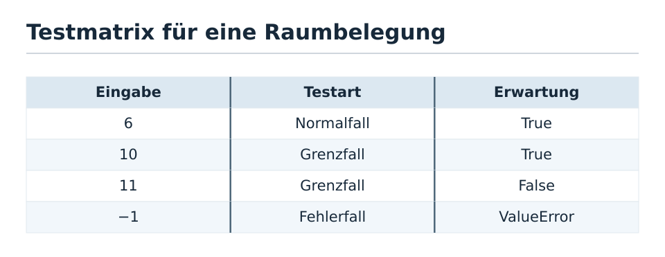

# M3-L5 – Testfälle und Fehlersuche {#L5}

**Kursbereich:** M3 – Algorithmen programmieren

**Niveau:** Sekundarstufe I (Kern)

**Vorwissen:** [M3-L4 – Listen, Funktionen und Zerlegung](M3-L4.md)

**Lernziel:** Normal-, Grenz- und Fehlerfälle prüfen und einen Defekt eingrenzen.

## Einstieg {#S1}

Ein Gruppenraum hat Platz für höchstens zehn Personen. Ein Buchungsprogramm erlaubt acht Personen, weist aber eine Gruppe mit genau zehn Personen ab. Der Programmablauf bricht dabei nicht ab. Die Rückgabe ist falsch, weil eine Formulierung aus der Anforderung falsch in einen Vergleich übersetzt wurde.

## Erwartung, Vergleich und Fehlerursache {#S2}

Ein **Testfall** verbindet eine Eingabe mit einem erwarteten Ergebnis. Schreibe zuerst die Anforderung auf. Für eine nichtnegative ganze Gruppengröße liefert die Funktion `True` bis einschließlich 10 und bei größeren Werten `False`. Eine negative Gruppengröße liegt außerhalb des vereinbarten Wertebereichs und löst `ValueError` aus.

Ein **Normalfall** prüft ein typisches Verhalten, etwa bei 6 Personen. Ein **Grenzfall** prüft genau am Rand eines Bereichs oder unmittelbar daneben, hier bei 10 und 11. Ein **Fehlerfall** prüft die Reaktion auf eine unzulässige Eingabe. Ein **Regressionstest** hält einen behobenen Defekt als dauerhaften Testfall fest. So fällt er bei späteren Änderungen erneut auf.

{alt="Für Gruppe 6 wird True erwartet. Die Grenzfälle 10 und 11 erwarten True und False. Der Fehlerfall minus 1 erwartet ValueError."}

## Einen Fehler reproduzieren und beheben {#S3}

Die fehlerhafte Rückgabe lautet `return people < 10`. Für `people = 10` ergibt sie `False`, obwohl der Raum Platz hat. Prüfe gedanklich denselben Vergleich mit 6 und 11. Beide Ergebnisse stimmen zufällig mit der Vorgabe überein. Der Wert 10 grenzt die Ursache ein. Korrigiere den Vergleich zu `people <= 10`.

```python
def group_fits(people):
    if people < 0:
        raise ValueError("group size must be non-negative")
    return people <= 10

assert group_fits(6) is True
assert group_fits(10) is True
assert group_fits(11) is False

try:
    group_fits(-1)
except ValueError:
    pass
else:
    raise AssertionError("expected ValueError for a negative group size")
```

`raise` meldet absichtlich eine Ausnahme. `try` führt die negative Probe aus. Bei `ValueError` ist das erwartete Verhalten erreicht und `pass` tut nichts. Wenn keine Ausnahme auftritt, zeigt `else` den fehlgeschlagenen Test durch `AssertionError` an. Wenn alle Prüfungen bestehen, gibt dieses Programm nichts aus.

## Selbstkontrolle {#S4}

### Aufgaben

1. Welcher Test schlägt fehl, wenn wieder `< 10` verwendet wird? Warum reicht ein Test mit 11 nicht?
2. Ergänze einen Normalfall oberhalb der Grenze und einen Test am kleinsten gültigen Wert der Spezifikation.
3. Die Funktion liefert fälschlicherweise `False` für jede negative Gruppengröße. Welcher Test meldet das?

### Lösungen

1. `assert group_fits(10) is True` schlägt fehl. Sowohl `11 < 10` als auch `11 <= 10` ergeben `False`.
2. Zum Beispiel `assert group_fits(20) is False` und `assert group_fits(0) is True`. Nach der vereinbarten Regel ist 0 gültig.
3. Bei `group_fits(-1)` bleibt die erwartete Ausnahme aus. Der `else`-Zweig löst daher `AssertionError` aus.

## Typische Fehler und Grenzen {#S5}

Berechne das erwartete Ergebnis aus der Regel. Wenn du dafür denselben Vergleich wie im Programm übernimmst, kann der Test den gemeinsamen Denkfehler nicht entdecken. Die Prüfungen decken ausgewählte Fälle ab. Sie beweisen keine Korrektheit für beliebige Eingaben. Das Programm setzt ganze Zahlen voraus und prüft hier keine Texte oder anderen Typen. Verwende `assert` für diese Lernprüfungen. Python kann sie mit der Option `-O` abschalten, deshalb steht die notwendige Eingabeprüfung im Funktionskörper als eigene Verzweigung.

## Zusammenfassung {#S6}

Halte fest, welche Eingaben zulässig sind und was sie liefern sollen. Ein Test direkt an der Grenze hilft bei der Fehlersuche. Behalte diesen Test nach der Korrektur als Regressionstest.

## Quellen und weiterführende Hinweise {#S7}

### Weiterführend (intern)

- [M4-L1 – Netzwerke, Pakete und Protokolle](M4-L1.md)

### Quellen (extern)

- [Gesellschaft für Informatik e. V. – Bildungsstandards Informatik für die Sekundarstufe I](https://informatikstandards.de/fileadmin/FA/IBS/user_upload/GI-Bildungsstandards_Informatik_Sek_I__2025__-_blau.pdf) · Bezug zur Lektion: §5.2 · Normal-, Grenz- und Fehlerfälle prüfen und einen Defekt eingrenzen · Zuletzt abgerufen: 2026-11-22 · Inhaltlich geprüft: 2026-11-22
- [Python Software Foundation – unittest – Unit testing framework](https://docs.python.org/3.13/library/unittest.html) · Bezug zur Lektion: Basic example · Normal-, Grenz- und Fehlerfälle prüfen und einen Defekt eingrenzen · Zuletzt abgerufen: 2026-11-22 · Inhaltlich geprüft: 2026-11-22
