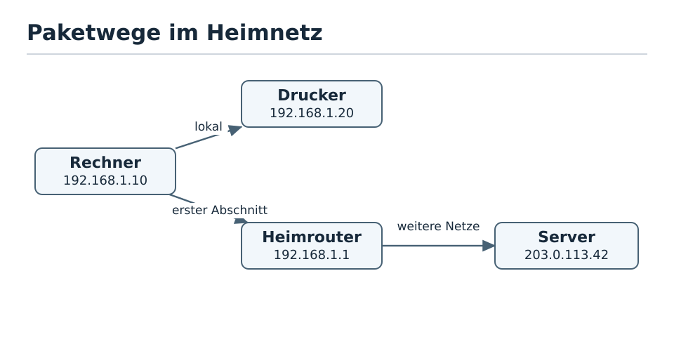

# M4-L1 – Netzwerke, Pakete und Protokolle {#L1}

**Kursbereich:** M4 – Netze, Web und Informationssicherheit

**Niveau:** Sekundarstufe I (Kern)

**Vorwissen:** [M1-L2 – Hardware, Software und Betriebssystem](M1-L2.md)

**Lernziel:** Adressierung, Paketweiterleitung und Schichtenmodell am Heimnetz erläutern.

## Ein Ziel in der Nähe und eines weit weg {#S1}

Dein Rechner druckt eine Seite im Nachbarzimmer und ruft danach den Stundenplan auf einem entfernten Server ab. Für beide Vorgänge wandern Daten durchs Netz. Beim ersten bleiben sie im Heimnetz. Beim zweiten verlassen sie es über den Router. Welche Entscheidung führt zu diesen zwei Wegen?

## Adressen, Pakete und Schichten {#S2}

Ein **Netzwerk** verbindet Geräte, damit sie Daten austauschen können. Eine **IP-Adresse** ist eine Adresse für die Zustellung auf der Netzwerkschicht. Ein Gerät kann mehrere Schnittstellen und mehrere Adressen haben. Wir betrachten genau eine IPv4-Adresse pro dargestellter Netzwerkschnittstelle.

Ein **Paket** ist eine übertragene Dateneinheit. Ein IP-Paket enthält unter anderem die IP-Adresse des Ziels und die zu transportierenden Daten. Für den nächsten Abschnitt wird dieses Paket in die Dateneinheit der lokalen Übertragung eingepackt, zum Beispiel in einen Ethernet-Frame. Ein **Protokoll** legt fest, wie die beteiligten Geräte Angaben codieren, deuten und austauschen. Eine Schicht arbeitet mit einem bestimmten Teil der Regeln:

- Die Anwendung legt fest, was die Nachricht bedeutet, beispielsweise eine Anfrage nach einem Dokument.
- Der Transport kann Daten unterschiedlichen Anwendungen zuordnen. TCP bietet einen geordneten Bytestrom und wiederholt bei Bedarf verlorene Übertragungen.
- IP kümmert sich um Adressierung und Zustellung über miteinander verbundene Netze. Die erfolgreiche Zustellung eines einzelnen Pakets ist dabei nicht garantiert.
- Die lokale Verbindung (etwa Ethernet oder WLAN) bringt die Daten über den nächsten Abschnitt.

Ein **Router** verbindet Netze. Er liest die Zieladresse und bestimmt anhand seiner Routingtabelle den nächsten Abschnitt. Bei einem Ziel im eigenen Netz kann der Rechner den ersten Abschnitt direkt zum Zielgerät nutzen.

{alt="Ein Rechner sendet lokal zum Drucker oder über den Heimrouter und weitere Netze zum Server."}

## Zwei Paketwege begründen {#S3}

Betrachte ein vereinfachtes Heimnetz mit dem Präfix `192.168.1.0/24`. Bei diesem Präfix bestimmen die ersten 24 der 32 Bits das Netz. In der üblichen Schreibweise mit Punkten müssen hier die ersten drei Zahlen übereinstimmen.

| Gerät | IPv4-Adresse |
| --- | --- |
| Rechner | `192.168.1.10` |
| Drucker | `192.168.1.20` |
| Heimrouter im lokalen Netz | `192.168.1.1` |
| Entfernter Server im Modell | `203.0.113.42` |

1. Beim Drucker stimmen die ersten drei Zahlen mit denen des Rechners überein. Der Rechner sendet über die lokale Verbindung zum Drucker.
2. Beim Server unterscheiden sich die drei Zahlen. Ohne spezifischere Route nutzt der Rechner seinen **Standardrouter** an `192.168.1.1`. Auf der IP-Schicht bleibt `203.0.113.42` dabei die Zieladresse. Nur der unmittelbar angesteuerte Nachbar ist zunächst der Router.
3. Weitere Router wählen ihre jeweiligen nächsten Abschnitte. Die Antwort braucht ebenfalls einen Weg und kann über eine andere Reihe von Routern zurückkommen.

Die Serveradresse ist für Dokumentationsbeispiele reserviert. Der Ablauf lässt sich mit Karten für Rechner, Router und Ziel nachspielen.

## Selbstkontrolle {#S4}

### Aufgaben

1. Ordne `192.168.1.99` und `192.168.2.20` im obigen Modell als lokal oder entfernt ein.
2. Ein Gerät sagt beim Weitergeben „Ich sende zum Router“. Im IP-Paket steht weiterhin die Adresse des Servers. Erkläre, warum beide Aussagen zusammenpassen.

### Lösungen

1. `192.168.1.99` ist lokal, da bei `/24` der Netzteil `192.168.1` übereinstimmt. `192.168.2.20` gehört aus Sicht des Rechners zu einem anderen Netz, da die dritte Zahl abweicht.
2. Der Router ist Empfänger der lokalen Übertragung auf diesem Abschnitt. Das IP-Ziel bezeichnet den Server. Der Router nutzt diese Angabe, um den weiteren Weg zu bestimmen.

## Annahmen, Fehler und Grenzen {#S5}

Die Regel mit den ersten drei Zahlen gilt genau für das gezeigte `/24`. Bei einem anderen Präfix müssen gegebenenfalls einzelne Bits einer Dezimalgruppe betrachtet werden. Das Heimnetz ist vereinfacht: Ein WLAN-Zugangspunkt oder Switch kann auf der lokalen Strecke beteiligt sein. Übliche Heimrouter können zudem die ausgehende Quelladresse mittels NAT umschreiben. Für die Frage, ob das Ziel lokal ist, genügt der Adressvergleich des Modells.

## Zusammenfassung {#S6}

Pakete transportieren Daten, Protokolle legen die Verständigungsregeln fest. IP-Adresse und Präfix helfen bei der Entscheidung, ob die lokale Verbindung zum Ziel genügt oder ein Router den nächsten Abschnitt übernehmen muss.

## Quellen und weiterführende Hinweise {#S7}

### Weiterführend (intern)

- [M4-L2 – Internet, DNS und das Web](M4-L2.md)

### Quellen (extern)

- [Gesellschaft für Informatik e. V. – Bildungsstandards Informatik für die Sekundarstufe I](https://informatikstandards.de/fileadmin/FA/IBS/user_upload/GI-Bildungsstandards_Informatik_Sek_I__2025__-_blau.pdf) · Bezug zur Lektion: §5.4 · Adressierung, Paketweiterleitung und Schichtenmodell am Heimnetz erläutern · Zuletzt abgerufen: 2026-11-22 · Inhaltlich geprüft: 2026-11-22
- [Bildungsserver Berlin-Brandenburg · Senatsverwaltung Berlin und MBJS Brandenburg – Rahmenlehrplan Teil C – Informatik, Wahlpflichtfach, Jahrgangsstufen 7–10](https://bildungsserver.berlin-brandenburg.de/fileadmin/bbb/unterricht/rahmenlehrplaene/Rahmenlehrplanprojekt/amtliche_Fassung/Teil_C_Informatik_2015_11_10.pdf) · Bezug zur Lektion: §3.3 · Adressierung, Paketweiterleitung und Schichtenmodell am Heimnetz erläutern · Zuletzt abgerufen: 2026-11-22 · Inhaltlich geprüft: 2026-11-22
- [MDN Web Docs – How does the Internet work?](https://developer.mozilla.org/en-US/docs/Learn_web_development/Howto/Web_mechanics/How_does_the_Internet_work) · Bezug zur Lektion: Infrastructure · Adressierung, Paketweiterleitung und Schichtenmodell am Heimnetz erläutern · Zuletzt abgerufen: 2026-11-22 · Inhaltlich geprüft: 2026-11-22
