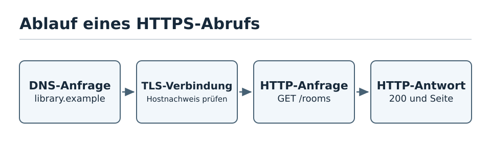

# M4-L2 – Internet, DNS und das Web {#L2}

**Kursbereich:** M4 – Netze, Web und Informationssicherheit

**Niveau:** Sekundarstufe I (Kern)

**Vorwissen:** [M4-L1 – Netzwerke, Pakete und Protokolle](M4-L1.md)

**Lernziel:** DNS-Auflösung, Client/Server und HTTP-Austausch auseinanderhalten.

## Vom Namen zur angezeigten Seite {#S1}

Du tippst eine Adresse in den Browser. Kurz darauf erscheint eine Webseite. Ein anderes Mal siehst du „404“. Auf welchem Schritt entscheidet sich, ob ein Server gefunden wurde, und auf welchem, ob der Server die gewünschte Seite hat?

## Drei getrennte Aufgaben {#S2}

Das **Internet** verbindet Netze, über die sich viele verschiedene Dienste erreichen lassen. Das **World Wide Web** ist einer dieser Dienste: Ressourcen wie Dokumente oder Bilder werden über URLs bezeichnet und über HTTP abgerufen.

Die Beispiel-URL `https://library.example/rooms` hat drei für uns wichtige Teile: `https` bezeichnet das Schema, `library.example` den Hostnamen und `/rooms` den Pfad der Ressource. Der Browser ist in unserem Fall der **Client**, der eine Anfrage stellt. Der **Server** verarbeitet sie und antwortet.

Das **Domain Name System** (DNS) ist ein verteiltes Namenssystem. Unter anderem liefert es IP-Adressen für einen Hostnamen. Der Rechner fragt gewöhnlich einen DNS-Resolver. Dieser kann eine gespeicherte Antwort verwenden oder andere DNS-Server befragen. Ein Webpfad gehört dabei nicht zur Namensanfrage. Ein Hostname kann mehrere Adressen haben, und mehrere Namen können sich eine Adresse teilen.

**HTTP** legt fest, wie der Client eine Ressource anfragt und wie der Server antwortet. **HTTPS** ist HTTP mit geschützter Verbindung. Der Server kann einem Client einen Erfolg oder einen Fehlerstatus mitteilen. Eine Namensauflösung beantwortet eine andere Frage: Zu welcher Adresse kann der Client eine Verbindung aufbauen?

{alt="DNS löst library.example auf. Danach verbinden sich Browser und Dienst geschützt. Auf GET /rooms antwortet der Dienst mit 200 und der Seite."}

## Einen Webabruf nachspielen {#S3}

Wir verwenden einen ausgedachten Dienst unter `library.example`, dessen Resolver im Modell `203.0.113.42` zurückgibt. Die Domain und die IP-Adresse sind für Beispiele vorgesehen. Die Anfrage lässt sich auf Papier spielen:

1. Der Browser trennt den Hostnamen vom Pfad. Der Resolver erhält eine Namensanfrage zu `library.example` und liefert beispielhaft `203.0.113.42`.
2. Für HTTPS stellt der Browser eine geschützte Verbindung zum vorgesehenen Host her. Vereinfacht gesagt prüft er dabei unter anderem den zum Host gehörenden Zertifikatsnachweis.
3. Der Browser sendet eine HTTP-Anfrage mit der Methode `GET`, dem Pfad `/rooms` und der Angabe des Hosts. `GET` ist für das Abrufen einer Repräsentation gedacht.
4. Der Dienst liefert im Beispiel den Status `200` und die Seite. Bei `GET /garden` meldet derselbe Dienst im Modell `404`, weil es diese Ressource dort nicht gibt.

| Beobachtung | Aussagekraft |
| --- | --- |
| DNS liefert eine Adresse | Der Name wurde im Modell aufgelöst. |
| Server antwortet mit `200` | Die HTTP-Anfrage war erfolgreich. |
| Server antwortet mit `404` | Ein HTTP-Dienst meldet, dass er keine aktuelle Darstellung findet oder deren Existenz nicht offenlegt. |

## Selbstkontrolle {#S4}

### Aufgaben

1. Welche Zeichenfolge fragt der Resolver für `https://library.example/events` als Hostnamen ab? Welcher Pfad geht in die HTTP-Anfrage?
2. Der Browser meldet bei einer neuen URL eine fehlgeschlagene Namensauflösung. Hat er dabei einen HTTP-Status `404` vom vorgesehenen Dienst erhalten? Begründe.

### Lösungen

1. Der Name lautet `library.example`, der Pfad `/events`. Der Resolver braucht den Pfad nicht. Über ihn entscheidet später der HTTP-Dienst.
2. Nein. Im vereinfachten Ablauf fehlt die Zieladresse und es kommt keine HTTP-Antwort des Diensts zustande. `404` wäre ein Status einer tatsächlich erhaltenen HTTP-Antwort.

## Annahmen, Fehler und Grenzen {#S5}

Der Abruf eines Dokuments kann weitere Anfragen für Bilder, Skripte oder Schriftdateien auslösen. Browser und Resolver speichern Antworten, sodass bei späteren Abrufen Schritte entfallen können. Ein Fehler nach erfolgreicher Namensauflösung kann auch beim Verbindungsaufbau oder bei der Zertifikatsprüfung auftreten. Er ist dadurch noch kein HTTP-Status. Eine `404`-Antwort beweist außerdem nicht, dass der beabsichtigte Ursprungsserver selbst geantwortet hat: Auch ein zwischengeschalteter HTTP-Dienst kann sie liefern.

## Zusammenfassung {#S6}

DNS hilft, einen Hostnamen einer Adresse zuzuordnen. Bei einem Webabruf ist HTTP die Verständigung über Ressourcen und Status. Die getrennten Aufgaben helfen dir, Fehler im Ablauf zuzuordnen.

## Quellen und weiterführende Hinweise {#S7}

### Weiterführend (intern)

- [M4-L3 – Daten schützen und Konten absichern](M4-L3.md)

### Quellen (extern)

- [Gesellschaft für Informatik e. V. – Bildungsstandards Informatik für die Sekundarstufe I](https://informatikstandards.de/fileadmin/FA/IBS/user_upload/GI-Bildungsstandards_Informatik_Sek_I__2025__-_blau.pdf) · Bezug zur Lektion: §5.4 · DNS-Auflösung, Client/Server und HTTP-Austausch auseinanderhalten · Zuletzt abgerufen: 2026-11-22 · Inhaltlich geprüft: 2026-11-22
- [MDN Web Docs – Overview of HTTP](https://developer.mozilla.org/en-US/docs/Web/HTTP/Guides/Overview) · Bezug zur Lektion: Client-server structure · DNS-Auflösung, Client/Server und HTTP-Austausch auseinanderhalten · Zuletzt abgerufen: 2026-11-22 · Inhaltlich geprüft: 2026-11-22
- [IETF – RFC 9110: HTTP Semantics](https://www.rfc-editor.org/rfc/rfc9110.html) · Bezug zur Lektion: §15.5.5 · DNS-Auflösung, Client/Server und HTTP-Austausch auseinanderhalten · Zuletzt abgerufen: 2026-11-22 · Inhaltlich geprüft: 2026-11-22
