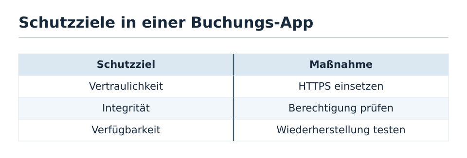

# M4-L3 – Daten schützen und Konten absichern {#L3}

**Kursbereich:** M4 – Netze, Web und Informationssicherheit

**Niveau:** Sekundarstufe I (Kern)

**Vorwissen:** [M4-L2 – Internet, DNS und das Web](M4-L2.md)

**Lernziel:** Schutzziele, Datensparsamkeit, Mehrfaktorverfahren und vertrauliche Übertragung anwenden.

## Eine App für den Probenraum {#S1}

Eine Schule möchte einen Probenraum reservierbar machen. Gruppen sollen freie Zeiten sehen und eigene Buchungen ändern können. Die Schule muss sich entscheiden, welche Daten sie überhaupt braucht, wer sie sehen darf und was bei einem Ausfall passiert. Dafür helfen drei Schutzziele.

## Schutzziele und Schutzmaßnahmen {#S2}

**Vertraulichkeit** bedeutet, dass nur berechtigte Personen oder Systeme die Daten erfahren. **Integrität** bedeutet hier, dass Daten vollständig bleiben und nur wie vorgesehen geändert werden. **Verfügbarkeit** bedeutet, dass berechtigte Personen bei Bedarf auf die Daten oder den Dienst zugreifen können. Eine Maßnahme kann mehr als ein Ziel fördern, und ein Ziel braucht oft mehrere Maßnahmen.

{alt="Vertraulichkeit: HTTPS. Integrität: Rechte prüfen. Verfügbarkeit: Wiederherstellung testen."}

Beginne vor der technischen Umsetzung mit **Datensparsamkeit**: Speichere für eine Buchung etwa Zeitfenster und Gruppenkennung. Eine Privatadresse wäre für diese Aufgabe ohne begründeten Zusatzbedarf überflüssig. Lege auch fest, wann ein alter Buchungseintrag seinen Zweck erfüllt hat und gelöscht werden kann.

Bei einem Konto unterscheidet man **Authentifizierung** und **Autorisierung**. Die Anmeldung prüft den Nachweis für eine behauptete Identität. Anschließend prüft der Dienst bei jeder geschützten Aktion, ob das Konto die erforderliche Berechtigung besitzt. **Mehrfaktor-Authentifizierung** verlangt Nachweise aus unterschiedlichen Kategorien: etwas, das ich weiß (z. B. ein Passwort), etwas, das ich besitze (z. B. einen Sicherheitsschlüssel), oder eine persönliche Eigenschaft, die geprüft wird. Zwei Passwörter wären beide aus der Wissenskategorie.

## Schutzbedarf einschätzen {#S3}

Wir prüfen die fiktive Probenraum-App. Die Übersicht zeigt freien und belegten Raum, aber keine privaten Kontaktdaten. Eine Gruppenleitung darf die eigenen Buchungen ändern. Eine zuständige Person verwaltet die Öffnungszeiten.

| Situation | Betroffenes Schutzziel | Geeignete Maßnahme |
| --- | --- | --- |
| Jemand liest eine Anmeldung unterwegs mit. | Vertraulichkeit | Geschützte Übertragung mittels HTTPS mit gültigem Zertifikat. |
| Eine angemeldete Person ändert eine fremde Buchung. | Integrität | Der Server prüft bei der Änderung die Berechtigung für genau diese Buchung. |
| Die Datenspeicherung fällt aus. | Verfügbarkeit | Eine getestete Wiederherstellung aus Sicherungen und ein Ersatzplan für den Ausfall. |

Für das Konto mit erhöhten Rechten führt die Schule einen weiteren Faktor ein, etwa einen geeigneten Sicherheitsschlüssel. Jede Rolle erhält nur die benötigten Rechte. Das Konto zur Verwaltung der Öffnungszeiten braucht beispielsweise keine Einsicht in private Daten, die diese Funktion nicht benötigt.

## Selbstkontrolle {#S4}

### Aufgaben

1. Eine App verlangt zu einem Passwort zusätzlich die Eingabe eines zweiten Passworts. Erfüllt das die Idee unterschiedlicher Faktoren? Nenne eine mögliche Ergänzung.
2. Beim fiktiven Dienst stimmt eine Buchung nach einer unberechtigten Änderung nicht mehr. Zugleich ist der Dienst wegen eines Defekts nicht erreichbar. Ordne die beiden Beobachtungen Schutzzielen zu und nenne je eine Maßnahme.

### Lösungen

1. Beide Nachweise sind Wissen. Ein geeigneter registrierter Sicherheitsschlüssel ergänzt in diesem Beispiel den Besitzfaktor.
2. Die unberechtigte Änderung betrifft die Integrität. Eine serverseitige Berechtigungsprüfung kann sie verhindern. Der Ausfall betrifft die Verfügbarkeit. Eine getestete Wiederherstellung und ein Ersatzplan helfen, den Betrieb wieder aufzunehmen.

## Annahmen, Fehler und Grenzen {#S5}

HTTPS schützt die Verbindung zum jeweiligen Endpunkt. Der Dienst kann empfangene Daten weiterhin lesen und muss sie bei der Speicherung schützen. Mehrere Faktoren machen eine Berechtigungsprüfung für einzelne Aktionen weiterhin nötig. Eine Sicherung erfüllt ihren Zweck erst, wenn Zuständigkeit, Aufbewahrung und Wiederherstellung geklärt sind. Sichere Voreinstellungen und ein Verfahren für verlorene Schlüssel gehören zur Kontoverwaltung.

## Zusammenfassung {#S6}

Beschreibe zuerst den Zweck der Daten und die möglichen Schäden. Wähle dann Schutzmaßnahmen passend zu Vertraulichkeit, Integrität und Verfügbarkeit. Datensparsamkeit verringert die Menge der Daten, die überhaupt geschützt werden müssen.

## Quellen und weiterführende Hinweise {#S7}

### Weiterführend (intern)

- [M4-L4 – Verschlüsselung, Signaturen und Vertrauen](M4-L4.md)

### Quellen (extern)

- [Gesellschaft für Informatik e. V. – Bildungsstandards Informatik für die Sekundarstufe I](https://informatikstandards.de/fileadmin/FA/IBS/user_upload/GI-Bildungsstandards_Informatik_Sek_I__2025__-_blau.pdf) · Bezug zur Lektion: §§5.4–5.5 · Schutzziele, Datensparsamkeit, Mehrfaktorverfahren und vertrauliche Übertragung anwenden · Zuletzt abgerufen: 2026-11-22 · Inhaltlich geprüft: 2026-11-22
- [Bildungsserver Berlin-Brandenburg · Senatsverwaltung Berlin und MBJS Brandenburg – Rahmenlehrplan Teil C – Informatik, Wahlpflichtfach, Jahrgangsstufen 7–10](https://bildungsserver.berlin-brandenburg.de/fileadmin/bbb/unterricht/rahmenlehrplaene/Rahmenlehrplanprojekt/amtliche_Fassung/Teil_C_Informatik_2015_11_10.pdf) · Bezug zur Lektion: §3.3 · Schutzziele, Datensparsamkeit, Mehrfaktorverfahren und vertrauliche Übertragung anwenden · Zuletzt abgerufen: 2026-11-22 · Inhaltlich geprüft: 2026-11-22
