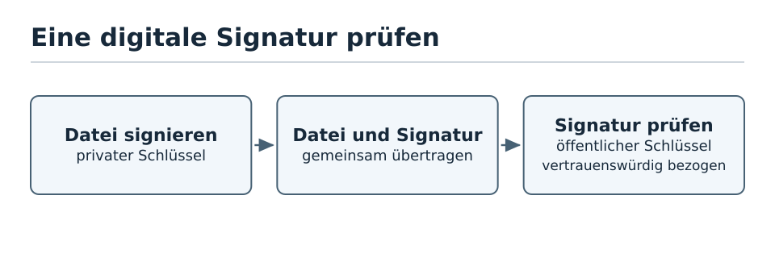

# M4-L4 – Verschlüsselung, Signaturen und Vertrauen {#L4}

**Kursbereich:** M4 – Netze, Web und Informationssicherheit

**Niveau:** Sekundarstufe II (erhöht)

**Vorwissen:** [M4-L3 – Daten schützen und Konten absichern](M4-L3.md)

**Lernziel:** Symmetrische und asymmetrische Aufgaben, Hash, Signatur und Zertifikat unterscheiden.

## Eine vertrauliche Anfrage und ein öffentlicher Plan {#S1}

Die Schulbibliothek nimmt vertrauliche Anfragen entgegen. Ihren Raumplan bietet sie allen an. Bei der Anfrage sollen Unberechtigte den Inhalt nicht lesen. Beim Plan ist die entscheidende Frage, ob die Datei wirklich von der Bibliothek stammt und unverändert ist. Die zwei Aufgaben brauchen unterschiedliche kryptografische Bausteine.

## Schlüssel, Prüfsummen und Vertrauensbeziehungen {#S2}

Ein **Schlüssel** ist eine Eingabe in ein kryptografisches Verfahren. Bei **symmetrischer Verschlüsselung** benutzen die berechtigten Endpunkte ein gemeinsames Geheimnis zum Verschlüsseln und Entschlüsseln. Moderne authentifizierte Verschlüsselung kann zusätzlich Änderungen erkennen. Das gemeinsame Geheimnis muss angemessen geschützt und vereinbart werden.

**Asymmetrische Verfahren** arbeiten mit einem öffentlichen und einem privaten Schlüssel. Das Schlüsselpaar hat je nach Verfahren eine bestimmte Aufgabe. Geeignete Verfahren schützen Daten für den Besitzer eines privaten Schlüssels oder helfen, ein gemeinsames Geheimnis für die Sitzung auszuhandeln. Bei einer **digitalen Signatur** erzeugt der Absender mit seinem privaten Signaturschlüssel eine Signatur. Der Empfänger kann mit dem zugehörigen öffentlichen Schlüssel prüfen, ob die Signatur zu den empfangenen Daten passt.

{alt="Der Absender signiert mit dem privaten Schlüssel und versendet Datei und Signatur. Der Empfänger prüft beide mit dem vertrauenswürdig erhaltenen öffentlichen Schlüssel."}

Eine **kryptografische Hashfunktion** berechnet aus Daten einen Prüfwert fester Länge. Eine kleine Änderung kann den Wert stark verändern. Ein bloßer Hashwert beweist keine Herkunft: Wer Datei und Hashwert gemeinsam ersetzen kann, kann auch für die neue Datei einen passenden Hash berechnen.

Ein **Zertifikat** verknüpft in einem Vertrauenssystem Angaben zur Identität mit einem öffentlichen Schlüssel. Ein Browser prüft bei HTTPS unter anderem, ob der Servername passt, das Zertifikat zeitlich gültig ist, die Signaturen über eine Vertrauenskette anerkannt sind und der Server im Verbindungsaufbau den zugehörigen privaten Schlüssel nachweist.

## Zwei Fälle Schritt für Schritt {#S3}

1. **Vertrauliche Anfrage.** Im Modell ruft der Browser den vorgesehenen Bibliotheksdienst per HTTPS auf. Die Endpunkte handeln Schlüsselmaterial aus. Nach Prüfung des Servernachweises werden die Nutzdaten mit symmetrischem Sitzungsschlüsselmaterial geschützt. Der Browser prüft damit den vorgesehenen Server, während der Dienst eine gegebenenfalls erforderliche Nutzeranmeldung gesondert behandelt.
2. **Öffentlicher Plan.** Die Bibliothek signiert die Datei mit ihrem privaten Signaturschlüssel. Die lesende Person bezieht den passenden öffentlichen Schlüssel über einen vertrauenswürdigen Weg und prüft mit ihm Datei und Signatur. Verändert sich die Datei, passt die alte Signatur normalerweise nicht mehr. Der Plan bleibt lesbar. Das Ergebnis der Prüfung hängt auch davon ab, wem der öffentliche Schlüssel tatsächlich zugeordnet ist.

## Selbstkontrolle {#S4}

### Aufgaben

1. Du bekommst einen Raumplan mit passendem Hashwert. Beides stammt aus derselben unbekannten Nachricht. Was kannst du durch Nachrechnen prüfen, und was bleibt offen?
2. Eine Datei besteht die Signaturprüfung mit einem zuvor vertrauenswürdig erhaltenen Bibliotheksschlüssel. Kann die Datei weiterhin öffentlich lesbar sein? Begründe, welche Aufgabe die Signatur erfüllt.

### Lösungen

1. Du kannst prüfen, ob die gelieferten Daten den gelieferten Hashwert ergeben. Die Herkunft bleibt offen, weil jemand beide Werte zusammen ersetzt haben könnte.
2. Ja. Die Prüfung verbindet die unveränderten Daten mit dem passenden Signaturschlüssel. Die Signatur verschlüsselt den Plan nicht und macht den Inhalt daher nicht vertraulich.

## Annahmen, Fehler und Grenzen {#S5}

Die Skizze beschreibt Aufgaben moderner Verfahren, keine Anleitung zur Entwicklung eigener Kryptografie. Ein vertrauenswürdig gebundener Schlüssel und ein korrekt geprüfter Verbindungsaufbau sind wesentliche Voraussetzungen. Ein gültiges Zertifikat sagt nichts über die inhaltliche Richtigkeit einer Seite. Eine Datei mit gültiger Signatur kann veraltet sein. Nach Verdacht auf Verlust eines privaten Schlüssels sind Schlüsselstatus und Gültigkeitszeitraum zu prüfen.

## Zusammenfassung {#S6}

Verschlüsselung schützt den Inhalt, eine Signatur unterstützt Integritäts- und Herkunftsprüfung, ein Hash liefert einen Prüfwert. Vertrauen entsteht bei der Signaturprüfung erst, wenn der öffentliche Schlüssel überprüfbar zum erwarteten Absender gehört.

## Quellen und weiterführende Hinweise {#S7}

### Weiterführend (intern)

- [M5-L1 – Tabellen, Schlüssel und Beziehungen](M5-L1.md)

### Quellen (extern)

- [Gesellschaft für Informatik e. V. – Bildungsstandards Informatik für die Sekundarstufe II](https://informatikstandards.de/fileadmin/GI/Projekte/Informatikstandards/Dokumente/Bildungsstandards_SII.pdf) · Bezug zur Lektion: §3.2.4 · Symmetrische und asymmetrische Aufgaben, Hash, Signatur und Zertifikat unterscheiden · Zuletzt abgerufen: 2026-11-22 · Inhaltlich geprüft: 2026-11-22
- [Bayern – Staatsinstitut für Schulqualität und Bildungsforschung (ISB) – LehrplanPLUS Gymnasium 11 – spät beginnende Informatik](https://www.lehrplanplus.bayern.de/fachlehrplan/gymnasium/11/informatik/mug_swg_sg) · Bezug zur Lektion: Inf11 LB2 · Symmetrische und asymmetrische Aufgaben, Hash, Signatur und Zertifikat unterscheiden · Zuletzt abgerufen: 2026-11-22 · Inhaltlich geprüft: 2026-11-22
