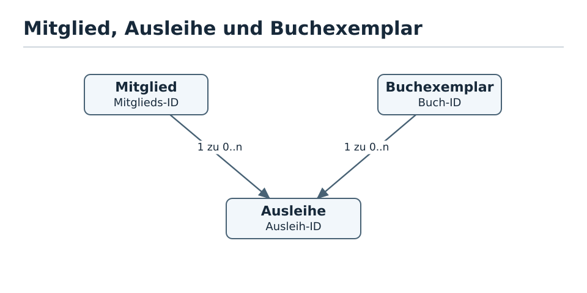

# M5-L1 – Tabellen, Schlüssel und Beziehungen {#L1}

**Kursbereich:** M5 – Datenbanken und Datenmodelle

**Niveau:** Sekundarstufe I (Kern)

**Vorwissen:** [M2-L4 – Vom Messsignal zur Tabelle](M2-L4.md)

**Lernziel:** Entitäten, Attribute, Schlüssel und Kardinalitäten am Ausleihmodell erklären.

## Welches Exemplar ist ausgeliehen? {#S1}

Die Bibliothek hat zwei Exemplare des gleichen Buchs. Eines steht im Regal, das andere ist ausgeliehen. Wenn eine Tabelle beide nur durch ihren Titel bezeichnet, kann die Bibliothek eine Rückgabe keinem bestimmten Exemplar zuordnen. Das Datenmodell braucht für diese Aufgabe eigene Kennungen.

## Entitäten, Attribute und Schlüssel {#S2}

Eine **Entität** ist etwas, das wir im Modell als einzelnen Gegenstand auffassen, etwa ein bestimmtes Exemplar. Ein **Entitätstyp** fasst gleichartig beschriebene Gegenstände zusammen. Ein **Attribut** ist ein Merkmal wie der Titel oder die Seitenzahl. Im Tabellenmodell entsprechen einander häufig Entitätstyp und Tabelle, Entität und Zeile sowie Attribut und Spalte.

Ein **Primärschlüssel** bezeichnet eine Zeile eindeutig. Er kann aus einer oder mehreren Spalten bestehen. Bei einem Büchertitel sind Dubletten möglich. Eine vergebene Exemplar-ID eignet sich besser. Ein **Fremdschlüssel** verweist auf eine eindeutig identifizierbare Zeile in einer Tabelle, häufig auf deren Primärschlüssel.

Die **Kardinalität** gibt an, wie viele Entitäten auf einer Seite einer Beziehung zu einer Entität auf der Gegenseite gehören können. Ein Mitglied kann viele Exemplare über verschiedene Termine ausleihen. Dasselbe Exemplar kann im Laufe der Zeit von mehreren Mitgliedern ausgeliehen werden. Die direkte Beziehung über die gesamte Historie ist damit eine **Viele-zu-viele-Beziehung** (n:m). Eine eigene Ausleihzeile bildet jeweils einen einzelnen Vorgang ab.

{alt="Ein Mitglied und ein Buchexemplar haben jeweils null bis viele Ausleihen. Jede Ausleihe ist genau einem Mitglied und einem Exemplar zugeordnet."}

## Ein Beispiel mit Ausleihgeschichte {#S3}

Wir modellieren jedes physische Exemplar als eigene Buchzeile. Die Beispielkennungen haben keine Bedeutung außerhalb des Modells.

| Mitglieds-ID | Anzeigename |
| --- | --- |
| 7 | Kim |
| 8 | Noor |

| Buch-ID | Titel |
| --- | --- |
| 1 | Moss |
| 2 | Orbit |
| 3 | Signals |
| 4 | Atlas |

| Ausleih-ID | Mitglieds-ID | Buch-ID | Datum |
| --- | --- | --- | --- |
| 10 | 7 | 1 | 2026-03-03 |
| 11 | 7 | 2 | 2026-03-04 |
| 12 | 8 | 1 | 2026-04-02 |

1. Für Ausleihe 10 finden wir mit Mitglieds-ID 7 den Anzeigenamen Kim und mit Buch-ID 1 den Titel Moss. Der Schlüssel der Ausleihe ist 10.
2. Ausleihen 10 und 11 gehören beide zu Kim. Das Mitglied kann mehrere Ausleihzeilen haben.
3. Ausleihen 10 und 12 betreffen beide dasselbe Exemplar Moss zu verschiedenen Terminen. Eine Tabelle „ein Buch pro Mitglied“ könnte die Historie nicht vollständig abbilden.

Jeder Ausleihvorgang verweist auf genau ein Mitglied und genau ein Exemplar. Andersherum können ein Mitglied oder ein Exemplar zu keiner, einer oder mehreren Ausleihzeilen gehören.

## Selbstkontrolle {#S4}

### Aufgaben

1. Die Bibliothek legt eine weitere Zeile mit Titel `Orbit` an. Darf deren Buch-ID 2 lauten? Welche Werte dürfen gleich sein?
2. Weshalb eignet sich das Paar aus Mitglieds-ID und Buch-ID allein für diese Historie nicht als Primärschlüssel der Ausleihe?

### Lösungen

1. Buch-ID 2 ist im Beispiel schon vergeben. Das weitere Exemplar erhält eine neue Buch-ID. Der Titel darf gleich sein.
2. Ein Mitglied kann dasselbe Exemplar zu verschiedenen Zeiten ausleihen. Das Paar würde dann wiederholt. Eine eigene Ausleih-ID hält die einzelnen Vorgänge auseinander.

## Annahmen, Fehler und Grenzen {#S5}

Die Buchzeile identifiziert im Beispiel ein physisches Exemplar, einschließlich seines wiederholbaren Titels. Für eine größere Bibliothek könnten bibliografische Daten in eine eigene Tabelle für Ausgaben ausgelagert werden. Die Schlüsselverweise prüfen, ob Buch und Mitglied existieren. Sie stellen für sich genommen nicht sicher, dass sich zwei Leihzeiträume für dasselbe Exemplar nicht überschneiden. Dafür braucht es weitere Regeln und Rückgabedaten.

## Zusammenfassung {#S6}

Der Primärschlüssel identifiziert eine Zeile, der Fremdschlüssel stellt den Bezug zu einer Zeile her. Eine eigene Beziehungstabelle erlaubt wiederholte Vorgänge und kann zum Beispiel das Datum jedes Vorgangs speichern.

## Quellen und weiterführende Hinweise {#S7}

### Weiterführend (intern)

- [M5-L2 – SQL-Abfragen: Filtern und Sortieren](M5-L2.md)

### Quellen (extern)

- [Gesellschaft für Informatik e. V. – Bildungsstandards Informatik für die Sekundarstufe I](https://informatikstandards.de/fileadmin/FA/IBS/user_upload/GI-Bildungsstandards_Informatik_Sek_I__2025__-_blau.pdf) · Bezug zur Lektion: §5.1 · Entitäten, Attribute, Schlüssel und Kardinalitäten am Ausleihmodell erklären · Zuletzt abgerufen: 2026-11-22 · Inhaltlich geprüft: 2026-11-22
- [Bildungsserver Berlin-Brandenburg · Senatsverwaltung Berlin und MBJS Brandenburg – Rahmenlehrplan Teil C – Informatik, Wahlpflichtfach, Jahrgangsstufen 7–10](https://bildungsserver.berlin-brandenburg.de/fileadmin/bbb/unterricht/rahmenlehrplaene/Rahmenlehrplanprojekt/amtliche_Fassung/Teil_C_Informatik_2015_11_10.pdf) · Bezug zur Lektion: §3.7 · Entitäten, Attribute, Schlüssel und Kardinalitäten am Ausleihmodell erklären · Zuletzt abgerufen: 2026-11-22 · Inhaltlich geprüft: 2026-11-22
- [Bayern – Staatsinstitut für Schulqualität und Bildungsforschung (ISB) – LehrplanPLUS Gymnasium 10 – Informatik](https://www.lehrplanplus.bayern.de/fachlehrplan/gymnasium/10/informatik) · Bezug zur Lektion: Inf10 LB1 · Entitäten, Attribute, Schlüssel und Kardinalitäten am Ausleihmodell erklären · Zuletzt abgerufen: 2026-11-22 · Inhaltlich geprüft: 2026-11-22
