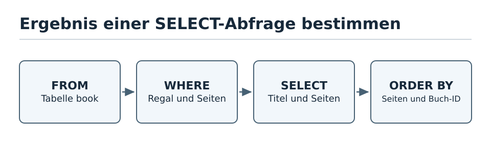

# M5-L2 – SQL-Abfragen: Filtern und Sortieren {#L2}

**Kursbereich:** M5 – Datenbanken und Datenmodelle

**Niveau:** Sekundarstufe I (Kern)

**Vorwissen:** [M5-L1 – Tabellen, Schlüssel und Beziehungen](M5-L1.md)

**Lernziel:** SQLite-Abfragen mit SELECT, WHERE und ORDER BY ausführen.

## Eine passende Liste aus einem großen Bestand {#S1}

Für eine Lesegruppe sollen naturkundliche Bücher ab 100 Seiten herausgesucht werden. Lange Bücher kommen zuerst. Eine Bibliothek führt Titel, Regal und Seitenzahl für jedes Exemplar. Welche SQL-Abfrage liefert genau die gesuchte Liste?

## Was die Teile von SELECT bedeuten {#S2}

**SQL** ist eine Sprache, mit der unter anderem Abfragen an relationale Datenbanken formuliert werden. Eine Abfrage beschreibt, welche Zeilen und Spalten im Ergebnis stehen sollen. Das Datenbanksystem wählt die Arbeitsschritte, um dieses Ergebnis zu berechnen.

- `FROM` gibt die Ausgangstabelle an.
- `WHERE` prüft eine Bedingung pro Zeile. Die Zeile bleibt, wenn die Bedingung wahr ist.
- `SELECT` nennt die Spalten oder Ausdrücke, die im Ergebnis stehen. Diese Auswahl heißt **Projektion**.
- `ORDER BY` legt die Reihenfolge der Ergebniszeilen fest. `ASC` sortiert aufsteigend und `DESC` absteigend. Weitere Sortierspalten lösen Gleichstände von links nach rechts auf.

Die Reihenfolge in der Abfrage beginnt mit `SELECT`. Zum Erklären des Ergebnisses ist es oft einfacher, mit `FROM` und `WHERE` zu beginnen.

{alt="Die Abfrage beginnt logisch mit der Buchtabelle, filtert auf Regal und Seitenzahl, projiziert Titel und Seiten und sortiert nach Seitenzahl und Buch-ID."}

## Zeilen auf Papier prüfen und in SQLite abfragen {#S3}

Lege die vier Beispieldatensätze in einer frischen SQLite-Datenbank an. Wenn die SQLite-Kommandozeile installiert ist, starte mit `sqlite3 :memory:`. Führe alle SQL-Blöcke dieser Lektion in derselben Sitzung aus und beginne für eine neue Lektion eine neue Sitzung. Die Titel, Regalkennungen und Seitenzahlen sind fiktiv. Die Annahme dieses Beispiels ist, dass alle erfassten Bücher eine positive Seitenzahl haben.

```sql
CREATE TABLE book (
    book_id INTEGER PRIMARY KEY,
    title TEXT NOT NULL,
    shelf TEXT NOT NULL,
    pages INTEGER NOT NULL CHECK (pages > 0)
);
INSERT INTO book VALUES
    (1, 'Moss', 'science', 120),
    (2, 'Orbit', 'fiction', 180),
    (3, 'Signals', 'science', 110),
    (4, 'Atlas', 'science', 120);
```

1. Prüfe das Regal. `Orbit` steht unter `fiction` und fällt weg.
2. `Moss`, `Signals` und `Atlas` erfüllen alle auch `pages >= 100`.
3. Zeige Titel und Seiten. `Moss` und `Atlas` haben je 120 Seiten, also entscheidet bei ihnen die aufsteigende Buch-ID. `Signals` folgt mit 110 Seiten.

```sql
SELECT title, pages
FROM book
WHERE shelf = 'science' AND pages >= 100
ORDER BY pages DESC, book_id ASC;
```

| title | pages |
| --- | ---: |
| Moss | 120 |
| Atlas | 120 |
| Signals | 110 |

Dass `book_id` die Reihenfolge festlegt, macht daraus keine sichtbare Ergebnisspalte.

## Selbstkontrolle {#S4}

### Aufgaben

1. Formuliere eine Abfrage für die Titel naturkundlicher Bücher mit genau 120 Seiten. Der Titel soll aufsteigend sortiert werden. Gib das Ergebnis an.
2. In der Beispielabfrage fehlt plötzlich `book_id ASC`. Welche Zeile steht sicher zuletzt? Welche Information zur Reihenfolge fehlt?

### Lösungen

1. Die Abfrage filtert auf `shelf = 'science'` und `pages = 120`. Sortieren nach dem Titel ergibt `Atlas`, dann `Moss`.

2. `Signals` bleibt wegen der 110 Seiten zuletzt. Die Reihenfolge der zwei Zeilen mit 120 Seiten ist durch die verbleibende Sortierangabe nicht festgelegt.

**Abfrage zu Aufgabe 1**

```sql
SELECT title
FROM book
WHERE shelf = 'science' AND pages = 120
ORDER BY title ASC;
```

| title |
| --- |
| Atlas |
| Moss |

## Annahmen, Fehler und Grenzen {#S5}

Ohne `ORDER BY` kann die Ausgabe in einer vertrauten Reihenfolge aussehen. Die Abfrage garantiert diese Reihenfolge aber nicht. Textwerte werden hier in einfache Anführungszeichen gesetzt. Die Textsortierung hängt von den Vergleichsregeln der Datenbank ab. Bei komplexeren Bedingungen solltest du Klammern setzen, damit klar ist, welche Teilbedingungen zusammengehören.

## Zusammenfassung {#S6}

Mit `WHERE` bestimmst du, welche Zeilen bleiben. Mit `SELECT` bestimmst du, welche Werte erscheinen. Mit `ORDER BY` und einem eindeutigen letzten Sortierkriterium erhältst du im Beispieldatensatz eine festgelegte Reihenfolge.

## Quellen und weiterführende Hinweise {#S7}

### Weiterführend (intern)

- [M5-L3 – SQL-Joins, Gruppen und fehlende Werte](M5-L3.md)

### Quellen (extern)

- [Gesellschaft für Informatik e. V. – Bildungsstandards Informatik für die Sekundarstufe I](https://informatikstandards.de/fileadmin/FA/IBS/user_upload/GI-Bildungsstandards_Informatik_Sek_I__2025__-_blau.pdf) · Bezug zur Lektion: §5.1 · SQLite-Abfragen mit SELECT, WHERE und ORDER BY ausführen · Zuletzt abgerufen: 2026-11-22 · Inhaltlich geprüft: 2026-11-22
- [SQLite – SELECT](https://www.sqlite.org/lang_select.html) · Bezug zur Lektion: Simple SELECT processing · SQLite-Abfragen mit SELECT, WHERE und ORDER BY ausführen · Zuletzt abgerufen: 2026-11-22 · Inhaltlich geprüft: 2026-11-22
