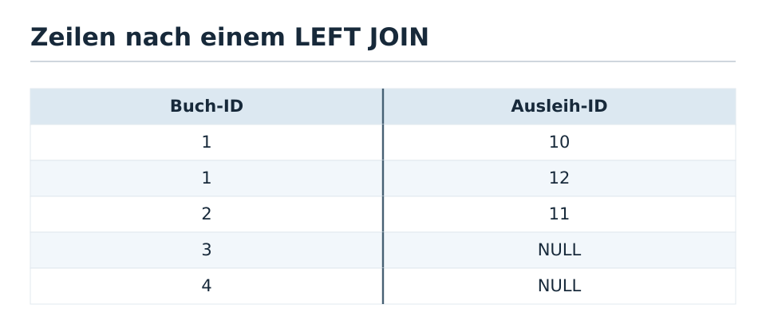

# M5-L3 – SQL-Joins, Gruppen und fehlende Werte {#L3}

**Kursbereich:** M5 – Datenbanken und Datenmodelle

**Niveau:** Sekundarstufe II (grundlegend)

**Vorwissen:** [M5-L2 – SQL-Abfragen: Filtern und Sortieren](M5-L2.md)

**Lernziel:** JOIN, GROUP BY und NULL anhand geprüfter Abfragen erklären.

## Auch Exemplare ohne Ausleihe zählen {#S1}

Die Bibliothek möchte zu jedem Exemplar wissen, wie oft es ausgeliehen wurde. Einige Exemplare haben keinen einzigen Vorgang in der Ausleihtabelle. Wenn wir nur dort zählen, verschwinden diese Exemplare aus der Liste. Wie können wir sie trotzdem mit dem Wert null anzeigen?

## Zeilen verbinden und gruppieren {#S2}

Ein **Join** verknüpft Zeilen aus zwei Tabellen anhand einer Bedingung. `ON book.book_id = loan.book_id` ordnet einer Buchzeile alle Ausleihen derselben Buch-ID zu. Ein **INNER JOIN** liefert nur passende Paare. Ein **LEFT JOIN** behält zusätzlich jede linke Zeile ohne Treffer. Die Spalten der rechten Tabelle werden dabei mit `NULL` aufgefüllt.

`NULL` steht in SQL für einen fehlenden oder unbekannten Wert. Null als Anzahl ist dagegen die Zahl `0`. Der Vergleich `= NULL` liefert keine wahre Aussage. Teste mit `IS NULL`, ob ein Wert fehlt.

`GROUP BY` fasst die Zeilen der Verknüpfung zu Gruppen zusammen. `COUNT(*)` zählt die Zeilen einer Gruppe. `COUNT(loan.loan_id)` zählt deren Zeilen mit einer vorhandenen Ausleih-ID. Da die Ausleih-ID ein Primärschlüssel ist, kann sie in einer echten Ausleihzeile nicht fehlen.

{alt="Buch 1 erscheint mit Ausleih-ID 10 und 12, Buch 2 mit 11, Buch 3 und Buch 4 jeweils mit NULL."}

## Die Ausleihzahl für jedes Exemplar berechnen {#S3}

Führe die folgenden Blöcke in einer frischen SQLite-Datenbank aus. Für die Zählfrage brauchen wir nur Buch-ID, Titel und Ausleih-ID.

```sql
PRAGMA foreign_keys = ON;
CREATE TABLE book (
    book_id INTEGER PRIMARY KEY,
    title TEXT NOT NULL
);
CREATE TABLE loan (
    loan_id INTEGER PRIMARY KEY,
    book_id INTEGER NOT NULL REFERENCES book(book_id)
);
INSERT INTO book VALUES
    (1, 'Moss'), (2, 'Orbit'), (3, 'Signals'), (4, 'Atlas');
INSERT INTO loan VALUES (10, 1), (11, 2), (12, 1);
```

1. Der Join erzeugt für Buch 1 zwei Zeilen mit Ausleih-IDs 10 und 12, für Buch 2 eine Zeile mit ID 11.
2. Buch 3 und Buch 4 erzeugen je eine Zeile mit fehlender Ausleih-ID.
3. Gruppiere nach Buch-ID und Titel. So bleiben Exemplare mit demselben Titel getrennt. Vergleiche beide Zählungen.

```sql
SELECT b.book_id, b.title, COUNT(*) AS joined_rows,
       COUNT(l.loan_id) AS loans
FROM book AS b
LEFT JOIN loan AS l ON b.book_id = l.book_id
GROUP BY b.book_id, b.title
ORDER BY b.book_id;
```

| book_id | title | joined_rows | loans |
| ---: | --- | ---: | ---: |
| 1 | Moss | 2 | 2 |
| 2 | Orbit | 1 | 1 |
| 3 | Signals | 1 | 0 |
| 4 | Atlas | 1 | 0 |

## Selbstkontrolle {#S4}

### Aufgaben

1. Wie viele Zeilen hätte das gruppierte Ergebnis mit einem INNER JOIN? Welche Bücher fehlen?
2. Finde alle Bücher ohne Ausleihe mit einem LEFT JOIN und `IS NULL`. Gib Buch-ID und Titel aus und sortiere nach ID.

### Lösungen

1. Es gäbe zwei Gruppen für Moss und Orbit. Signals und Atlas haben keine passenden Zeilen und fehlen.
2. Prüfe nach dem Join die Ausleih-ID auf `NULL`. Die zwei ausgegebenen Zeilen sind die Bücher 3 und 4.

**Abfrage zu Aufgabe 2**

```sql
SELECT b.book_id, b.title
FROM book AS b
LEFT JOIN loan AS l ON b.book_id = l.book_id
WHERE l.loan_id IS NULL
ORDER BY b.book_id;
```

| book_id | title |
| ---: | --- |
| 3 | Signals |
| 4 | Atlas |

## Annahmen, Fehler und Grenzen {#S5}

Ein Filter auf eine rechte Spalte in `WHERE` kann aufgefüllte Zeilen nach dem LEFT JOIN wieder ausschließen. Beispiel: `WHERE l.loan_id >= 12` behält die fehlenden Werte nicht. Wenn nur passende Ausleihen ab ID 12 verbunden und gleichzeitig alle Bücher behalten werden sollen, gehört die Zusatzbedingung in `ON`. Jeder weitere Join kann Zeilen vervielfachen. Prüfe daher vor dem Zählen, was eine Zeile im Zwischenergebnis bedeutet.

## Zusammenfassung {#S6}

LEFT JOIN bewahrt linke Zeilen ohne Treffer. Gruppiere nach der gewünschten Einheit, hier dem Exemplar. Zähle eine zuverlässig vorhandene Spalte der rechten Tabelle, wenn nur echte Treffer gezählt werden sollen.

## Quellen und weiterführende Hinweise {#S7}

### Weiterführend (intern)

- [M5-L4 – Normalisierung und Datenintegrität](M5-L4.md)

### Quellen (extern)

- [Gesellschaft für Informatik e. V. – Bildungsstandards Informatik für die Sekundarstufe II](https://informatikstandards.de/fileadmin/GI/Projekte/Informatikstandards/Dokumente/Bildungsstandards_SII.pdf) · Bezug zur Lektion: §3.2.1 · JOIN, GROUP BY und NULL anhand geprüfter Abfragen erklären · Zuletzt abgerufen: 2026-11-22 · Inhaltlich geprüft: 2026-11-22
- [SQLite – SELECT](https://www.sqlite.org/lang_select.html) · Bezug zur Lektion: FROM clause processing · JOIN, GROUP BY und NULL anhand geprüfter Abfragen erklären · Zuletzt abgerufen: 2026-11-22 · Inhaltlich geprüft: 2026-11-22
