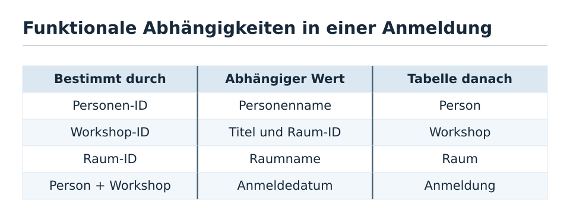

# M5-L4 – Normalisierung und Datenintegrität {#L4}

**Kursbereich:** M5 – Datenbanken und Datenmodelle

**Niveau:** Sekundarstufe II (erhöht)

**Vorwissen:** [M5-L3 – SQL-Joins, Gruppen und fehlende Werte](M5-L3.md)

**Lernziel:** Redundanz, funktionale Abhängigkeiten und schlüsselgesicherte Zerlegung analysieren.

## Derselbe Raumname in vielen Zeilen {#S1}

Bei einer Projektwoche werden Anmeldungen gespeichert. In jeder Zeile stehen der Name einer Person, der Workshop und der Raumname. Als „Studio“ in „Atelier“ umbenannt wird, ändert eine Helferin nur zwei von drei Zeilen. Wie lässt sich ein Datenmodell entwerfen, in dem diese Art von Widerspruch gar nicht erst entsteht?

## Was von welchem Schlüssel abhängt {#S2}

Eine **funktionale Abhängigkeit** `X → Y` gilt, wenn Zeilen mit gleichen Werten für `X` stets gleiche Werte für `Y` haben müssen. Sie folgt aus den Fachregeln für alle gültigen Daten, nicht aus einem zufälligen Muster in einer Stichprobe. Ein **Kandidatenschlüssel** ist eine minimale Spaltenmenge, die eine Zeile eindeutig identifiziert. Er ist minimal, wenn man keine Spalte weglassen kann.

Wir nehmen an, dass sich eine Person pro Workshop nur einmal anmeldet. Jeder Workshop hat genau einen Raum, und jede Raum-ID genau einen Namen. Spalten sind hier einwertig. Der einzige Kandidatenschlüssel der großen Tabelle ist das Paar `(student_id, workshop_id)`.

- **Erste Normalform (1NF):** Hier steht pro Zelle ein einzelner Wert, keine Liste von Workshops.
- **Zweite Normalform (2NF):** Jedes Nichtschlüsselattribut muss vom ganzen Kandidatenschlüssel abhängen, nicht bloß von einem Teil. Der Personenname hängt aber bereits von `student_id` ab und die Workshopdaten von `workshop_id`. Wir lagern sie daher aus den Anmeldungen aus.
- **Dritte Normalform (3NF):** Im verbleibenden einfachen Workshopschema hängt der Raumname von `room_id` ab und darüber mittelbar von `workshop_id`. Wir legen für den Raum eine eigene Tabelle an.

{alt="Personen-ID bestimmt den Namen, Workshop-ID bestimmt Titel und Raum-ID, Raum-ID bestimmt Raumnamen, und das Paar aus Person und Workshop bestimmt das Anmeldedatum. Die Werte stehen danach in Person, Workshop, Raum und Anmeldung."}

## Die Tabellen zerlegen und wieder verbinden {#S3}

Die Anmeldung behält ihre zwei Schlüsselspalten und das Anmeldedatum. Den Namen und den Raum lesen wir bei Bedarf per Join. Das folgende Beispiel läuft in einer frischen SQLite-Datenbank.

```sql
PRAGMA foreign_keys = ON;
CREATE TABLE student (
    student_id INTEGER PRIMARY KEY,
    student_name TEXT NOT NULL
);
CREATE TABLE room (
    room_id INTEGER PRIMARY KEY,
    room_name TEXT NOT NULL
);
CREATE TABLE workshop (
    workshop_id INTEGER PRIMARY KEY,
    workshop_title TEXT NOT NULL,
    room_id INTEGER NOT NULL REFERENCES room(room_id)
);
CREATE TABLE registration (
    student_id INTEGER NOT NULL REFERENCES student(student_id),
    workshop_id INTEGER NOT NULL REFERENCES workshop(workshop_id),
    registered_on TEXT NOT NULL,
    PRIMARY KEY (student_id, workshop_id)
);
INSERT INTO student VALUES (7, 'Kim'), (8, 'Noor');
INSERT INTO room VALUES (5, 'Studio');
INSERT INTO workshop VALUES (20, 'Sound', 5), (21, 'Light', 5);
INSERT INTO registration VALUES
    (7, 20, '2026-03-03'), (7, 21, '2026-03-03'),
    (8, 20, '2026-03-04');
UPDATE room SET room_name = 'Atelier' WHERE room_id = 5;
```

```sql
SELECT s.student_name, w.workshop_title, r.room_name
FROM registration AS a
JOIN student AS s ON a.student_id = s.student_id
JOIN workshop AS w ON a.workshop_id = w.workshop_id
JOIN room AS r ON w.room_id = r.room_id
ORDER BY a.student_id, a.workshop_id;
```

| student_name | workshop_title | room_name |
| --- | --- | --- |
| Kim | Sound | Atelier |
| Kim | Light | Atelier |
| Noor | Sound | Atelier |

Jeder Join findet für seine Kennung genau eine Zeile, weil Primärschlüssel eindeutig sind und die vorgeschriebenen Fremdschlüssel auf vorhandene Einträge verweisen. Mit den übrigen ursprünglichen Spalten im SELECT ließe sich jede ursprüngliche Anmeldung rekonstruieren.

## Selbstkontrolle {#S4}

### Aufgaben

1. Warum gehört `registered_on` in die Anmeldung und weder zur Person noch zum Workshop?
2. Was passiert im Beispiel bei einer zweiten Anmeldung von Kim für Sound? Was passiert bei einer Anmeldung für Workshop 99?

### Lösungen

1. Eine Person kann sich an verschiedenen Tagen zu verschiedenen Workshops anmelden. Mehrere Personen können denselben Workshop an verschiedenen Tagen buchen. Deshalb bestimmt erst das Paar im Modell den Tag.
2. Kim und Sound ergeben das bereits vorhandene Paar `(7, 20)`. Der zusammengesetzte Primärschlüssel weist die Wiederholung ab. Eine Anmeldung zu Workshop 99 verletzt den Fremdschlüssel, da dieser Workshop fehlt und Fremdschlüsselprüfungen aktiviert sind.

## Annahmen, Fehler und Grenzen {#S5}

Die 3NF-Erklärung behandelt diesen Fall mit einfachen Schlüsseln und Abhängigkeiten. Allgemein muss bei jeder nichttrivialen funktionalen Abhängigkeit mit einer Spalte rechts die linke Seite ein Superschlüssel sein oder die rechte Spalte zu einem Kandidatenschlüssel gehören. Ein Superschlüssel identifiziert eine Zeile eindeutig und darf zusätzliche Spalten enthalten. Veränderte Regeln, etwa mehrere Räume pro Workshop, erfordern ein angepasstes Modell. Ein SQL-Fremdschlüssel kennt die Fachlogik nur so weit, wie sie im Schema ausgedrückt ist.

## Zusammenfassung {#S6}

Zerlege die Tabelle entlang der fachlich begründeten Abhängigkeiten. Speichere den Raumnamen beim Raum und die Anmeldung beim vollständigen Anmeldeschlüssel. Schlüssel und Fremdschlüssel ermöglichen es, die verteilten Angaben wieder eindeutig zusammenzuführen.

## Quellen und weiterführende Hinweise {#S7}

### Weiterführend (intern)

- [M6-L1 – Klassen, Objekte und Schnittstellen](M6-L1.md)

### Quellen (extern)

- [Senatsverwaltung für Bildung, Jugend und Familie Berlin – Rahmenlehrplan für die gymnasiale Oberstufe – Informatik, Teil C](https://www.berlin.de/sen/bildung/unterricht/faecher-rahmenlehrplaene/rahmenlehrplaene/rahmenlehrplan-informatik-go-teil-c.pdf?ts=1705017673) · Bezug zur Lektion: §3.2 · Redundanz, funktionale Abhängigkeiten und schlüsselgesicherte Zerlegung analysieren · Zuletzt abgerufen: 2026-11-22 · Inhaltlich geprüft: 2026-11-22
- [SQLite – SQLite Foreign Key Support](https://www.sqlite.org/foreignkeys.html) · Bezug zur Lektion: Foreign key support · Redundanz, funktionale Abhängigkeiten und schlüsselgesicherte Zerlegung analysieren · Zuletzt abgerufen: 2026-11-22 · Inhaltlich geprüft: 2026-11-22
- [Sibel Adalı, Rensselaer Polytechnic Institute – CSCI 4380 Database Systems: Lecture 5 Normalization](https://www.cs.rpi.edu/~sibel/csci4380/fall2026/lecture_notes/lecture5.html) · Bezug zur Lektion: Formal Definition, BCNF and 3NF · Redundanz, funktionale Abhängigkeiten und schlüsselgesicherte Zerlegung analysieren · Zuletzt abgerufen: 2026-11-22 · Inhaltlich geprüft: 2026-11-22
