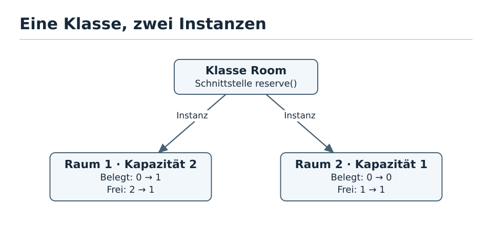

# M6-L1 – Klassen, Objekte und Schnittstellen {#L1}

**Kursbereich:** M6 – Objekte, Algorithmen und Datenstrukturen

**Niveau:** Sekundarstufe II (grundlegend)

**Vorwissen:** [M3-L5 – Testfälle und Fehlersuche](M3-L5.md)

**Lernziel:** Zustand, Verhalten, Instanz und Schnittstelle am Objektmodell unterscheiden.

## Zwei Räume, eine Regel {#S1}

Für den Informatiktag können sich Gruppen für zwei Arbeitsräume anmelden. In Raum 1 gibt es zwei Plätze und in Raum 2 einen. Beide Räume folgen derselben Regel: Ist kein Platz frei, wird eine weitere Anmeldung abgelehnt. Die Räume sollen unabhängig voneinander reagieren. Wenn sich jemand für Raum 1 anmeldet, bleibt die Verfügbarkeit in Raum 2 gleich. Wie lässt sich die gemeinsame Regel einmal schreiben und dann für beide Räume verwenden?

## Klasse, Instanz und Schnittstelle {#S2}

Eine **Klasse** beschreibt in diesem Modell, welche Daten und Operationen zu einer Raumbelegung gehören. Ein konkretes **Objekt**, auch **Instanz** der Klasse genannt, besitzt eigene Werte. Sein **Zustand** umfasst hier die Kapazität und die Anzahl belegter Plätze. Sein **Verhalten** besteht aus den zulässigen Operationen, mit denen sich der Zustand abfragen oder ändern lässt.

Die **Schnittstelle** ist die Vereinbarung, auf die sich der aufrufende Code verlassen darf. Eine Anfrage über `free` liefert die Zahl freier Plätze. `reserve()` liefert `True` und belegt einen freien Platz oder liefert `False` und lässt den Zustand unverändert. Die interne Darstellung lässt sich ändern, solange das zugesagte Verhalten erhalten bleibt.

{alt="Aus Room entstehen Raum 1 mit zwei Plätzen und Raum 2 mit einem Platz. Nach einer Reservierung in Raum 1 ist dort ein Platz belegt und in Raum 2 keiner."}

Eine **Invariante** ist eine Bedingung, die nach dem Erzeugen des Objekts und nach jeder abgeschlossenen Operation gilt. Hier bleibt die Belegung stets zwischen null und der jeweiligen Kapazität. **Kapselung** bedeutet hier, die Veränderung der Belegung über die definierte Operation zu organisieren. So wird die Regel an einer Stelle geprüft.

## Den Zustandswechsel ausführen {#S3}

`Room(2)` erzeugt eine neue Instanz und übergibt die Kapazität `2` an `__init__`. Python bezieht `self` in den Methoden jeweils auf die konkrete Instanz. `@property` erlaubt es, `free` wie einen Wert zu lesen, obwohl er aus zwei gespeicherten Werten berechnet wird.

```python
class Room:
    def __init__(self, capacity):
        if type(capacity) is not int or capacity < 1:
            raise ValueError("capacity must be a positive integer")
        self._capacity = capacity
        self._booked = 0

    @property
    def free(self):
        return self._capacity - self._booked

    def reserve(self):
        if self.free == 0:
            return False
        self._booked += 1
        return True


first = Room(2)
second = Room(1)
assert (first.free, second.free) == (2, 1)
assert first.reserve() is True
assert (first.free, second.free) == (1, 1)
assert first.reserve() is True
assert (first.free, second.free) == (0, 1)
assert first.reserve() is False
assert (first.free, second.free) == (0, 1)
```

Vor der ersten Anmeldung ist die Belegung in Raum 1 null. Die ersten beiden Aufrufe erhöhen sie auf eins und zwei. Beim dritten Aufruf ist `free` gleich null. Dadurch endet die Methode vor der Zuweisung. In Raum 2 bleibt die Belegung während des gesamten Ablaufs null.

## Selbstkontrolle {#S4}

### Aufgaben

1. Starte mit den beiden Räumen nach dem Beispiel und rufe `second.reserve()` zweimal auf. Gib Rückgaben und freie Plätze an.
2. Entwirf eine Schnittstelle für eine Stornierung. Welche Vorbedingung braucht sie, damit die Invariante gilt?
3. Nach `alias = first` wird über `first` ein Platz storniert. Was muss `alias.free` anschließend anzeigen, wenn die Stornierung Erfolg hat?

### Lösungen

1. Der erste Aufruf liefert `True`, der zweite `False`. Beide Räume haben anschließend null freie Plätze. Nur der erste Aufruf ändert Raum 2.
2. `cancel()` kann `True` zurückgeben und die Belegung um eins senken, wenn mindestens ein Platz belegt ist. Bei Belegung null liefert die Methode `False` und ändert nichts.
3. `alias.free` zeigt einen freien Platz. Die Zuweisung erzeugt keine zweite Instanz und beide Namen bezeichnen dasselbe Objekt.

## Fehler und Grenzen {#S5}

Der Unterstrich bei `_booked` signalisiert in Python internen Gebrauch. Direkte Zuweisungen von außen bleiben technisch möglich und können die Invariante verletzen. Das Beispiel nimmt Aufrufe nacheinander an. Bei gleichzeitigen Anfragen brauchen Prüfung und Änderung eine geeignete Synchronisation. Für namentliche Buchungen oder ein Zeitraster reichen zwei Zahlen als Zustand nicht aus.

## Zusammenfassung {#S6}

Eine Klasse bündelt gemeinsame Regeln und jede neue Instanz besitzt ihren eigenen Zustand. Eine überprüfbare Schnittstelle legt Rückgaben und Wirkungen fest. Prüfe bei jeder zustandsändernden Methode den erfolgreichen Fall und mindestens einen Grenzfall, bei dem der Zustand unverändert bleiben soll.

## Quellen und weiterführende Hinweise {#S7}

### Weiterführend (intern)

- [M6-L2 – Lineare und binäre Suche](M6-L2.md)

### Quellen (extern)

- [Gesellschaft für Informatik e. V. – Bildungsstandards Informatik für die Sekundarstufe II](https://informatikstandards.de/fileadmin/GI/Projekte/Informatikstandards/Dokumente/Bildungsstandards_SII.pdf) · Bezug zur Lektion: §3.2.2 · Zustand, Verhalten, Instanz und Schnittstelle am Objektmodell unterscheiden · Zuletzt abgerufen: 2026-11-22 · Inhaltlich geprüft: 2026-11-22
- [Python Software Foundation – Python Tutorial – Classes](https://docs.python.org/3.13/tutorial/classes.html) · Bezug zur Lektion: §9.3 · Zustand, Verhalten, Instanz und Schnittstelle am Objektmodell unterscheiden · Zuletzt abgerufen: 2026-11-22 · Inhaltlich geprüft: 2026-11-22
