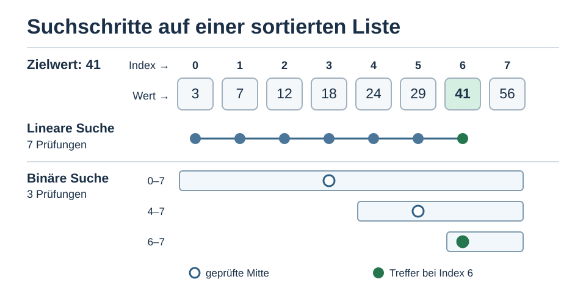

# M6-L2 – Lineare und binäre Suche {#L2}

**Kursbereich:** M6 – Objekte, Algorithmen und Datenstrukturen

**Niveau:** Sekundarstufe II (grundlegend)

**Vorwissen:** [M3-L5 – Testfälle und Fehlersuche](M3-L5.md)

**Lernziel:** Suchinvarianten und Vorbedingungen vergleichen, logische Schritte zählen.

## Welche Einträge muss man prüfen? {#S1}

In einer Liste stehen die Nummern der abgegebenen Materialkisten. Eine bestimmte Nummer kann vorkommen, sie kann aber auch fehlen. Ohne zugesicherte Ordnung liest man die Einträge von vorn und hält beim ersten Treffer an. Wenn die Liste aufsteigend sortiert ist, kann ein Vergleich in der Mitte stattdessen einen großen Teil der verbleibenden Positionen ausschließen.

## Zwei Suchverfahren und ihre Invarianten {#S2}

Die **lineare Suche** prüft einen Eintrag nach dem anderen. Vor dem Prüfen von Position `i` gilt: Der Zielwert stand an keiner früheren Position. Beim Erreichen des Endes ist der Nichtfund begründet. Diese **Invariante**, also eine zu jedem Prüfschritt erneut gültige Aussage, braucht keine Sortierung.

Die **binäre Suche** arbeitet hier mit einem geschlossenen Suchintervall `lo` bis `hi`, einschließlich beider Grenzen. Vor jedem Schritt gilt: Wenn der Zielwert überhaupt vorhanden ist, enthält das Intervall mindestens einen Treffer. Ist der mittlere Wert kleiner als das Ziel, können die Mitte und alle Positionen links davon ausgeschlossen werden. Ist er größer, werden Mitte und rechter Teil ausgeschlossen. Diese Folgerung setzt voraus, dass die Werte aufsteigend sortiert sind. Ist `lo > hi`, ist das Intervall leer.

{alt="Für Ziel 41 prüft die lineare Suche die Indizes 0 bis 6. Die binäre Suche betrachtet nacheinander die Intervalle 0 bis 7, 4 bis 7 und 6 bis 7 mit den Mittelpunkten 3, 5 und 6."}

Gezählt werden im Beispiel **geprüfte Listenpositionen**. Ein solcher Schritt kann in Python mehr als einen Vergleichsoperator verwenden. Für Listen mit direktem Indexzugriff wächst die Zahl der Prüfungen im schlechtesten Fall linear oder logarithmisch mit der Länge `n`. Man schreibt dafür $O(n)$ bzw. $O(\log n)$. Beim linearen Verfahren kann jeder Eintrag nötig sein. Beim binären Verfahren bleibt nach einem erfolglosen Schritt höchstens ungefähr die Hälfte der Kandidaten übrig.

## Treffer und Nichtfund verfolgen {#S3}

Die Liste `[3, 7, 12, 18, 24, 29, 41, 56]` hat die Indizes 0 bis 7. Für 41 liest die lineare Suche die sieben Positionen 0 bis 6. Die binäre Suche folgt diesen Intervallen:

| Intervall | Mitte | Wert | Ergebnis |
| --- | --- | --- | --- |
| 0–7 | 3 | 18 | Weiter in 4–7 |
| 4–7 | 5 | 29 | Weiter in 6–7 |
| 6–7 | 6 | 41 | Treffer |

Bei Zielwert 20 prüft die binäre Suche 18, 29 und 24. Nach dem letzten Test ist das Intervall 4 bis 3 leer. Beide Funktionen liefern einen Index bei Erfolg, sonst `None`, jeweils zusammen mit der Zahl geprüfter Positionen.

```python
def linear_search(values, goal):
    for i, value in enumerate(values):
        if value == goal:
            return i, i + 1
    return None, len(values)


def binary_search(values, goal):
    lo, hi = 0, len(values) - 1
    probes = 0
    while lo <= hi:
        mid = (lo + hi) // 2
        value = values[mid]
        probes += 1
        if value == goal:
            return mid, probes
        if value < goal:
            lo = mid + 1
        else:
            hi = mid - 1
    return None, probes


values = [3, 7, 12, 18, 24, 29, 41, 56]
assert linear_search(values, 41) == (6, 7)
assert binary_search(values, 41) == (6, 3)
assert linear_search(values, 20) == (None, 8)
assert binary_search(values, 20) == (None, 3)
assert binary_search([], 20) == (None, 0)
```

## Selbstkontrolle {#S4}

### Aufgaben

1. Suche 56 binär. Nenne die geprüften Werte und den Rückgabewert.
2. Zeige mit `[2, 9, 4]` und dem Zielwert 4, warum die Vorbedingung der binären Suche wichtig ist.
3. Wie unterscheiden sich die Zusagen beider Implementierungen für mehrfach vorkommende Zielwerte?

### Lösungen

1. Geprüft werden 18, 29, 41 und 56. Die Rückgabe ist `(7, 4)`.
2. Die Mitte 9 verwirft den rechten Teil einschließlich der tatsächlichen Fundstelle. Nach der Prüfung von 2 endet die binäre Suche mit `(None, 2)`. Linear ergibt sich `(2, 3)`.
3. Die lineare Suche liefert den ersten passenden Index. Die gezeigte binäre Suche liefert irgendeinen passenden Index, der von den gewählten Mittelpunkten abhängt.

## Fehler und Grenzen {#S5}

Nach einem Nichttreffer muss die Mitte ausgeschlossen werden. Mit `lo = mid` könnte die obere Hälfte nicht kleiner werden, etwa bei nur einem Kandidaten. Für eine unsortierte Liste kostet das Vorsortieren zusätzliche Arbeit und kann die ursprünglichen Positionsnummern ändern. Ein Index `0` ist ein gültiger Treffer. Der Fundstatus lässt sich daher mit `index is not None` prüfen.

## Zusammenfassung {#S6}

Lineare Suche braucht keine Ordnung. Binäre Suche nutzt eine Sortiergarantie sowie direkten Positionszugriff und schränkt das Intervall nach jeder erfolglosen Prüfung ein. Für einen Vergleich beider Verfahren gehören Suchziel, Rückgabevertrag und Zählgröße ausdrücklich zum Experiment.

## Quellen und weiterführende Hinweise {#S7}

### Weiterführend (intern)

- [M6-L3 – Sortieren, Korrektheit und Aufwand](M6-L3.md)

### Quellen (extern)

- [Gesellschaft für Informatik e. V. – Bildungsstandards Informatik für die Sekundarstufe II](https://informatikstandards.de/fileadmin/GI/Projekte/Informatikstandards/Dokumente/Bildungsstandards_SII.pdf) · Bezug zur Lektion: §3.2.2 · Suchinvarianten und Vorbedingungen vergleichen, logische Schritte zählen · Zuletzt abgerufen: 2026-11-22 · Inhaltlich geprüft: 2026-11-22
- [Senatsverwaltung für Bildung, Jugend und Familie Berlin – Rahmenlehrplan für die gymnasiale Oberstufe – Informatik, Teil C](https://www.berlin.de/sen/bildung/unterricht/faecher-rahmenlehrplaene/rahmenlehrplaene/rahmenlehrplan-informatik-go-teil-c.pdf?ts=1705017673) · Bezug zur Lektion: §4 · Suchinvarianten und Vorbedingungen vergleichen, logische Schritte zählen · Zuletzt abgerufen: 2026-11-22 · Inhaltlich geprüft: 2026-11-22
