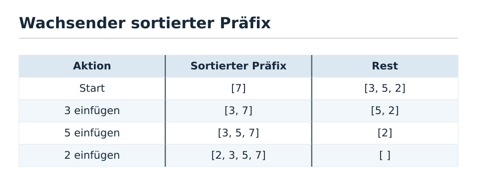

# M6-L3 – Sortieren, Korrektheit und Aufwand {#L3}

**Kursbereich:** M6 – Objekte, Algorithmen und Datenstrukturen

**Niveau:** Sekundarstufe II (grundlegend)

**Vorwissen:** [M6-L2 – Lineare und binäre Suche](M6-L2.md)

**Lernziel:** Einfügesortierung schrittweise analysieren und quadratischen Aufwand begründen.

## Aus einer unsortierten Reihe eine geordnete machen {#S1}

Beim Ablegen von Karteikarten kannst du eine Karte aus dem noch unsortierten Stapel nehmen und an die passende Stelle der bereits geordneten Karten schieben. Eine Liste lässt sich nach demselben Prinzip sortieren. Bei der **Einfügesortierung** wächst der geordnete Anfang von links nach rechts.

## Der sortierte Präfix {#S2}

Ein **Präfix** ist ein zusammenhängendes Anfangsstück einer Liste. Unmittelbar vor Runde `i` ist der Präfix an den Positionen `0` bis `i - 1` aufsteigend sortiert und enthält genau die bisherigen Elemente. Das ist die Schleifeninvariante. Vor der ersten Runde besteht dieser Präfix aus einer Position. Ein einzelnes Element ist bereits sortiert.

Die Runde speichert den neuen Wert an Position `i` zwischen. Größere Werte des Präfixes werden von rechts nach links um eine Position nach rechts verschoben. In die frei gewordene Position kommt der gespeicherte Wert. Da alle weiter links verbleibenden Werte höchstens so groß sind wie der neue Wert, ist der erweiterte Präfix sortiert. Das Zwischenspeichern verhindert, dass beim Verschieben ein Element verloren geht. Nach der letzten Runde umfasst der Präfix die gesamte Liste. Damit sind Ordnung und Erhalt der Elemente begründet.

{alt="Der Präfix wächst von 7 über 3 und 7 zu 3, 5 und 7. Nach dem letzten Schritt lautet die gesamte Liste 2, 3, 5 und 7."}

Die Zahl der Verschiebungen hängt von der Eingabe ab. Bei einer schon sortierten Liste prüft jede Runde den unmittelbaren Nachbarn und verschiebt nichts. Bei streng absteigender Eingabe muss die Runde `i` alle `i` bisherigen Werte verschieben. Für `n` Einträge ergeben sich $1 + 2 + \cdots + (n-1) = n(n-1)/2$ Verschiebungen. Das Wachstum im schlechtesten Fall ist quadratisch, also $O(n^2)$.

## Einfügen und Schritte nachzählen {#S3}

Für `[7, 3, 5, 2]` beginnt der geordnete Abschnitt mit `[7]`. Dann läuft die Sortierung wie folgt:

| Neuer Wert | Präfix danach | Verschiebungen | Wertvergleiche |
| --- | --- | --- | --- |
| 3 | [3, 7] | 1 | 1 |
| 5 | [3, 5, 7] | 1 | 2 |
| 2 | [2, 3, 5, 7] | 3 | 3 |

Beim Einfügen von 5 wird zunächst 7 verschoben. Der zweite Wertvergleich mit 3 beendet die Suche nach der Einfügeposition. Gezählt werden nur Vergleiche zweier Listenwerte, keine Indexprüfungen. Das Python-Beispiel arbeitet auf einer Kopie der übergebenen Liste.

```python
def insertion_sort(values):
    items = values.copy()
    comparisons = shifts = 0
    for i in range(1, len(items)):
        value = items[i]
        j = i
        while j > 0:
            comparisons += 1
            if items[j - 1] <= value:
                break
            items[j] = items[j - 1]
            shifts += 1
            j -= 1
        items[j] = value
    return items, shifts, comparisons


values = [7, 3, 5, 2]
assert insertion_sort(values) == ([2, 3, 5, 7], 5, 6)
assert values == [7, 3, 5, 2]
assert insertion_sort([]) == ([], 0, 0)
assert insertion_sort([1, 2, 3, 4]) == ([1, 2, 3, 4], 0, 3)
assert insertion_sort([4, 3, 2, 1]) == ([1, 2, 3, 4], 6, 6)
```

## Selbstkontrolle {#S4}

### Aufgaben

1. Wende die Sortierung auf `[4, 1, 3]` an. Gib beide neuen Präfixe sowie die Gesamtzahl der Verschiebungen und Wertvergleiche an.
2. Weshalb enthält das Ergebnis genau dieselben Elemente wie die Eingabe? Warum reicht ein aufsteigender Ergebnis-Test allein nicht?
3. Zwei beschriftete Karten A und B haben denselben Sortierschlüssel 5. A kommt zuerst. Was folgt aus der Abbruchbedingung für ihre Reihenfolge?

### Lösungen

1. Die Präfixe sind `[1, 4]` und `[1, 3, 4]`. Die Runden brauchen je eine Verschiebung und 1 bzw. 2 Vergleiche. Insgesamt sind es 2 Verschiebungen und 3 Vergleiche.
2. Jede Runde speichert das aktuelle Element, verschiebt andere Elemente in die Lücke und setzt das gespeicherte Element wieder ein. Eine aufsteigende Folge wie `[1, 1, 1]` erfüllt die Ordnung und kann trotzdem falsche Elemente enthalten.
3. A bleibt vor B. Bei Gleichheit endet die Verschiebung. Dieser Erhalt der Reihenfolge gleicher Schlüssel heißt **Stabilität**. Für beschriftete Karten müsste eine Umsetzung die Schlüssel vergleichen.

## Fehler und Grenzen {#S5}

Vergleiche und Verschiebungen tragen unterschiedlich zum Aufwand bei. Eine Verschiebung bedeutet hier eine Zuweisung aus dem sortierten Präfix. Die abschließende Zuweisung des zwischengespeicherten Werts ist separat und wird im Beispiel nicht mitgezählt. Weil die Funktion am Anfang kopiert, braucht sie zusätzlichen Speicher für die Ergebnisliste.

## Zusammenfassung {#S6}

Die Einfügesortierung erhält einen sortierten Präfix und verlängert ihn um je einen Eintrag. Aus der Invariante folgt Korrektheit, aus der Summe der Verschiebungen im ungünstigsten Fall der quadratische Aufwand. Auf der so sortierten Liste ist [binäre Suche](M6-L2.md) möglich.

## Quellen und weiterführende Hinweise {#S7}

### Weiterführend (intern)

- [M6-L4 – Rekursion, Stapel und Warteschlangen](M6-L4.md)

### Quellen (extern)

- [Gesellschaft für Informatik e. V. – Bildungsstandards Informatik für die Sekundarstufe II](https://informatikstandards.de/fileadmin/GI/Projekte/Informatikstandards/Dokumente/Bildungsstandards_SII.pdf) · Bezug zur Lektion: §3.2.2 · Einfügesortierung schrittweise analysieren und quadratischen Aufwand begründen · Zuletzt abgerufen: 2026-11-22 · Inhaltlich geprüft: 2026-11-22
- [Rheinland-Pfalz, Lehrplan Informatik für Grund- und Leistungsfach in der Mainzer Studienstufe – Lehrplan Informatik – Grund- und Leistungsfach, gymnasiale Oberstufe](https://bildung.rlp.de/fileadmin/user_upload/informatik.bildung.rlp.de/Lehrplaene/Informatik_LP_SekII.pdf) · Bezug zur Lektion: §3.4, S. 54–55 · Einfügesortierung schrittweise analysieren und quadratischen Aufwand begründen · Zuletzt abgerufen: 2026-11-22 · Inhaltlich geprüft: 2026-11-22
