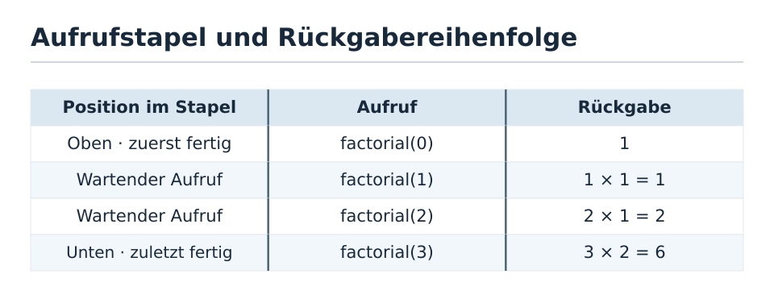

# M6-L4 – Rekursion, Stapel und Warteschlangen {#L4}

**Kursbereich:** M6 – Objekte, Algorithmen und Datenstrukturen

**Niveau:** Sekundarstufe II (grundlegend)

**Vorwissen:** [M6-L3 – Sortieren, Korrektheit und Aufwand](M6-L3.md)

**Lernziel:** Basisfall und rekursiven Fortschritt mit LIFO- und FIFO-Schnittstellen verbinden.

## Ein Problem schrittweise verkleinern {#S1}

Wie viele verschiedene Reihenfolgen gibt es für drei verschiedene Robotermodelle? Für den ersten Platz stehen drei Modelle zur Wahl. Nach dieser Wahl bleiben zwei Modelle, deren Reihenfolgen auf dieselbe Art gezählt werden können. Jede Wahl verkleinert die Aufgabe. Die entscheidende Frage ist, bei welcher Eingabe man sofort antworten kann.

## Rekursion, Stapel und Warteschlange {#S2}

Bei **Rekursion** ruft eine Funktion sich für eine kleinere Teilaufgabe erneut auf. Der **Basisfall** liefert unmittelbar ein Ergebnis. Der rekursive Schritt muss bei gültigen Eingaben tatsächlich in Richtung Basisfall fortschreiten. Für die Zahl der Reihenfolgen heißt die Regel $n! = n \cdot (n-1)!$ für $n>0$. Die leere Reihe hat genau eine Anordnung. Damit gilt $0!=1$.

Ein noch nicht abgeschlossener Aufruf behält seine lokalen Werte und die Stelle, an der er fortfahren soll. Um Funktionsaufrufe zu verfolgen, kann man diese Einträge als **Aufrufstapel** darstellen. Der zuletzt hinzugekommene Aufruf wird zuerst abgeschlossen und entfernt. Dieses Prinzip heißt LIFO (*last in, first out*). Bei einer **Warteschlange** wird zuerst das am längsten wartende Element entnommen. Das ist FIFO (*first in, first out*).

{alt="Die Aufrufe beginnen mit 3 und folgen über 2 und 1 bis 0. Danach werden von oben nach unten die Werte 1, 1, 2 und 6 zurückgegeben."}

Ein **abstrakter Datentyp** beschreibt die angebotenen Operationen und ihre Zusagen, unabhängig von der Speicherung. Ein Stapel hat beispielsweise die Operationen Ablegen und Entnehmen am selben Ende. Bei einer FIFO-Warteschlange werden Elemente hinten angefügt und vorn entnommen. Eine Python-Liste kann einen Stapel realisieren. Wird sie als Warteschlange verwendet, kann das Entnehmen am Anfang aber das Verschieben vieler Einträge kosten. Für häufiges Entnehmen an beiden Enden bietet Python `collections.deque`.

## Aufrufe und Rückgaben verfolgen {#S3}

`factorial(3)` wartet auf `factorial(2)`, dieser Aufruf auf `factorial(1)` und dieser auf `factorial(0)`. Auf dem Stapel sind dann von unten nach oben die Argumente 3, 2, 1 und 0. Der oberste Aufruf gibt 1 zurück. Danach liefern die wartenden Aufrufe nacheinander $1\cdot1=1$, $2\cdot1=2$ und $3\cdot2=6$.

```python
from collections import deque


def factorial(n):
    if type(n) is not int or n < 0:
        raise ValueError("n must be a nonnegative integer")
    if n == 0:
        return 1
    return n * factorial(n - 1)


assert factorial(0) == 1
assert factorial(3) == 6
assert factorial(5) == 120

stack = ["A", "B"]
stack.append("C")
assert stack.pop() == "C"
assert stack == ["A", "B"]

queue = deque(["A", "B"])
queue.append("C")
assert queue.popleft() == "A"
assert list(queue) == ["B", "C"]
```

Beide Speicher beginnen mit A vor B und nehmen C hinzu. Der Stapel entnimmt danach C. Die Warteschlange entnimmt A. Die Vorstellung „oben“ beim Aufrufstapel bezeichnet die Seite, an der neue Aufrufe hinzugefügt werden.

## Selbstkontrolle {#S4}

### Aufgaben

1. Schreibe die Argumente der Aufrufe für `factorial(2)` und die Rückgabewerte in zeitlicher Reihenfolge auf.
2. In einer leeren Warteschlange kommen A und B an. Ein Auftrag wird entfernt. Dann kommt C an und ein weiterer Auftrag wird entfernt. Gib die beiden entnommenen Aufträge und den Rest an. Wiederhole den Ablauf für einen Stapel.
3. Eine fehlerhafte Funktion verwendet beim rekursiven Aufruf `factorial(n + 1)`. Warum hilft ihr korrekt formulierter Basisfall für positive Startwerte nicht?

### Lösungen

1. Die Aufrufe haben die Argumente 2, 1, 0. In dieser Zeitfolge gehen die Rückgaben 1 aus dem Aufruf mit 0, 1 aus dem Aufruf mit 1 und 2 aus dem Aufruf mit 2 zurück.
2. FIFO entnimmt A und B. C bleibt übrig. LIFO entnimmt zuerst B und nach dem Hinzufügen C. A bleibt übrig.
3. Das Argument wächst statt gegen null zu sinken. Der Basisfall wird nie erreicht. In Python wird ein solcher Aufruf schließlich an der Grenze der Aufruftiefe scheitern.

## Fehler und Grenzen {#S5}

Auch korrekte Rekursion kann bei großen Eingaben Pythons Rekursionstiefengrenze erreichen. Für die Fakultät genügt alternativ eine Schleife mit einem laufenden Produkt. Große ganze Zahlen können auch bei der Schleifenfassung Rechenzeit und Speicher beanspruchen. Für einen leeren Stapel oder eine leere Warteschlange muss eine Schnittstelle außerdem festlegen, wie ein Entnahmeversuch behandelt wird. `pop()` bzw. `popleft()` lösen hier `IndexError` aus.

## Zusammenfassung {#S6}

Prüfe bei Rekursion den Basisfall, den Fortschritt und die Verknüpfung des Teilergebnisses. Beim Aufrufstapel wird der jüngste Aufruf zuerst abgeschlossen. Eine FIFO-Warteschlange entnimmt dagegen den ältesten wartenden Eintrag. Diese Ordnung bestimmt in der [Breitensuche](M6-L5.md), welche Knoten als Nächstes untersucht werden.

## Quellen und weiterführende Hinweise {#S7}

### Weiterführend (intern)

- [M6-L5 – Bäume, Graphen und Breitensuche](M6-L5.md)

### Quellen (extern)

- [Gesellschaft für Informatik e. V. – Bildungsstandards Informatik für die Sekundarstufe II](https://informatikstandards.de/fileadmin/GI/Projekte/Informatikstandards/Dokumente/Bildungsstandards_SII.pdf) · Bezug zur Lektion: §3.2.2 · Basisfall und rekursiven Fortschritt mit LIFO- und FIFO-Schnittstellen verbinden · Zuletzt abgerufen: 2026-11-22 · Inhaltlich geprüft: 2026-11-22
- [Bayern – Staatsinstitut für Schulqualität und Bildungsforschung (ISB) – LehrplanPLUS Gymnasium 12 – Informatik, grundlegendes Niveau](https://www.lehrplanplus.bayern.de/fachlehrplan/gymnasium/12/informatik/grundlegend) · Bezug zur Lektion: Inf12 LB1–3 · Basisfall und rekursiven Fortschritt mit LIFO- und FIFO-Schnittstellen verbinden · Zuletzt abgerufen: 2026-11-22 · Inhaltlich geprüft: 2026-11-22
- [Rheinland-Pfalz, Lehrplan Informatik für Grund- und Leistungsfach in der Mainzer Studienstufe – Lehrplan Informatik – Grund- und Leistungsfach, gymnasiale Oberstufe](https://bildung.rlp.de/fileadmin/user_upload/informatik.bildung.rlp.de/Lehrplaene/Informatik_LP_SekII.pdf) · Bezug zur Lektion: §3.4 · Basisfall und rekursiven Fortschritt mit LIFO- und FIFO-Schnittstellen verbinden · Zuletzt abgerufen: 2026-11-22 · Inhaltlich geprüft: 2026-11-22
