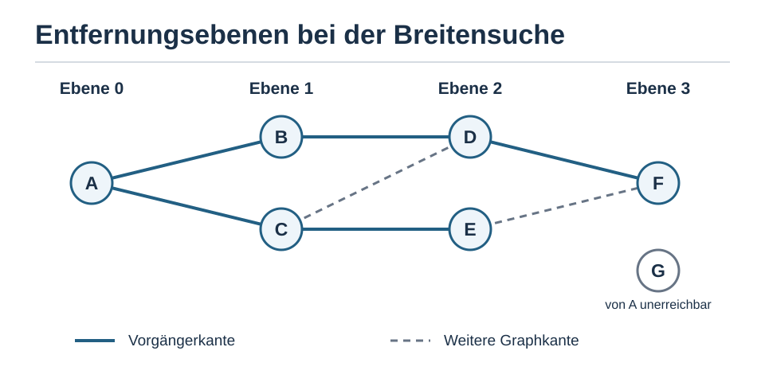

# M6-L5 – Bäume, Graphen und Breitensuche {#L5}

**Kursbereich:** M6 – Objekte, Algorithmen und Datenstrukturen

**Niveau:** Sekundarstufe II (erhöht)

**Vorwissen:** [M6-L4 – Rekursion, Stapel und Warteschlangen](M6-L4.md)

**Lernziel:** Graphen darstellen und kürzeste ungewichtete Wege per Breitensuche erklären.

## Wenige Übergänge finden {#S1}

Eine Skizze des Schulgeländes zeigt Orte und direkte Fußwege. Vom Eingang A sollen möglichst wenige Wegstücke bis zum Raum F zurückgelegt werden. Eine Suche kann zuerst die direkten Nachbarn von A prüfen und erst danach die Orte in zwei oder mehr Schritten. Dadurch braucht sie auf der Skizze keine Längenangaben. Die Aufgabe zählt Übergänge.

## Graph, Baum und Entfernungsebenen {#S2}

Ein **Graph** besteht aus **Knoten**, hier Orten, und **Kanten**, hier Verbindungen. Sind alle Wege in beide Richtungen nutzbar, ist der Graph ungerichtet. Eine **Nachbarschaftsliste** speichert für jeden Knoten, welche anderen Knoten direkt erreichbar sind. In einer ungerichteten Darstellung wird jede Verbindung bei beiden Endpunkten eingetragen.

Ein **Baum** ist ein zusammenhängender ungerichteter Graph ohne Zyklus. Zwischen zwei seiner Knoten gibt es genau einen einfachen Weg, der keinen Knoten wiederholt. Bei der **Breitensuche** entsteht aus einem allgemeinen Graphen ein Baum der vom Start erreichbaren Knoten. Jeder neu erreichte Knoten erhält genau einen Vorgänger, auch **Elternknoten** genannt. Die eingezeichneten Ursprungskanten des Graphen können zusätzliche Verbindungen und Zyklen enthalten.

{alt="A steht in Ebene 0, B und C in Ebene 1, D und E in Ebene 2 und F in Ebene 3. Durchgehende Kanten verbinden A mit B und C, B mit D, C mit E sowie D mit F. Die Zusatzkanten C–D und E–F sind gestrichelt. G bleibt unerreichbar."}

Die Suche speichert entdeckte Knoten in einer FIFO-Warteschlange. Startknoten A eröffnet Ebene 0. Beim Entnehmen eines Knotens auf Ebene $d$ werden seine unentdeckten Nachbarn markiert und als Ebene $d+1$ hinten angefügt. Sie warten damit hinter allen verbleibenden Knoten der Ebene $d$. So wird jede Ebene vollständig bearbeitet, bevor die nächste an die Reihe kommt. Für einen erstmals auf Ebene $d+1$ gefundenen Knoten gibt es einen Weg mit $d+1$ Kanten über seinen Vorgänger. Gäbe es einen kürzeren Weg, hätte dessen vorletzter Knoten den Fund schon aus einer früheren Ebene ausgelöst. Darum entspricht die Ebene der kleinsten Kantenzahl vom Start.

## Besuchsreihenfolge und Weg ableiten {#S3}

Die Reihenfolge der Nachbarn entspricht hier der Reihenfolge in den Listen. Neue Knoten werden beim **Anfügen** markiert. Damit kommt D nur einmal in die Warteschlange, auch wenn B und C beide nach D führen.

| Entnommen | Neu entdeckt | Warteschlange danach |
| --- | --- | --- |
| A | B, C | B, C |
| B | D | C, D |
| C | E | D, E |
| D | F | E, F |
| E | keine | F |
| F | keine | leer |

```python
from collections import deque


def breadth_first(graph, start):
    parents = {start: None}
    order = []
    queue = deque([start])
    while queue:
        node = queue.popleft()
        order.append(node)
        for neighbor in graph[node]:
            if neighbor not in parents:
                parents[neighbor] = node
                queue.append(neighbor)
    return parents, order


def path_to(parents, target):
    if target not in parents:
        return None
    path = []
    while target is not None:
        path.append(target)
        target = parents[target]
    return path[::-1]


graph = {
    "A": ["B", "C"],
    "B": ["A", "D"],
    "C": ["A", "D", "E"],
    "D": ["B", "C", "F"],
    "E": ["C", "F"],
    "F": ["D", "E"],
    "G": [],
}
parents, order = breadth_first(graph, "A")
assert order == ["A", "B", "C", "D", "E", "F"]
assert path_to(parents, "F") == ["A", "B", "D", "F"]
assert path_to(parents, "A") == ["A"]
assert path_to(parents, "G") is None
```

Von F führen die Vorgänger rückwärts zu D, B und A. Umgedreht ergibt sich A–B–D–F mit drei Kanten. G ist im Beispiel ein einzelner Knoten ohne Verbindung zum übrigen Graphen. Er taucht im Ergebnis der Suche ab A nicht auf.

## Selbstkontrolle {#S4}

### Aufgaben

1. Beginne bei B. Gib die Entnahmereihenfolge sowie den gefundenen Weg von B nach F an.
2. Vertausche nur in der Nachbarschaftsliste von A die Reihenfolge von B und C. Welcher Weg zu F entsteht, und was bleibt gleich?
3. Welche Zusatzangabe könnte die kürzeste Strecke von A nach F vom Weg mit den wenigsten Kanten unterscheiden?

### Lösungen

1. Die Reihenfolge lautet B, A, D, C, F, E. D wird direkt von B angefügt und entdeckt später F. Der Weg B–D–F hat zwei Kanten.
2. A stellt jetzt C vor B an. C entdeckt D vor B und entdeckt E im selben Schritt. D wird vor E entnommen und entdeckt F zuerst. Der Weg A–C–D–F hat weiterhin drei Kanten.
3. Werden Weglängen oder Zeiten als Kantengewichte angegeben, kann ein Weg mit mehr Kanten eine kleinere Gesamtlänge oder Fahrzeit haben. Die ungewichtete Breitensuche garantiert dort nur die minimale Kantenzahl.

## Fehler und Grenzen {#S5}

Spätes Markieren beim Entnehmen kann zu doppelten Einträgen in der Warteschlange führen. Hier verhindert der sofortige Eintrag in `parents` das auch bei Zyklen. Die Implementierung erwartet, dass der Start und jeder genannte Nachbar als Schlüssel vorhanden sind. Die Knotennamen sind Zeichenketten. `None` kennzeichnet ausschließlich den fehlenden Vorgänger des Startknotens. Bei Nachbarschaftslisten und im Mittel schnellen Wörterbuchzugriffen sind Zeit und Speicher nachvollziehbar: Die Suche besucht jeden erreichbaren Knoten einmal und betrachtet jeden zugehörigen Nachbarschaftseintrag einmal. Die Zeit ist damit $O(|V|+|E|)$ für erreichbare Knoten und Kanten sowie der zusätzliche Speicher $O(|V|)$, ohne Eingabe und Rekonstruktion weiterer Wege.

## Zusammenfassung {#S6}

Breitensuche untersucht erreichbare Knoten nach steigender Kantenzahl. Ein Eintrag beim Anfügen verhindert Doppelbesuche. Die Vorgänger bilden einen Baum, aus dem sich ein kürzester Weg nach Kantenzahl ablesen lässt. Seine konkrete Auswahl kann bei gleich langen Wegen von der Reihenfolge in der Nachbarschaftsliste abhängen.

## Quellen und weiterführende Hinweise {#S7}

### Weiterführend (intern)

- [M7-L1 – Aussagenlogik und digitale Schaltungen](M7-L1.md)

### Quellen (extern)

- [Gesellschaft für Informatik e. V. – Bildungsstandards Informatik für die Sekundarstufe II](https://informatikstandards.de/fileadmin/GI/Projekte/Informatikstandards/Dokumente/Bildungsstandards_SII.pdf) · Bezug zur Lektion: §3.2.2 · Graphen darstellen und kürzeste ungewichtete Wege per Breitensuche erklären · Zuletzt abgerufen: 2026-11-22 · Inhaltlich geprüft: 2026-11-22
- [Bayern – Staatsinstitut für Schulqualität und Bildungsforschung (ISB) – LehrplanPLUS Gymnasium 11 – Informatik (NTG)](https://www.lehrplanplus.bayern.de/fachlehrplan/gymnasium/11/informatik/ntg) · Bezug zur Lektion: Inf11 LB1 (BFS mit Adjazenzmatrix) · Graphen darstellen und kürzeste ungewichtete Wege per Breitensuche erklären · Zuletzt abgerufen: 2026-11-22 · Inhaltlich geprüft: 2026-11-22
- [Bayern – Staatsinstitut für Schulqualität und Bildungsforschung (ISB) – LehrplanPLUS Gymnasium 12 – Informatik, grundlegendes Niveau](https://www.lehrplanplus.bayern.de/fachlehrplan/gymnasium/12/informatik/grundlegend) · Bezug zur Lektion: Inf12 LB1–3 · Graphen darstellen und kürzeste ungewichtete Wege per Breitensuche erklären · Zuletzt abgerufen: 2026-11-22 · Inhaltlich geprüft: 2026-11-22
