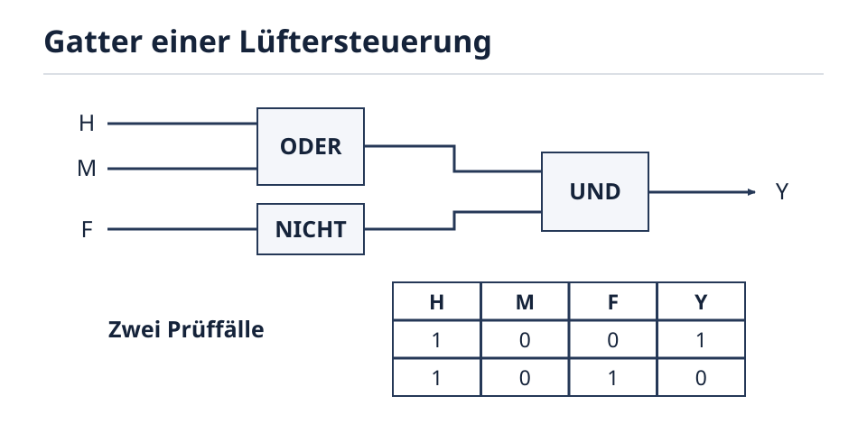

# M7-L1 – Aussagenlogik und digitale Schaltungen {#L1}

**Kursbereich:** M7 – Logik, Automaten und Berechenbarkeit

**Niveau:** Sekundarstufe II (grundlegend)

**Vorwissen:** [M3-L2 – Bedingungen und Verzweigungen](M3-L2.md)

**Lernziel:** Boolesche Ausdrücke mittels Wahrheitstabelle und Gattern darstellen.

## Wann soll ein Lüfter starten? {#S1}

Ein Lüfter soll anlaufen, wenn ein Raum zu warm ist oder jemand die Lüftung anfordert. Meldet ein Fehlersensor eine Störung, soll der Lüfter im Aufgabenmodell aus bleiben. Aus diesen drei Eingaben entsteht eine Entscheidung. Damit die Regel in jeder Situation gleich angewendet wird, übersetzen wir sie in eine logische Formel, prüfen ihre Wahrheitstabelle und zeichnen die zugehörige Schaltung.

## Wahrheitswerte und Gatter {#S2}

Eine **Aussage** hat im Modell einen Wahrheitswert: wahr ($1$) oder falsch ($0$). Wir bezeichnen die Hitzeanforderung mit $H$, den manuellen Wunsch mit $M$ und den Fehler mit $F$. Ein **Gatter** setzt eine logische Verknüpfung mit digitalen Signalen um.

- **UND** ($\land$) gibt $1$ aus, wenn beide Eingänge $1$ sind.
- **ODER** ($\lor$) gibt $1$ aus, wenn mindestens ein Eingang $1$ ist. Das schließt den Fall mit zwei Einsen ein.
- **NICHT** ($\neg$) kehrt einen einzelnen Wahrheitswert um.

Der Ausgang ist $Y=(H\lor M)\land\neg F$. Die Klammer macht die erste Teilentscheidung sichtbar. $H\lor M$ und $\neg F$ entstehen parallel. Beide Ergebnisse gelangen zum UND-Gatter.

{alt="H und M führen zum ODER-Gatter. F führt zum NICHT-Gatter. Beide Gatter münden in UND mit Ausgang Y. Bei H=1 und M=0 ergibt ein Fehler Y=0, ohne Fehler gilt Y=1."}

## Vollständige Prüfung der Steuerregel {#S3}

Für drei unabhängige Eingänge gibt es $2^3=8$ Belegungen. Schreibe sie in binärer Reihenfolge auf und werte die Teilausdrücke zuerst aus. Bei `011` ist der manuelle Wunsch aktiv. Gleichzeitig liegt ein Fehler vor. Daher gilt $H\lor M=1$, $\neg F=0$ und $Y=0$.

| $H$ | $M$ | $F$ | $H\lor M$ | $\neg F$ | $Y$ |
| --- | --- | --- | --- | --- | --- |
| 0 | 0 | 0 | 0 | 1 | 0 |
| 0 | 0 | 1 | 0 | 0 | 0 |
| 0 | 1 | 0 | 1 | 1 | 1 |
| 0 | 1 | 1 | 1 | 0 | 0 |
| 1 | 0 | 0 | 1 | 1 | 1 |
| 1 | 0 | 1 | 1 | 0 | 0 |
| 1 | 1 | 0 | 1 | 1 | 1 |
| 1 | 1 | 1 | 1 | 0 | 0 |

In Python stehen `and`, `or` und `not` für diese Operationen auf booleschen Werten. Das folgende Beispiel überprüft alle acht Fälle.

```python
from itertools import product

inputs = list(product((False, True), repeat=3))
outputs = [(hot or manual) and not fault for hot, manual, fault in inputs]
assert outputs == [False, False, True, False, True, False, True, False]
assert [int(value) for value in outputs] == [0, 0, 1, 0, 1, 0, 1, 0]
```

## Selbstkontrolle {#S4}

### Aufgaben

1. Bestimme den Ausgang für `110`. Begründe anhand dieser Zeile, warum ein exklusives ODER das Modell ändern würde.
2. Formuliere $\neg Y$ nur mit $\neg H$, $\neg M$ und $F$ sowie UND und ODER. Prüfe das Ergebnis mit `101`.
3. Ergänze einen Freigabeeingang $E$. Welche Formel schaltet den Lüfter genau dann ein, wenn die bisherige Bedingung gilt und die Freigabe aktiv ist?

### Lösungen

1. $H\lor M=1$ und $\neg F=1$. Deshalb gilt $Y=1$. Ein exklusives ODER hätte bei zwei Einsen den Wert $0$ und ließe den Ausgang aus.
2. De Morgan liefert $\neg(A\land B)=\neg A\lor\neg B$ und $\neg(A\lor B)=\neg A\land\neg B$. Damit ist $\neg Y=(\neg H\land\neg M)\lor F$. Bei `101` macht $F=1$ die Negation wahr. Die Tabelle liefert dazu passend $Y=0$.
3. $Y'=(H\lor M)\land\neg F\land E$. Sobald $E=0$ gilt, ist der Ausgang $0$, unabhängig von den übrigen Eingängen.

## Annahmen und typische Fehler {#S5}

Alle Variablen sind hier gleichzeitig vorliegende Wahrheitswerte. Ein Sensor kann erst durch eine Schwellenregel aus einem Messwert ein solches Signal bilden. Die Wahrheitstabelle enthält weder Verzögerungen noch einen Speicher für frühere Zustände. Bei realen Stromkreisen gehören Laufzeiten, Spannungspegel und Fehlermodi zu einer gesonderten Prüfung. Aus der Tabelle allein lässt sich deshalb keine technische Sicherheitsfreigabe ableiten.

Bei einer Negation über mehrere Eingaben müssen die Verknüpfungen gemäß De Morgan ebenfalls wechseln. In einer Python-Zeile mit ganzen Zahlen sind `&` und `|` bitweise Operatoren. Für die hier verwendeten booleschen Eingänge ist die Schreibweise mit `and`, `or` und `not` eindeutiger.

## Zusammenfassung {#S6}

Eine Wahrheitswerttabelle ordnet jeder Eingabebelegung genau einen Ausgang zu. Der Formelaufbau zeigt, wie die elementaren Gatter verschaltet werden. Wenn spätere Entscheidungen auch von früheren Eingaben abhängen, braucht das Modell zusätzlich einen Zustand.

## Quellen und weiterführende Hinweise {#S7}

### Weiterführend (intern)

- [M7-L2 – Zustände und endliche Automaten](M7-L2.md)

### Quellen (extern)

- [Gesellschaft für Informatik e. V. – Bildungsstandards Informatik für die Sekundarstufe II](https://informatikstandards.de/fileadmin/GI/Projekte/Informatikstandards/Dokumente/Bildungsstandards_SII.pdf) · Bezug zur Lektion: §3.2.4 · Boolesche Ausdrücke mittels Wahrheitstabelle und Gattern darstellen · Zuletzt abgerufen: 2026-11-22 · Inhaltlich geprüft: 2026-11-22
- [Bayern – Staatsinstitut für Schulqualität und Bildungsforschung (ISB) – LehrplanPLUS Gymnasium 12 – Informatik, erhöhtes Niveau](https://www.lehrplanplus.bayern.de/fachlehrplan/gymnasium/12/informatik/erhoeht) · Bezug zur Lektion: Inf12 LB4 · Boolesche Ausdrücke mittels Wahrheitstabelle und Gattern darstellen · Zuletzt abgerufen: 2026-11-22 · Inhaltlich geprüft: 2026-11-22
