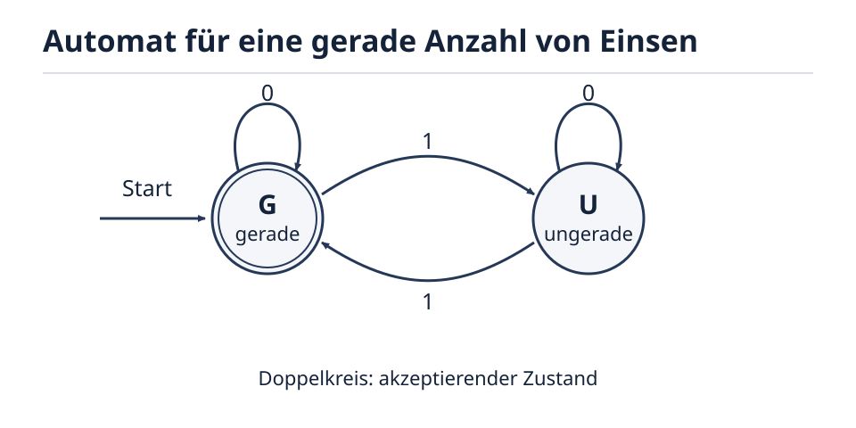

# M7-L2 – Zustände und endliche Automaten {#L2}

**Kursbereich:** M7 – Logik, Automaten und Berechenbarkeit

**Niveau:** Sekundarstufe II (grundlegend)

**Vorwissen:** [M1-L3 – Präzise Anweisungen, Ablaufpläne und Blöcke](M1-L3.md)

**Lernziel:** Übergangstabelle und deterministischen endlichen Automaten für Eingabewörter entwerfen.

## Ein Merkzettel mit zwei Möglichkeiten {#S1}

Stell dir vor, du liest eine lange Folge aus Nullen und Einsen. Am Ende sollst du entscheiden, ob die Anzahl der Einsen gerade ist. Du könntest mitzählen. Es genügt aber, dir »gerade« oder »ungerade« zu merken. Eine Null ändert daran nichts, eine Eins wechselt die Antwort. Zwei Zustände bilden genau das Gedächtnis, das diese Aufgabe benötigt.

## Vom Verhalten zum endlichen Automaten {#S2}

Ein **deterministischer endlicher Automat** (DEA) hat endlich viele Zustände und ein endliches **Alphabet** erlaubter Eingabezeichen. Ein **Wort** ist eine endliche Folge solcher Zeichen. Der Automat beginnt im **Startzustand** und liest das Wort von links nach rechts. Für jede Kombination aus Zustand und gelesenem Zeichen ist genau ein nächster Zustand festgelegt. Steht der Automat nach dem letzten Zeichen in einem **akzeptierenden Zustand**, akzeptiert er das Wort.

Für das Alphabet $\{0,1\}$ wählen wir $G$ und $U$: gerade und ungerade Anzahl gelesener Einsen. $G$ ist Startzustand und einziger akzeptierender Zustand. Der Doppellinienkreis im Diagramm zeigt, dass akzeptiert wird, falls dort nach dem letzten Zeichen Schluss ist.

{alt="Startpfeil zum doppelt umrandeten Zustand G. G und U besitzen Schleifen mit 0. Die beiden gerichteten Verbindungen zwischen G und U tragen je 1."}

| Zustand | bei `0` | bei `1` |
| --- | --- | --- |
| $G$ | $G$ | $U$ |
| $U$ | $U$ | $G$ |

## Ein Wort verfolgen und die Regel testen {#S3}

Beim Wort `10110` lautet der Weg $G \to U \to U \to G \to U \to U$. Der Endzustand $U$ verwirft das Wort. Hier sind tatsächlich drei Einsen enthalten. Bei `101` führt dieselbe Tabelle nach $G$, also wird das Wort akzeptiert.

Die **Invariante** ist eine Aussage, die nach jedem gelesenen Präfix gilt: Der Zustand benennt die Parität, also die Geradheit oder Ungeradheit, der bisherigen Einsenzahl. Anfangs trifft sie zu, weil noch null Einsen gelesen wurden. Beim Lesen von `0` ändert sich weder die Einsenzahl noch der Zustand. Bei `1` wechseln sowohl die Parität als auch der Zustand. Daher trifft die Invariante bis zum Ende zu.

```python
transitions = {
    ("E", "0"): "E", ("E", "1"): "O",
    ("O", "0"): "O", ("O", "1"): "E",
}

def accepts(word):
    state = "E"
    for symbol in word:
        if symbol not in ("0", "1"):
            raise ValueError("Expected a binary word")
        state = transitions[state, symbol]
    return state == "E"

assert not accepts("10110")
assert accepts("101")
assert accepts("")
assert accepts("000")
```

Der Code verwendet `E` für `even` und `O` für `odd`. Das ist dieselbe Zustandsbedeutung wie $G$ und $U$.

## Selbstkontrolle {#S4}

### Aufgaben

1. Verfolge `0111`, `000` und das leere Wort $\varepsilon$. Welche Wörter werden akzeptiert?
2. Ändere ausschließlich die akzeptierende Zustandsmenge so, dass genau die Wörter mit ungerader Anzahl von Einsen akzeptiert werden. Bleibt das leere Wort akzeptiert?
3. Ein Mitschüler möchte bei $U$ und `0` nach $G$ wechseln. Finde ein möglichst kurzes Gegenbeispiel.

### Lösungen

1. `0111` führt über $G,U,G,U$ nach $U$ und wird verworfen. `000` bleibt in $G$ und wird akzeptiert. Beim leeren Wort findet kein Übergang statt. $G$ akzeptiert es.
2. $U$ wird der einzige akzeptierende Zustand. Übergänge und Startzustand bleiben gleich. Das leere Wort endet weiterhin in $G$ und wird jetzt verworfen.
3. `10` muss abgelehnt werden, weil es genau eine Eins enthält. Die vorgeschlagene Änderung führt aber von $G$ über $U$ nach $G$ und akzeptiert es. Bei Wörtern der Länge null oder eins wird der geänderte Übergang nicht benutzt.

## Annahmen und typische Fehler {#S5}

Ein akzeptierender Zustand darf ausgehende Übergänge haben. Akzeptanz beurteilen wir erst am Wortende. Ein Zeichen wie `2` gehört nicht zum Alphabet und steht im Beispiel für einen Eingabefehler. `0` ist ein gültiges Wort der Länge eins, $\varepsilon$ hat dagegen die Länge null. Ein DEA speichert nur seinen aktuellen Zustand. Für Aufgaben, die ein unbegrenzt wachsendes Gedächtnis brauchen, ist diese Beschränkung entscheidend.

## Zusammenfassung {#S6}

Zustände fassen diejenigen Eigenschaften des bisherigen Eingabeteils zusammen, die für die Zukunft zählen. Diagramm und Tabelle beschreiben dieselbe Übergangsfunktion. Die Menge aller akzeptierten Wörter führt zum Begriff der formalen Sprache.

## Quellen und weiterführende Hinweise {#S7}

### Weiterführend (intern)

- [M7-L3 – Formale Sprachen, Muster und Grammatik](M7-L3.md)

### Quellen (extern)

- [Gesellschaft für Informatik e. V. – Bildungsstandards Informatik für die Sekundarstufe II](https://informatikstandards.de/fileadmin/GI/Projekte/Informatikstandards/Dokumente/Bildungsstandards_SII.pdf) · Bezug zur Lektion: §3.2.3 · Übergangstabelle und deterministischen endlichen Automaten für Eingabewörter entwerfen · Zuletzt abgerufen: 2026-11-22 · Inhaltlich geprüft: 2026-11-22
- [Bayern – Staatsinstitut für Schulqualität und Bildungsforschung (ISB) – LehrplanPLUS Gymnasium 13 – Informatik, grundlegendes Niveau](https://www.lehrplanplus.bayern.de/fachlehrplan/gymnasium/13/informatik/grundlegend) · Bezug zur Lektion: Inf13 LB1 · Übergangstabelle und deterministischen endlichen Automaten für Eingabewörter entwerfen · Zuletzt abgerufen: 2026-11-22 · Inhaltlich geprüft: 2026-11-22
