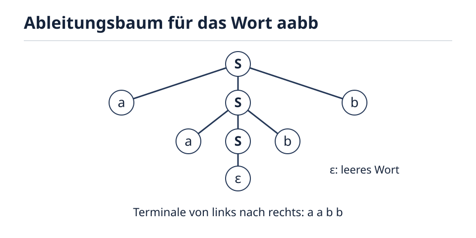

# M7-L3 – Formale Sprachen, Muster und Grammatik {#L3}

**Kursbereich:** M7 – Logik, Automaten und Berechenbarkeit

**Niveau:** Sekundarstufe II (grundlegend)

**Vorwissen:** [M7-L2 – Zustände und endliche Automaten](M7-L2.md)

**Lernziel:** Syntax, Semantik, reguläres Muster und eine kleine Grammatik vergleichen.

## Welche Zeichenfolge ist erlaubt? {#S1}

Ein Programm liest einen kurzen Befehl von einem Gerät. Bevor es den Befehl ausführt, muss es erkennen, ob der Text überhaupt die vereinbarte Form hat. »Gehört die Folge zur erlaubten Menge?« ist eine andere Frage als »Was bedeutet dieser Befehl?«. Für die erste Frage brauchen wir eine Beschreibung des Aufbaus.

## Alphabet, Sprache und Grammatik {#S2}

Ein **Alphabet** $\Sigma$ besteht aus den verfügbaren Zeichen, zum Beispiel $\{a,b\}$. $\Sigma^*$ umfasst alle endlichen Wörter über diesem Alphabet, einschließlich des leeren Worts $\varepsilon$. Eine **formale Sprache** $L$ ist eine Teilmenge von $\Sigma^*$. Ihre **Syntax** bestimmt, welche Wörter zulässig sind. Eine **Semantik** ordnet zulässigen Wörtern eine Bedeutung zu, beispielsweise eine Aktion oder einen Zahlenwert.

Das reguläre Muster `a*b` steht hier für beliebig viele `a` (auch null), gefolgt von genau einem `b`. Ein DEA kann dieses Muster erkennen: Er liest im Startzustand beliebig viele `a`, wechselt beim ersten `b` in den akzeptierenden Zustand und geht bei jedem weiteren Zeichen in einen verwerfenden Fangzustand. Im Fangzustand bleibt er für beide Alphabetzeichen.

Eine **Grammatik** beschreibt eine Sprache durch Ersetzungsregeln. Sie beginnt beim Startsymbol $S$. Ein **Nichtterminal** wie $S$ darf durch eine Regel ersetzt werden. **Terminale** wie `a` und `b` erscheinen unverändert im fertigen Wort. Die Regeln $S\to aSb$ und $S\to\varepsilon$ erzeugen paarweise je ein `a` links und ein `b` rechts. Ableitungsbäume zeigen, welche Regel eine Verzweigung erzeugt und wo die Ersetzung endet.

{alt="Das Startsymbol S verzweigt in a, S und b. Das mittlere S verzweigt erneut in a, S und b. Das innerste S führt zum leeren Wort ε."}

## Schrittweise aus der Regel ableiten {#S3}

Die Ableitung für `aabb` lautet $S \Rightarrow aSb \Rightarrow aaSbb \Rightarrow aabb$. In den ersten beiden Schritten wird die erste Regel angewendet. Im letzten Schritt wird das verbleibende $S$ durch das leere Wort ersetzt. Damit besteht jedes erzeugte Wort aus $n$ Zeichen `a`, gefolgt von $n$ Zeichen `b`, für eine beliebige nichtnegative ganze Zahl $n$. Umgekehrt erzeugen genau $n$ umschließende Ersetzungen und eine leere Ersetzung das Wort $a^n b^n$. `abab` ist trotz gleicher Anzahlen ausgeschlossen. Bei jeder umschließenden Ersetzung stehen sämtliche `a` links von sämtlichen `b`.

Die Grammatik erzeugt eine **nicht reguläre Sprache**. Ein DEA mit $k$ Zuständen muss unter den $k+1$ Anfangsteilen $\varepsilon,a,\ldots,a^k$ mindestens zwei verschiedene, $a^i$ und $a^j$, in denselben Zustand führen. Bei anschließend jeweils $i$ Zeichen `b` reagiert er für beide Wörter gleich. Er müsste jedoch $a^i b^i$ akzeptieren und $a^j b^i$ verwerfen. Das ist unmöglich.

## Selbstkontrolle {#S4}

### Aufgaben

1. Welche Wörter aus `b`, `aab`, `abb`, `aa` und $\varepsilon$ passen vollständig zum Muster `a*b`?
2. Leite `aaabbb` aus der Grammatik ab. Prüfe anschließend `aabbb` und `ba`.
3. Wie ändern sich die Regeln, falls mindestens ein Paar von `a` und `b` vorkommen muss?

### Lösungen

1. `b` gehört dazu, weil null `a` erlaubt sind, und `aab` gehört mit zwei `a` dazu. `abb` hat ein `b` zu viel. `aa` und $\varepsilon$ enthalten kein abschließendes `b`.
2. $S\Rightarrow aSb\Rightarrow aaSbb\Rightarrow aaaSbbb\Rightarrow aaabbb$. `aabbb` hat unterschiedlich viele `a` und `b`. `ba` verletzt die Reihenfolge. Beide sind ausgeschlossen.
3. Ersetze die leere Regel durch $S\to ab$. Dann bildet die letzte Ersetzung immer das erste Paar. Weitere Paare können wie zuvor mit $S\to aSb$ ergänzt werden.

## Annahmen und typische Fehler {#S5}

Das Muster wird auf das **gesamte** Wort angewendet. Eine Suche nach einem passenden Teilstück hätte für `abb` ein anderes Ergebnis, weil `ab` darin vorkommt. Im formalen Wort ist $\varepsilon$ eine Schreibweise für Länge null. Das Zeichen $\varepsilon$ selbst wird dabei nicht eingegeben. Programmbibliotheken für Muster können zusätzliche Konstrukte besitzen, die über die hier betrachteten regulären Sprachen hinausgehen.

## Zusammenfassung {#S6}

Reguläre Sprachen lassen sich durch endliche Automaten erkennen. Eine Grammatik beschreibt gültige Wörter über Ableitungsschritte und kann auch nicht reguläre Sprachen erzeugen. Die Wahl des Modells hängt davon ab, welche Abhängigkeiten in den Wörtern ausgedrückt werden sollen.

## Quellen und weiterführende Hinweise {#S7}

### Weiterführend (intern)

- [M7-L4 – Turingmodell und Grenzen der Berechenbarkeit](M7-L4.md)

### Quellen (extern)

- [Gesellschaft für Informatik e. V. – Bildungsstandards Informatik für die Sekundarstufe II](https://informatikstandards.de/fileadmin/GI/Projekte/Informatikstandards/Dokumente/Bildungsstandards_SII.pdf) · Bezug zur Lektion: §3.2.3 · Syntax, Semantik, reguläres Muster und eine kleine Grammatik vergleichen · Zuletzt abgerufen: 2026-11-22 · Inhaltlich geprüft: 2026-11-22
- [Senatsverwaltung für Bildung, Jugend und Familie Berlin – Rahmenlehrplan für die gymnasiale Oberstufe – Informatik, Teil C](https://www.berlin.de/sen/bildung/unterricht/faecher-rahmenlehrplaene/rahmenlehrplaene/rahmenlehrplan-informatik-go-teil-c.pdf?ts=1705017673) · Bezug zur Lektion: §3.2 · Syntax, Semantik, reguläres Muster und eine kleine Grammatik vergleichen · Zuletzt abgerufen: 2026-11-22 · Inhaltlich geprüft: 2026-11-22
