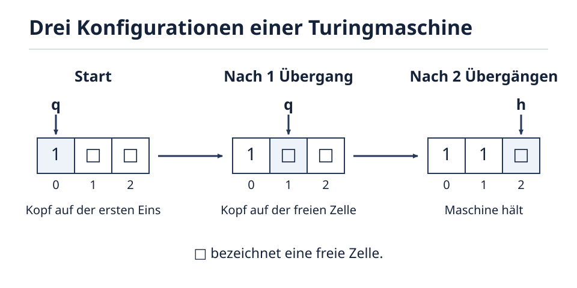

# M7-L4 – Turingmodell und Grenzen der Berechenbarkeit {#L4}

**Kursbereich:** M7 – Logik, Automaten und Berechenbarkeit

**Niveau:** Sekundarstufe II (erhöht)

**Vorwissen:** [M7-L3 – Formale Sprachen, Muster und Grammatik](M7-L3.md)

**Lernziel:** Ein einfaches Maschinenmodell simulieren und Halteproblem von Zeitaufwand unterscheiden.

## Was kann ein Computer grundsätzlich entscheiden? {#S1}

Ein Programm läuft seit mehreren Minuten ohne Ergebnis. Vielleicht benötigt es für diese Eingabe viel Zeit. Vielleicht endet es nie. Kann ein zweites Programm diese beiden Situationen in **jedem** Fall auseinanderhalten? Um darüber exakt zu sprechen, benutzen wir ein einfaches Modell für ausführbare Programme.

## Ein Band mit veränderbarem Inhalt {#S2}

Eine **Turingmaschine** besitzt endlich viele Steuerzustände und ein Band mit Zellen. Ihr Kopf liest und überschreibt jeweils genau eine Zelle. Für den aktuellen Zustand und das gelesene Zeichen kann eine Regel vorgeben, welches Zeichen geschrieben wird, wohin sich der Kopf bewegt und welcher Zustand folgt. Das Band kann im Modell beliebig weit verwendet werden. Ein endlicher Lauf besucht dennoch nur endlich viele Zellen. Wir verwenden ein nach rechts unbeschränktes Band, beginnen an Position $0$ und brauchen im Beispiel nur Rechtsbewegungen. Das Zeichen $\square$ bezeichnet eine leere Zelle.

Ein **Haltezustand** beendet den Lauf. Eine **Konfiguration** hält Bandinhalt, Kopfposition und Steuerzustand für einen Zeitpunkt fest. Ein Band, das schon Daten enthält, kann in späteren Schritten überschrieben werden. Diese Eigenschaft unterscheidet das Modell vom DEA mit seinem einmalig gelesenen Eingabewort.

{alt="Start: Zustand q und Kopf über Position 0, Band 1 leer leer. Nach einem Übergang steht q über Position 1, das Band bleibt gleich. Danach steht h über Position 2, Band 1 1 leer."}

## Ein Strich kommt hinzu {#S3}

Wir kodieren eine Zahl $n$ durch $n$ aufeinanderfolgende Einsen ab Position $0$. Eine Maschine zum Addieren von $1$ benutzt einen Suchzustand $q$ und einen Haltezustand $h$.

| Zustand | Gelesen | Schreiben | Bewegung | Folgezustand |
| --- | --- | --- | --- | --- |
| $q$ | 1 | 1 | rechts | $q$ |
| $q$ | $\square$ | 1 | rechts | $h$ |

1. Für die Eingabe `1` steht der Kopf an Position $0$. Die Maschine liest `1`, lässt die Zelle unverändert und geht nach rechts in Position $1$.
2. Die Zelle an Position $1$ ist leer. Die Maschine schreibt `1`, geht nach Position $2$ und wechselt in den Haltezustand. Das beschriebene Bandwort lautet `11`. Im gewählten Code steht es für $2$.

Im Allgemeinen werden $n$ Einsen überlaufen und eine leere Zelle wird beschrieben. Der Lauf braucht $n+1$ Übergänge. Das ist eine konkrete Zeitabschätzung für dieses Verfahren.

## Selbstkontrolle {#S4}

### Aufgaben

1. Verfolge dieselbe Maschine auf dem leeren Eingabewort und auf `11`. Gib jeweils Endwort und Anzahl der Übergänge an.
2. Angenommen, ein Programm $H(p,x)$ liefert stets korrekt »ja«, wenn Programm $p$ auf Eingabe $x$ hält, und andernfalls »nein«. Definiere $D(p)$ so: Es läuft endlos, wenn $H(p,p)$ »ja« sagt, und hält, wenn $H(p,p)$ »nein« sagt. Was müsste $H(D,D)$ liefern?
3. Warum kann ein Zeitlimit von 1000 Schritten $H$ aus Aufgabe 2 nicht ersetzen?

### Lösungen

1. Auf leerer Eingabe schreibt der erste Übergang eine Eins und hält. Ergebnis `1` nach einem Übergang. Auf `11` überläuft die Maschine zunächst zwei Einsen und schreibt danach eine dritte. Ergebnis `111` nach drei Übergängen.
2. Programme werden dabei als Eingabewörter kodiert, also kann die Beschreibung von $D$ selbst als Eingabe dienen. Lautet die Antwort »ja«, läuft $D(D)$ endlos und die Antwort ist falsch. Lautet sie »nein«, hält $D(D)$ und die Antwort ist ebenfalls falsch. Damit kann der angenommene allgemeine und stets haltende Entscheider $H$ nicht existieren.
3. Ein Programm, das nach 1001 Schritten hält, wäre nach 1000 Schritten noch nicht fertig. Das Zeitlimit erkennt nur, dass der Lauf in diesem Fenster nicht geendet hat.

## Annahmen und typische Fehler {#S5}

Der Widerspruch betrifft ein Verfahren für **alle** Programme und Eingaben. Für einzelne Programme ist Terminierung oft beweisbar. Im Bandbeispiel schiebt jeder Suchschritt den Kopf eine Zelle weiter und die erste freie Zelle beendet die Suche. Sehr lange Laufzeit und Unentscheidbarkeit sind verschiedene Eigenschaften. Das unbeschränkte Band ist eine Modellannahme über verfügbaren Speicher, keine Aussage über ein konkretes Gerät.

## Zusammenfassung {#S6}

Eine Turingmaschine beschreibt einen Lauf durch Übergangsregeln und Konfigurationen. Das Halteproblem setzt einer allgemeinen automatischen Entscheidung eine prinzipielle Grenze. Für entscheidbare Probleme lässt sich anschließend fragen, wie der Aufwand mit der Eingabe wächst.

## Quellen und weiterführende Hinweise {#S7}

### Weiterführend (intern)

- [M7-L5 – Wachstumsordnungen, P und NP](M7-L5.md)

### Quellen (extern)

- [Gesellschaft für Informatik e. V. – Bildungsstandards Informatik für die Sekundarstufe II](https://informatikstandards.de/fileadmin/GI/Projekte/Informatikstandards/Dokumente/Bildungsstandards_SII.pdf) · Bezug zur Lektion: §3.2.3 · Ein einfaches Maschinenmodell simulieren und Halteproblem von Zeitaufwand unterscheiden · Zuletzt abgerufen: 2026-11-22 · Inhaltlich geprüft: 2026-11-22
- [Senatsverwaltung für Bildung, Jugend und Familie Berlin – Rahmenlehrplan für die gymnasiale Oberstufe – Informatik, Teil C](https://www.berlin.de/sen/bildung/unterricht/faecher-rahmenlehrplaene/rahmenlehrplaene/rahmenlehrplan-informatik-go-teil-c.pdf?ts=1705017673) · Bezug zur Lektion: §3.2 · Ein einfaches Maschinenmodell simulieren und Halteproblem von Zeitaufwand unterscheiden · Zuletzt abgerufen: 2026-11-22 · Inhaltlich geprüft: 2026-11-22
- [Bayern – Staatsinstitut für Schulqualität und Bildungsforschung (ISB) – LehrplanPLUS Gymnasium 13 – Informatik, erhöhtes Niveau](https://www.lehrplanplus.bayern.de/fachlehrplan/gymnasium/13/informatik/erhoeht) · Bezug zur Lektion: Inf13 LB3–4 · Ein einfaches Maschinenmodell simulieren und Halteproblem von Zeitaufwand unterscheiden · Zuletzt abgerufen: 2026-11-22 · Inhaltlich geprüft: 2026-11-22
- [Bayern – Staatsinstitut für Schulqualität und Bildungsforschung (ISB) – LehrplanPLUS Gymnasium 13 – Informatik, grundlegendes Niveau](https://www.lehrplanplus.bayern.de/fachlehrplan/gymnasium/13/informatik/grundlegend) · Bezug zur Lektion: Inf13 LB3 · Ein einfaches Maschinenmodell simulieren und Halteproblem von Zeitaufwand unterscheiden · Zuletzt abgerufen: 2026-11-22 · Inhaltlich geprüft: 2026-11-22
