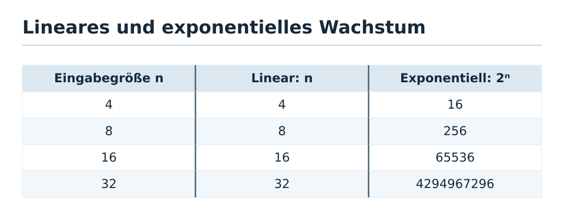

# M7-L5 – Wachstumsordnungen, P und NP {#L5}

**Kursbereich:** M7 – Logik, Automaten und Berechenbarkeit

**Niveau:** Sekundarstufe II (erhöht)

**Vorwissen:** [M6-L5 – Bäume, Graphen und Breitensuche](M6-L5.md), [M7-L4 – Turingmodell und Grenzen der Berechenbarkeit](M7-L4.md)

**Lernziel:** Praktische Laufzeit, asymptotische obere Schranke und Entscheidungsklassen unterscheiden.

## Wächst die Arbeit mit der Eingabe oder mit ihren Möglichkeiten? {#S1}

Ein Planer soll die Frage beantworten, ob jemand in einem Wegenetz jeden Ort genau einmal besuchen kann. Eine fertige Reihenfolge lässt sich schnell kontrollieren. Alle möglichen Reihenfolgen auszuprobieren kann dagegen sehr viele Versuche erfordern. Diese beiden Tätigkeiten, das **Entscheiden** und das **Überprüfen eines Lösungsvorschlags**, führen zu verschiedenen Komplexitätsbegriffen.

## Aufwand als Funktion der Eingabegröße {#S2}

Wähle für einen Algorithmus zuerst eine Eingabegröße $n$ und eine elementare Operation, etwa einen Vergleich. Bei einer linearen Suche sind $n$ die Listenelemente und im schlechtesten Fall werden $n$ Werte verglichen. Das Durchlaufen aller Teilmengen einer $n$-elementigen Menge betrachtet dagegen $2^n$ Kandidaten: Jedes Element kann aufgenommen oder weggelassen werden.

Die Schreibweise $T(n)\in O(g(n))$ bezeichnet eine asymptotische obere Schranke. Es gibt Konstanten $c>0$ und $n_0$, sodass $T(n)\leq c\,g(n)$ für alle $n\geq n_0$. Die Schranke lässt konstante Faktoren und kleine Eingaben außer Betracht. Zum Beispiel liegen $5n+7$ in $O(n)$ und auch in $O(n^2)$. Die erste Angabe ist hier aussagekräftiger. Eine Schranke allein gibt weder exakte Sekunden noch automatisch eine passende untere Schranke an.

{alt="Für n gleich 4, 8, 16 und 32 wächst n linear. Zwei hoch n nimmt die Werte 16, 256, 65536 und 4294967296 an."}

## Entscheidungsprobleme und Zertifikate {#S3}

Ein **Entscheidungsproblem** hat für jede gültige Eingabe die Antwort »ja« oder »nein«. Messen wir die Eingabegröße an der Länge ihrer vereinbarten Kodierung, gilt:

- **P** umfasst die Entscheidungsprobleme mit einem deterministischen Entscheidungsalgorithmus, der im schlimmsten Fall in polynomialer Zeit läuft. Für mindestens einen festen Exponenten $k$ lässt sich der Aufwand durch $O(n^k)$ nach oben beschränken.
- **NP** umfasst die Entscheidungsprobleme, für deren Ja-Eingaben es ein Zertifikat polynomial beschränkter Länge gibt, das ein deterministischer Algorithmus in polynomialer Zeit überprüfen kann. Für eine Nein-Eingabe darf kein Zertifikat akzeptiert werden.
- $P \subseteq NP$: Ein Entscheider kann bei der Prüfung auf ein Zertifikat verzichten und die Eingabe direkt entscheiden. Ob $P=NP$ gilt, ist offen.

Bei einem ungerichteten Wegenetz nennt ein Zertifikat für einen **Hamiltonpfad** alle Orte in Besuchsreihenfolge. Für die Kanten $\{A,B\}$, $\{B,C\}$ und $\{C,D\}$ sowie die Knoten $A,B,C,D$ besteht `A B C D` die Prüfung. Die Länge stimmt, jede Station kommt genau einmal vor und jede benachbarte Paarung ist verbunden. `A C B D` fällt bereits bei $\{A,C\}$ durch. Die Prüfung kann die Adjazenzmatrix einmal aufbauen und anschließend die aufeinanderfolgenden Paare nachschlagen. Auch der Aufbau und die Knotenprüfung brauchen insgesamt nur polynomialen Aufwand. Das erklärt, warum die Entscheidungsfrage in NP liegt. Es liefert kein Verfahren, das alle Instanzen des Problems in polynomialer Zeit entscheidet.

## Selbstkontrolle {#S4}

### Aufgaben

1. Vergleiche $n$ und $2^n$ für $n=16$ und $n=32$. Warum sind die Zahlen noch keine gemessenen Laufzeiten?
2. In einem Stern mit Zentrum $A$ sind nur die Kanten $\{A,B\}$, $\{A,C\}$ und $\{A,D\}$ vorhanden. Prüfe `B A C D` als Zertifikat. Kann irgendeine Reihenfolge alle vier Orte genau einmal besuchen?
3. Warum beweist der Aufwand des Verfahrens »alle Reihenfolgen ausprobieren« nicht, dass der Hamiltonpfad außerhalb von P liegt?

### Lösungen

1. Die linearen Modellwerte sind $16$ und $32$. Die exponentiellen Werte sind $65536$ und $4294967296$. Der tatsächliche Zeitbedarf hängt unter anderem von der Arbeit pro gezählter Operation und der Implementierung ab.
2. $\{C,D\}$ fehlt. Jeder der drei äußeren Knoten hat nur einen Nachbarn und kann deshalb in einem Hamiltonpfad nur an einem Ende liegen. Es gibt aber nur zwei Enden. Keine Reihenfolge besteht.
3. Der Aufwand beschreibt einen bestimmten Algorithmus. Um zu zeigen, dass das **Problem** außerhalb von P liegt, müsste man einen polynomialen Entscheider für das Problem grundsätzlich ausschließen.

## Annahmen und typische Fehler {#S5}

»NP« steht für »nichtdeterministisch polynomial«. Daraus folgt nicht, dass ein Problem in NP zwingend nichtpolynomialen Zeitbedarf besitzt. Probleme aus P liegen ebenfalls in NP. Auch ein polynomiales Verfahren kann bei großem Exponenten oder hohen konstanten Kosten unpraktisch sein. Um zwei Verfahren fair zu vergleichen, müssen Eingabekodierung, gezählte Operationen und betrachteter Fall übereinstimmen.

## Zusammenfassung {#S6}

Wachstumsordnungen beschreiben den Aufwand eines Verfahrens bei großen Eingaben. P und NP klassifizieren Entscheidungsprobleme anhand effizienter Entscheidung beziehungsweise effizienter Prüfung von Ja-Zertifikaten.

## Quellen und weiterführende Hinweise {#S7}

### Weiterführend (intern)

- [M7-L6 – Deklarative Regeln und Abfragen](M7-L6.md)

### Quellen (extern)

- [Bayern – Staatsinstitut für Schulqualität und Bildungsforschung (ISB) – LehrplanPLUS Gymnasium 13 – Informatik, erhöhtes Niveau](https://www.lehrplanplus.bayern.de/fachlehrplan/gymnasium/13/informatik/erhoeht) · Bezug zur Lektion: Inf13 LB4 · Praktische Laufzeit, asymptotische obere Schranke und Entscheidungsklassen unterscheiden · Zuletzt abgerufen: 2026-11-22 · Inhaltlich geprüft: 2026-11-22
- [Gesellschaft für Informatik e. V. – Bildungsstandards Informatik für die Sekundarstufe II](https://informatikstandards.de/fileadmin/GI/Projekte/Informatikstandards/Dokumente/Bildungsstandards_SII.pdf) · Bezug zur Lektion: §3.2.2 · Praktische Laufzeit, asymptotische obere Schranke und Entscheidungsklassen unterscheiden · Zuletzt abgerufen: 2026-11-22 · Inhaltlich geprüft: 2026-11-22
- [Clay Mathematics Institute – P vs NP](https://www.claymath.org/millennium/p-vs-np/) · Bezug zur Lektion: Problem statement · Praktische Laufzeit, asymptotische obere Schranke und Entscheidungsklassen unterscheiden · Zuletzt abgerufen: 2026-11-22 · Inhaltlich geprüft: 2026-11-22
