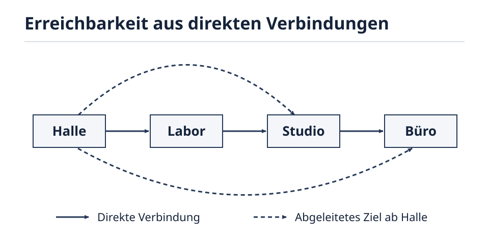

# M7-L6 – Deklarative Regeln und Abfragen {#L6}

**Kursbereich:** M7 – Logik, Automaten und Berechenbarkeit

**Niveau:** Sekundarstufe II (erhöht)

**Vorwissen:** [M5-L3 – SQL-Joins, Gruppen und fehlende Werte](M5-L3.md), [M7-L3 – Formale Sprachen, Muster und Grammatik](M7-L3.md)

**Lernziel:** Fakten, Regeln und Abfragen als deklaratives Modell anwenden.

## Verbindungen aus bekannten Fakten herleiten {#S1}

Ein Gebäudeverzeichnis enthält direkte Verbindungen zwischen benannten Räumen. Du willst fragen, welche Räume man von der Halle aus über mindestens eine Verbindung erreicht. In einem imperativen Programm legst du fest, welche Zwischenschritte der Rechner ausführt. Hier beschreibst du stattdessen, welche Fakten vorliegen und unter welchen Bedingungen eine weitere Beziehung gilt. Eine Auswertung leitet die passenden Aussagen ab.

## Fakten, Regeln und Anfragen {#S2}

Ein **Fakt** beschreibt eine bekannte Beziehung, beispielsweise `edge(hall, lab)`. Eine **Regel** hat einen Kopf und einen Rumpf. Der Kopf gibt den ableitbaren Fakt an. Jedes Teilziel im Rumpf muss für dieselbe Belegung der Variablen erfüllt sein. Eine **Anfrage** fragt nach einem einzelnen ableitbaren Fakt oder nach allen Belegungen ihrer freien Variablen. In der folgenden Datalog-artigen Schreibweise sind Großbuchstaben Variablen und `:-` bedeutet »gilt, falls«. Ein Komma im Rumpf verbindet Bedingungen mit UND.

```text
edge(hall, lab).
edge(lab, studio).
edge(studio, office).

reachable(X, Y) :- edge(X, Y).
reachable(X, Z) :- reachable(X, Y), edge(Y, Z).
```

Die Basisregel übernimmt jede direkte Verbindung. Die rekursive Regel verlängert einen bereits hergeleiteten Weg um eine Kante. Die Regeln betrachten gerichtete Folgen mit mindestens einer Kante. Ein Raum darf mehrfach vorkommen. Ein einfacher Pfad würde dagegen Wiederholungen verbieten.

{alt="Drei durchgezogene Pfeile verbinden Halle, Labor, Studio und Büro in dieser Reihenfolge. Gestrichelte Pfeile führen von der Halle direkt zum Studio beziehungsweise zum Büro."}

## Ableiten bis zum Fixpunkt {#S3}

1. Aus der Basisregel folgt `reachable(hall, lab)`. Sie liefert auch `reachable(lab, studio)` und `reachable(studio, office)`.
2. Setze in der rekursiven Regel $X=\text{hall}$, $Y=\text{lab}$ und $Z=\text{studio}$. Beide Rumpfbedingungen sind wahr. Deshalb folgt `reachable(hall, studio)`. Analog entsteht `reachable(lab, office)`.
3. Aus `reachable(hall, studio)` und `edge(studio, office)` folgt `reachable(hall, office)`. Danach kommt kein neues Paar hinzu. Die Menge ist am **Fixpunkt**. Weitere Regelanwendungen verändern sie nicht mehr.

Die Anfrage `reachable(hall, Z)` liefert `lab`, `studio` und `office`. Eine `JOIN`-Abfrage kann genau zwei direkte Kanten kombinieren:

```sql
CREATE TABLE edge (src TEXT NOT NULL, dst TEXT NOT NULL);
INSERT INTO edge VALUES ('hall', 'lab'), ('lab', 'studio'), ('studio', 'office');
SELECT e2.dst
FROM edge AS e1 JOIN edge AS e2 ON e1.dst = e2.src
WHERE e1.src = 'hall'
ORDER BY e2.dst;
```

| dst |
| --- |
| studio |

Der Join für zwei Kanten liefert hier weder den direkten Weg zum Labor noch den Weg über drei Kanten zum Büro. Eine rekursive SQL-Abfrage kann Erreichbarkeit für beliebige Weglängen ausdrücken. Der Vergleich zeigt, was eine einzelne feste Verknüpfung gegenüber der wiederholten Regelanwendung leistet.

## Selbstkontrolle {#S4}

### Aufgaben

1. Welche Ergebnisse liefert `reachable(lab, Z)` in den ursprünglichen Fakten? Begründe die Ergebnisse mit den Regeln.
2. Füge `edge(office, hall)` hinzu. Ist `reachable(hall, hall)` jetzt ableitbar? Warum kann die Auswertung trotzdem enden?
3. Welche Teilbedingung stellt sicher, dass die zwei Kanten des SQL-Joins einen zusammenhängenden Weg bilden?

### Lösungen

1. `studio` folgt unmittelbar aus `edge(lab, studio)`. `office` folgt, weil der Weg zum Studio mit `edge(studio, office)` verlängert wird.
2. Ja. Von der Halle führt ein Weg über Labor, Studio und Büro zurück zur Halle. Es gibt nur vier Raumnamen und höchstens $4^2=16$ verschiedene geordnete Paare. Eine Menge speichert jedes Paar nur einmal. Nach endlich vielen Ergänzungen gibt es kein neues Paar mehr.
3. `e1.dst = e2.src` verbindet das Ziel der ersten Kante mit der Quelle der zweiten. `e1.src = 'hall'` legt zusätzlich den Startort fest.

## Annahmen und typische Fehler {#S5}

Aus `edge(hall, lab)` folgt keine Gegenrichtung. Eine Beziehung ohne verbindende Kantenfolge in den gegebenen Fakten bleibt in diesem Modell unbelegt. Die Datenbasis kann in der Wirklichkeit unvollständig sein. Die Fixpunktbegründung setzt eine endliche Menge von Raumnamen, positive Regeln und Speicherung ohne Duplikate voraus. Andere Regelsysteme können beispielsweise Werte erzeugen oder andere Auswertungsstrategien verwenden.

## Zusammenfassung {#S6}

Deklarative Regeln legen die Bedingungen einer Lösung fest. Aus Basisfällen und einer rekursiven Regel entsteht die Menge gerichteter Erreichbarkeiten durch wiederholtes Ableiten. Der gezeigte Join verbindet genau zwei Kanten.

## Quellen und weiterführende Hinweise {#S7}

### Weiterführend (intern)

- [M8-L1 – Sensoren, Steuerung und Simulation](M8-L1.md)

### Quellen (extern)

- [Rheinland-Pfalz, Lehrplan Informatik für Grund- und Leistungsfach in der Mainzer Studienstufe – Lehrplan Informatik – Grund- und Leistungsfach, gymnasiale Oberstufe](https://bildung.rlp.de/fileadmin/user_upload/informatik.bildung.rlp.de/Lehrplaene/Informatik_LP_SekII.pdf) · Bezug zur Lektion: §3.7 · Fakten, Regeln und Abfragen als deklaratives Modell anwenden · Zuletzt abgerufen: 2026-11-22 · Inhaltlich geprüft: 2026-11-22
- [Bayern – Staatsinstitut für Schulqualität und Bildungsforschung (ISB) – LehrplanPLUS Gymnasium 13 – Informatik, erhöhtes Niveau](https://www.lehrplanplus.bayern.de/fachlehrplan/gymnasium/13/informatik/erhoeht) · Bezug zur Lektion: Inf13 LB2 · Fakten, Regeln und Abfragen als deklaratives Modell anwenden · Zuletzt abgerufen: 2026-11-22 · Inhaltlich geprüft: 2026-11-22
- [SQLite – The WITH Clause](https://www.sqlite.org/lang_with.html) · Bezug zur Lektion: Recursive Common Table Expressions · Fakten, Regeln und Abfragen als deklaratives Modell anwenden · Zuletzt abgerufen: 2026-11-22 · Inhaltlich geprüft: 2026-11-22
