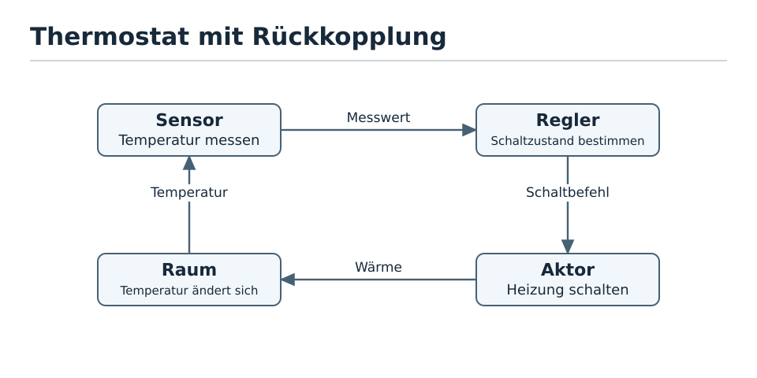

# M8-L1 – Sensoren, Steuerung und Simulation {#L1}

**Kursbereich:** M8 – Systeme und Softwareprojekte

**Niveau:** Sekundarstufe II (grundlegend)

**Vorwissen:** [M2-L4 – Vom Messsignal zur Tabelle](M2-L4.md), [M7-L2 – Zustände und endliche Automaten](M7-L2.md)

**Lernziel:** Einen Sensor-Aktor-Regelkreis modellieren und Grenzen diskreter Simulation erklären.

## Wann soll eine Heizung schalten? {#S1}

In einem Modellraum soll die Heizung anhand gemessener Temperaturwerte schalten. Eine Regel mit nur einer Schwelle könnte sie bei Messwerten dicht an der Schwelle häufig ein- und ausschalten. Ein **Thermostat mit Hysterese** verwendet zwei Schwellen. Der Abstand zwischen ihnen erlaubt, dass die Heizung bei schwankenden Messwerten ihren Zustand eine Weile behält.

## Messen, entscheiden, wirken {#S2}

Der **Sensor** misst die Temperatur und liefert einen Wert. Der **Regler** kennt die Schaltschwellen und den bisherigen Zustand der Heizung. Er bestimmt den nächsten Zustand. Der **Aktor** setzt die Entscheidung um, hier durch Ein- oder Ausschalten der Heizung. Die Raumtemperatur kann sich dadurch ändern. Die nächste Messung erfasst die veränderte Lage. Dieser Rückweg vom Ergebnis zur nächsten Entscheidung heißt **Rückkopplung**.

{alt="Der Raum gibt die Temperatur an den Sensor vor. Dessen Messwert geht an den Regler. Der Regler schaltet die Heizung, die wiederum auf den Raum wirkt."}

Im Modell wird bei höchstens 19 °C eingeschaltet und ab 22 °C ausgeschaltet. Dazwischen gilt der alte Schaltzustand. Bei 20 °C kann die Heizung also an sein, wenn sie gerade aufwärmt, oder aus sein, wenn der Raum sich abkühlt. Ein Messwert innerhalb des Bandes allein reicht nicht zur Vorhersage.

## Erprobung mit Messwerten und mit Rückkopplung {#S3}

Bei vorgegebenen Messwerten beginnt die Heizung aus. 20 °C lässt sie aus. Bei 19 °C schaltet sie ein, danach bleibt sie bei 20 °C und 21 °C an. Bei 22 °C schaltet sie aus, bleibt bei 21 °C aus und schaltet bei 19 °C wieder ein.

Eine **diskrete Simulation** erzeugt die nächsten Temperaturwerte selbst in gleich langen Zeitschritten. Wir nehmen an, dass die Temperatur pro Schritt bei eingeschalteter Heizung um 2 °C steigt und sonst um 1 °C sinkt. Die neue Messung beginnt erst nach dieser Änderung. Das Programm prüft die vorgegebenen Messwerte und simuliert anschließend acht Schritte mit Rückkopplung.

```python
def next_state(reading, heating):
    if reading <= 19:
        return True
    if reading >= 22:
        return False
    return heating


readings = [20, 19, 20, 21, 22, 21, 19]
heating = False
states = []
for reading in readings:
    heating = next_state(reading, heating)
    states.append(heating)
assert states == [False, True, True, True, False, False, True]

temperature = 19
heating = False
trace = []
for _ in range(8):
    heating = next_state(temperature, heating)
    trace.append((temperature, heating))
    temperature += 2 if heating else -1
assert trace == [
    (19, True), (21, True), (23, False), (22, False),
    (21, False), (20, False), (19, True), (21, True),
]
```

In der Simulation folgt auf 21 °C bei laufender Heizung ein Schritt zu 23 °C. Dieser Wert schaltet die Heizung beim nächsten Abtastzeitpunkt aus.

## Selbstkontrolle {#S4}

### Aufgaben

1. Beginne mit eingeschalteter Heizung. Ein Sensor liefert nacheinander 20 °C, 22 °C, 21 °C und 19 °C. Notiere den Zustand nach jedem Messwert.
2. Ändere im Simulationsmodell den Temperaturanstieg bei laufender Heizung auf 1 °C je Schritt. Bei welcher Temperatur und bei welchem Schritt schaltet die Heizung nach dem Start bei 19 °C erstmals aus? Zähle ab Schritt 0.

### Lösungen

1. An, aus, aus, an. Die Messwerte 20 °C und 21 °C liegen zwischen den Schwellen und behalten jeweils den vorherigen Zustand.
2. Die Messwerte in Schritt 0 bis 3 sind 19 °C, 20 °C, 21 °C und 22 °C. Bei 22 °C, also in Schritt 3, schaltet die Heizung erstmals aus.

## Annahmen, Fehler und Grenzen {#S5}

Die beiden Schwellen gehören ausdrücklich zu den jeweiligen Schaltfällen. Wer im Code versehentlich `<` und `>` verwendet, würde bei 19 °C und 22 °C andere Ergebnisse bekommen. Reale Räume erwärmen und kühlen sich zudem nicht mit festen Beträgen. Messfehler und Verzögerungen können das Schalten beeinflussen. Ein guter Versuch hält die Schrittweite fest und prüft, ob veränderte Annahmen das Ergebnis ändern.

## Zusammenfassung {#S6}

Sensor, Regelalgorithmus, Aktor und Umgebung bilden einen Regelkreis. Hysterese erklärt, warum zwischen zwei Schwellen der alte Schaltzustand zählt. Eine Simulation macht diese Übergänge nachvollziehbar und ihre Annahmen prüfbar.

## Quellen und weiterführende Hinweise {#S7}

### Weiterführend (intern)

- [M8-L2 – Software planen, dokumentieren und versionieren](M8-L2.md)

### Quellen (extern)

- [Gesellschaft für Informatik e. V. – Bildungsstandards Informatik für die Sekundarstufe I](https://informatikstandards.de/fileadmin/FA/IBS/user_upload/GI-Bildungsstandards_Informatik_Sek_I__2025__-_blau.pdf) · Bezug zur Lektion: §5.4 · Einen Sensor-Aktor-Regelkreis modellieren und Grenzen diskreter Simulation erklären · Zuletzt abgerufen: 2026-11-22 · Inhaltlich geprüft: 2026-11-22
- [Bildungsserver Berlin-Brandenburg · Senatsverwaltung Berlin und MBJS Brandenburg – Rahmenlehrplan Teil C – Informatik, Wahlpflichtfach, Jahrgangsstufen 7–10](https://bildungsserver.berlin-brandenburg.de/fileadmin/bbb/unterricht/rahmenlehrplaene/Rahmenlehrplanprojekt/amtliche_Fassung/Teil_C_Informatik_2015_11_10.pdf) · Bezug zur Lektion: §3.9 · Einen Sensor-Aktor-Regelkreis modellieren und Grenzen diskreter Simulation erklären · Zuletzt abgerufen: 2026-11-22 · Inhaltlich geprüft: 2026-11-22
