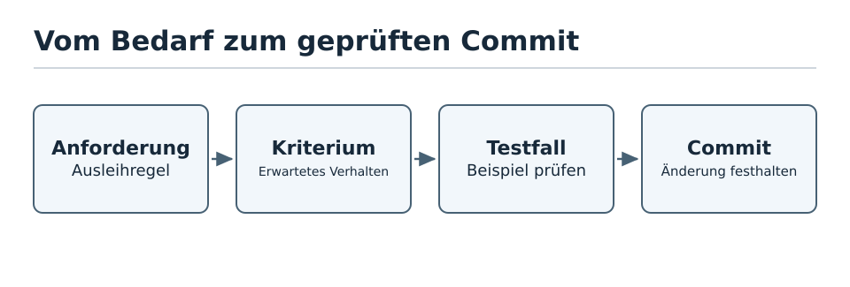

# M8-L2 – Software planen, dokumentieren und versionieren {#L2}

**Kursbereich:** M8 – Systeme und Softwareprojekte

**Niveau:** Sekundarstufe II (grundlegend)

**Vorwissen:** [M3-L5 – Testfälle und Fehlersuche](M3-L5.md), [M6-L1 – Klassen, Objekte und Schnittstellen](M6-L1.md)

**Lernziel:** Prüfbare Anforderungen, Schnittstellen, Tests und Versionsgeschichte koppeln.

## Was bedeutet „fertig“? {#S1}

Eine Gruppe entwickelt eine Ausleihanzeige für die Schule. „Die Anzeige soll gut funktionieren“ lässt offen, welches Verhalten das Team prüfen muss. „Ein bekannter Gegenstand ohne aktive Ausleihe wird als verfügbar angezeigt“ legt einen überprüfbaren Fall fest. So können zwei Personen unabhängig voneinander programmieren und testen.

## Von der Anforderung zum Versionsstand {#S2}

Eine **Anforderung** beschreibt den erwarteten Nutzen oder das erwartete Verhalten. Ein **Abnahmekriterium** übersetzt sie in beobachtbare Bedingungen. Eine **Schnittstelle** legt fest, welche Eingaben ein Programmteil erwartet und was er zurückgibt. Dadurch können andere Programmteile die Funktion benutzen, ohne ihre interne Darstellung kennen zu müssen.

{alt="Von links nach rechts: Anforderung zur Ausleihe, beobachtbares Abnahmekriterium, Testfall und Commit mit Änderung und Tests."}

In einem **Versionsverwaltungssystem** wie Git lässt sich ein gewählter Dateistand als **Commit** festhalten. Git unterscheidet drei Zustände. Im Arbeitsverzeichnis liegen die aktuellen Dateien. Im Index stehen die Dateistände, die für den nächsten Commit ausgewählt sind. Die Commit-Historie enthält die gespeicherten Projektstände. Ein kleiner, nachvollziehbarer Commit verknüpft eine konkrete Änderung und passende Tests.

## Eine Ausleihregel prüfbar machen {#S3}

Wir vereinbaren die Funktion `is_available(item_id, known_items, active_loans)`. Sie gibt wahr zurück, wenn die Kennung bekannt ist und keine aktive Ausleihe vorliegt. Im Beispiel sind `CAM1` und `CAM2` bekannt. `CAM2` ist ausgeliehen. `CAM9` existiert nicht. Die Anzeige kann die Antwort falsch anschließend genauer begründen, wenn sie auch weiß, ob die Kennung vorhanden ist.

```python
def is_available(item_id, known_items, active_loans):
    return item_id in known_items and item_id not in active_loans


items = {"CAM1", "CAM2"}
loans = {"CAM2"}
assert is_available("CAM1", items, loans) is True
assert is_available("CAM2", items, loans) is False
assert is_available("CAM9", items, loans) is False
```

Das Team hält Eingaben, Ergebnis und die Annahme „Kennungen sind eindeutige Zeichenketten“ in der Dokumentation fest. In einem neuen lokalen Git-Übungsverzeichnis speichert es die Funktion als `available.py` und die Prüfungen als `tests.py`. Die erste Zeile in `tests.py` lautet `from available import is_available`. Die folgende Befehlsfolge setzt eine für Git konfigurierte lokale Autoridentität voraus.

```text
git init
python -B tests.py
git add available.py tests.py
git diff --staged
git commit -m "Define and test item availability"
git status --short
```

Der erfolgreiche Testlauf beendet sich ohne Assertion-Fehler. `git add` wählt die beiden Dateistände aus. `git diff --staged` zeigt die vorgemerkten Änderungen vor dem Commit. Wenn nur diese Dateien existieren und seitdem unverändert sind, bleibt `git status --short` danach ohne Ausgabe.

## Selbstkontrolle {#S4}

### Aufgaben

1. Formuliere für die Anforderung „Ausgeliehenes darf nicht doppelt ausgeliehen werden“ ein Abnahmekriterium mit Ausgangslage, Aktion und beobachtbarem Ergebnis. Prüfe auch, ob Daten unverändert bleiben.
2. Du fügst `available.py` mit `git add` zum Index hinzu und änderst sie danach erneut. Welche Fassung gehört zum nächsten normalen `git commit`? Wie nimmst du die Änderung noch in den Commit auf?

### Lösungen

1. Ausgangslage: `CAM2` ist bereits der fiktiven Kennung `A17` zugeordnet. Aktion: Eine zweite Ausleihe für `A18` wird angefordert. Ergebnis: Das Programm meldet die Ablehnung und zeigt weiterhin genau die ursprüngliche Zuordnung zu `A17`. Die zweite Kennung taucht in keiner aktiven Ausleihe für `CAM2` auf.
2. Der Commit enthält den beim letzten `git add available.py` ausgewählten Dateistand. Ein erneutes `git add available.py` übernimmt die neue Fassung in den Index. `git diff --staged` zeigt, was daraufhin vorgemerkt ist.

## Annahmen, Fehler und Grenzen {#S5}

Die drei Tests belegen nur die vereinbarten Beispiele für diese Funktion. Die Funktion liest lediglich zwei Sammlungen. Sie reserviert keinen Gegenstand und verhindert keine gleichzeitigen Ausleihen. Ein lokaler Commit bewahrt einen Stand im lokalen Repository. Eine getrennte Sicherung oder eine freigegebene gemeinsame Ablage erfüllt einen anderen Zweck. Testdaten und Versionsgeschichte sollen keine realen persönlichen Daten enthalten.

## Zusammenfassung {#S6}

Ein überprüfbares Kriterium verbindet die Anforderung mit einem konkreten Test. Die Schnittstelle macht das Verhalten für andere Programmteile nutzbar. Der Commit hält eine geprüfte Änderung als nachvollziehbaren Stand fest.

## Quellen und weiterführende Hinweise {#S7}

### Weiterführend (intern)

- [M8-L3 – Nebenläufigkeit und konsistente Änderungen](M8-L3.md)

### Quellen (extern)

- [Gesellschaft für Informatik e. V. – Bildungsstandards Informatik für die Sekundarstufe II](https://informatikstandards.de/fileadmin/GI/Projekte/Informatikstandards/Dokumente/Bildungsstandards_SII.pdf) · Bezug zur Lektion: §3.1.4 · Prüfbare Anforderungen, Schnittstellen, Tests und Versionsgeschichte koppeln · Zuletzt abgerufen: 2026-11-22 · Inhaltlich geprüft: 2026-11-22
- [Scott Chacon und Ben Straub – Pro Git – Recording Changes to the Repository](https://git-scm.com/book/en/v2/Git-Basics-Recording-Changes-to-the-Repository) · Bezug zur Lektion: Recording Changes · Prüfbare Anforderungen, Schnittstellen, Tests und Versionsgeschichte koppeln · Zuletzt abgerufen: 2026-11-22 · Inhaltlich geprüft: 2026-11-22
