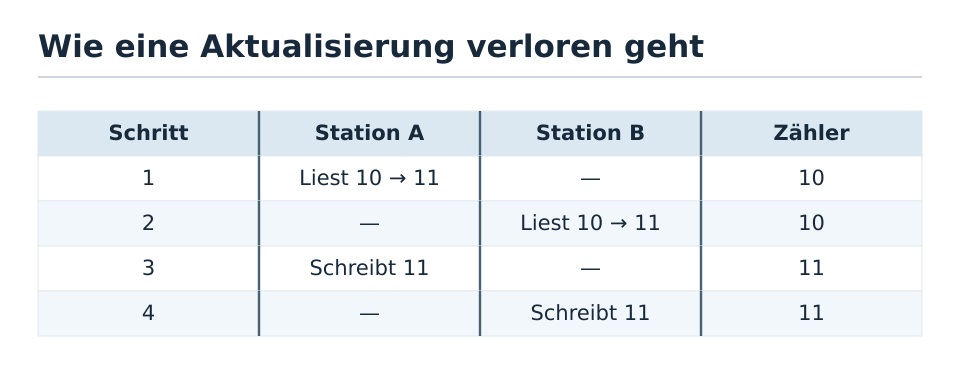

# M8-L3 – Nebenläufigkeit und konsistente Änderungen {#L3}

**Kursbereich:** M8 – Systeme und Softwareprojekte

**Niveau:** Sekundarstufe II (erhöht)

**Vorwissen:** [M8-L2 – Software planen, dokumentieren und versionieren](M8-L2.md), [M5-L4 – Normalisierung und Datenintegrität](M5-L4.md)

**Lernziel:** Verlorene Aktualisierung erklären und Synchronisation als Modell bewerten.

## Wenn zwei gleichzeitig zählen {#S1}

Zwei Stationen erfassen, wie viele Kopfhörer in einem Lager abgegeben wurden. Beide erhöhen denselben Zähler. Eine Station kann ihren Wert schon gelesen haben, während die andere die eigene Aktualisierung vorbereitet. Bei zehn eingelagerten Geräten erwartet man nach zwei Abgaben zwölf. Ob dieses Ergebnis entsteht, hängt davon ab, wie die Arbeitsschritte ineinandergreifen.

## Nebenläufige Schritte und gemeinsame Daten {#S2}

Zwei Abläufe sind **nebenläufig**, wenn ihre Bearbeitungszeiträume sich überschneiden. Ihre einzelnen Schritte werden möglicherweise abwechselnd ausgeführt. **Parallel** heißen sie, wenn gleichzeitig tatsächlich mehrere Schritte ausgeführt werden. Eine abwechselnde Ausführung auf einem Rechenkern reicht für das folgende Problem.

Im Modell besteht jede Erhöhung aus Lesen, Addieren und Schreiben. Lesen und Addieren können in diesem Beispiel zu einem lokalen Vorbereitungsschritt zusammengefasst werden. Schreiben ersetzt den gemeinsamen Wert. Eine **verlorene Aktualisierung** entsteht, wenn ein vorbereiteter, mittlerweile veralteter Wert später eine andere Änderung überschreibt.

{alt="A liest 10 und bereitet 11 vor. B liest ebenfalls 10 und bereitet 11 vor. A schreibt 11. Dann schreibt B wieder 11. Beide Erhöhungen ergeben insgesamt nur 11 statt 12."}

Ein **kritischer Abschnitt** ist ein Programmteil, in dem gemeinsame Daten unter Schutz bearbeitet werden müssen. Eine gemeinsame **Sperre** kann garantieren, dass höchstens ein beteiligter Ablauf diesen Abschnitt gleichzeitig betritt. Alle beteiligten Abläufe müssen dieselbe Sperre für den ganzen Lese-Änderungs-Schreib-Abschnitt verwenden.

## Zwei Ausführungsreihenfolgen nachvollziehen {#S3}

Beim verschränkten Ablauf lesen A und B jeweils 10. Beide bereiten 11 vor. A schreibt 11. B schreibt ebenfalls 11. Das Ergebnis 11 enthält nur eine Erhöhung. Beim seriellen Ablauf schreibt A zuerst 11. B liest danach 11 und schreibt 12. Das folgende Modell simuliert beide Reihenfolgen und startet jedes Mal bei 10.

```python
def simulate(events):
    count = 10
    prepared = {}
    for worker, action in events:
        if action == "read":
            prepared[worker] = count + 1
        elif action == "write":
            count = prepared.pop(worker)
    return count


interleaved = [
    ("A", "read"), ("B", "read"), ("A", "write"), ("B", "write")
]
serial = [
    ("A", "read"), ("A", "write"), ("B", "read"), ("B", "write")
]
assert simulate(interleaved) == 11
assert simulate(serial) == 12
```

Dieses Programm wählt die Reihenfolge ausdrücklich vorab. Damit lässt sich der Fehler wiederholt beobachten, ohne auf Entscheidungen eines Betriebssystems zu warten.

## Selbstkontrolle {#S4}

### Aufgaben

1. Nun addiert A jeweils 3 und B jeweils 2. Beide lesen 10. Erst schreibt A, dann B. Was ist der Endwert? Gib für dieselben Erhöhungen auch den Endwert bei serieller Ausführung an.
2. Ein Team sperrt jeweils nur den Schreibschritt. Zeige, wie trotzdem ein Update verlorengeht. Welche Schritte müssen zusammen geschützt sein?

### Lösungen

1. A bereitet 13 vor, B bereitet 12 vor. B überschreibt 13 mit 12, also ist der Endwert des verschränkten Ablaufs 12. Seriell ist der Endwert 15, unabhängig davon, welche Station zuerst erhöht.
2. Beide können vor der ersten Schreibsperre 10 lesen. A und B schreiben anschließend nacheinander jeweils 11, obwohl jede Schreiboperation für sich geschützt ist. In einer Sperrphase müssen gemeinsames Lesen, Berechnen und Schreiben zusammengefasst sein.

## Annahmen, Fehler und Grenzen {#S5}

Die Simulation nimmt an, dass jede einfache Lese- und Schreiboperation für sich ungeteilt abläuft. Die zusammengesetzte Aktualisierung besteht trotzdem aus mehreren Schritten. Die Programmiersprache, Bibliothek und Datenbank bestimmen, welche realen Operationen ungeteilt sind. Eine Sperre hilft nur bei gemeinsamer Vereinbarung. Wenn mehrere Sperren benutzt werden, können Abläufe sich gegenseitig dauerhaft blockieren, falls jeder auf eine vom anderen gehaltene Sperre wartet.

## Zusammenfassung {#S6}

Nebenläufige Abläufe können denselben Ausgangswert gleichzeitig zur Grundlage ihrer Berechnung machen. Eine geeignete Synchronisation schützt die Aktualisierung als Ganzes. Eine Ablauftabelle macht sichtbar, welche Reihenfolge die Datenregel verletzt.

## Quellen und weiterführende Hinweise {#S7}

### Weiterführend (intern)

- [M8-L4 – Teamprojekt: ein prüfbares Ausleihsystem](M8-L4.md)

### Quellen (extern)

- [Gesellschaft für Informatik e. V. – Bildungsstandards Informatik für die Sekundarstufe II](https://informatikstandards.de/fileadmin/GI/Projekte/Informatikstandards/Dokumente/Bildungsstandards_SII.pdf) · Bezug zur Lektion: §3.2.4 · Verlorene Aktualisierung erklären und Synchronisation als Modell bewerten · Zuletzt abgerufen: 2026-11-22 · Inhaltlich geprüft: 2026-11-22
- [Bayern – Staatsinstitut für Schulqualität und Bildungsforschung (ISB) – LehrplanPLUS Gymnasium 12 – Informatik, grundlegendes Niveau](https://www.lehrplanplus.bayern.de/fachlehrplan/gymnasium/12/informatik/grundlegend) · Bezug zur Lektion: Inf12 LB4 · Verlorene Aktualisierung erklären und Synchronisation als Modell bewerten · Zuletzt abgerufen: 2026-11-22 · Inhaltlich geprüft: 2026-11-22
