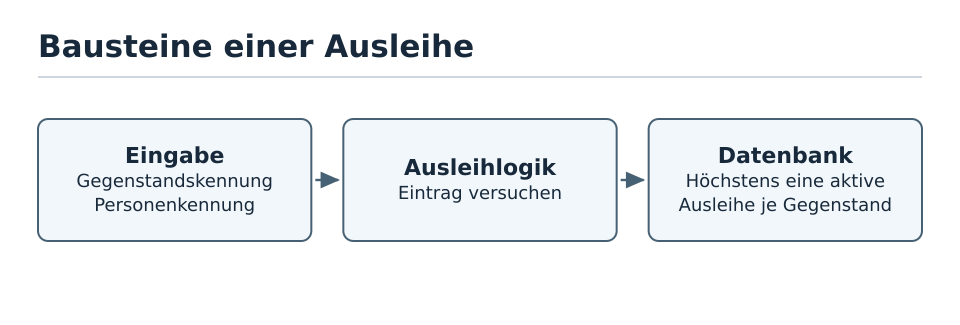

# M8-L4 – Teamprojekt: ein prüfbares Ausleihsystem {#L4}

**Kursbereich:** M8 – Systeme und Softwareprojekte

**Niveau:** Sekundarstufe II (grundlegend)

**Vorwissen:** [M8-L2 – Software planen, dokumentieren und versionieren](M8-L2.md), [M5-L3 – SQL-Joins, Gruppen und fehlende Werte](M5-L3.md)

**Lernziel:** Eine kleine Datenanwendung mit Testdaten, Testplan und Aufgabenverteilung ausarbeiten.

## Ein kleiner Auftrag für ein Team {#S1}

Eine Schul-AG leiht Kameras aus. Sie braucht einen Prototyp, der einen bekannten freien Gegenstand einer fiktiven Personenkennung zuordnet. Ausgeliehene Gegenstände bleiben bis zur Rückgabe belegt. Auf Papier ist eine zweite Zeile schnell ergänzt. Eine Datenbank soll diese widersprüchliche Zuordnung zuverlässig verhindern.

## Komponenten und Datenregel {#S2}

Die Eingabe liefert Gegenstands- und Personenkennung. Die Programmlogik verarbeitet sie und meldet, ob die Anforderung angenommen wurde. Die Datenbank speichert Gegenstände und aktive Ausleihen. Die Tabelle `active_loan` hat höchstens eine Zeile je Gegenstand. Ihr Primärschlüssel `item_id` macht diese Regel überprüfbar. Ein Fremdschlüssel stellt sicher, dass eine Ausleihe zu einem bekannten Gegenstand gehört.

{alt="Eingabe liefert Gegenstands- und Personenkennung an die Ausleihlogik. Die Logik versucht den Datenbankeintrag. Die Datenbank lässt höchstens eine aktive Ausleihe je Gegenstand zu."}

Für die Teamarbeit teilen wir die Verantwortung auf. Eine Person setzt Schema und Datenregeln um. Eine zweite implementiert die fachlichen Funktionen. Eine dritte entwirft Testfälle und dokumentiert beobachtete Ergebnisse. Alle vereinbaren Schnittstelle, Testdaten und Bedeutung der Rückgabewerte vor der Umsetzung. Danach prüft eine andere Person anhand der vereinbarten Kriterien jeden Änderungsvorschlag.

## Einen testbaren Prototyp ausführen {#S3}

Dieses Beispiel braucht Python 3.11 oder neuer mit SQLite ab Version 3.24. Es startet mit zwei bekannten, freien Gegenständen. `book` versucht, eine Ausleihe für einen passenden Gegenstand einzutragen. Der Parameterausdruck `?` bindet jeweils einen Wert. Wenn die Gegenstandskennung unbekannt ist, liefert die Auswahl keine Zeile. Wenn bereits eine aktive Ausleihe besteht, führt der Konflikt auf `item_id` ebenfalls zu keiner neuen Zeile. Beide Fälle liefern `False`.

```python
import sqlite3

db = sqlite3.connect(":memory:")
db.execute("PRAGMA foreign_keys = ON")
db.executescript("""
    CREATE TABLE item (
        item_id TEXT NOT NULL PRIMARY KEY
    );
    CREATE TABLE active_loan (
        item_id TEXT NOT NULL PRIMARY KEY REFERENCES item(item_id),
        member_id TEXT NOT NULL
    );
    INSERT INTO item VALUES ('CAM1'), ('CAM2');
""")


def book(connection, item_id, member_id):
    with connection:
        result = connection.execute("""
            INSERT INTO active_loan (item_id, member_id)
            SELECT item_id, ? FROM item WHERE item_id = ?
            ON CONFLICT(item_id) DO NOTHING
        """, (member_id, item_id))
    return result.rowcount == 1


assert book(db, "CAM2", "A17") is True
assert book(db, "CAM2", "A18") is False
assert book(db, "CAM9", "A18") is False
loans = db.execute("SELECT item_id, member_id FROM active_loan").fetchall()
assert loans == [("CAM2", "A17")]
db.close()
```

Am Ende ist nur die erste Zuordnung gespeichert. Die Tests prüfen sowohl die Rückgaben der Funktion als auch den beobachtbaren Datenstand. Damit würde ein Fehler auffallen, bei dem das Programm zwar eine Ablehnung meldet, die alte Zuordnung aber überschreibt.

## Selbstkontrolle {#S4}

### Aufgaben

1. Entwirf eine Rückgabefunktion für eine Gegenstandskennung. Welche Tabelleneinträge ändert sie? Formuliere drei Proben mit Ergebnissen für Rückgabe, wiederholte Rückgabe und anschließende neue Ausleihe.
2. Im Projektbericht steht „Alle Testfälle funktionieren“. Formuliere für die doppelte Ausleihe einen konkreten Nachweis, den eine andere Person mit dem Prototyp wiederholen kann.

### Lösungen

1. Die Funktion führt `DELETE FROM active_loan WHERE item_id = ?` mit der Gegenstandskennung als Parameter in einer Transaktion aus. Sie meldet anhand der Zahl gelöschter Zeilen, ob ein Eintrag entfernt wurde. `CAM2` bleibt in `item`. Nach der ursprünglichen Ausleihe liefert die erste Rückgabe wahr und die zweite falsch. Eine neue Ausleihe an `A18` liefert danach wahr und hinterlässt genau `("CAM2", "A18")` in `active_loan`.
2. Starte mit freien Gegenständen. Rufe `book` zuerst für `CAM2` und `A17` auf und danach für `CAM2` und `A18`. Erwartet werden `True` und `False`. Die abschließende Tabellenabfrage muss genau `("CAM2", "A17")` liefern. Halte Eingaben, Sollwerte, tatsächlich beobachtete Werte und den getesteten Versionsstand fest.

## Annahmen, Fehler und Grenzen {#S5}

Die Datenbank im Arbeitsspeicher verschwindet beim Schließen der Verbindung. Der Prototyp setzt gültige fiktive Personenkennungen voraus. Er hat keine Anmeldung, keine Ausleihfristen und keinen Verlauf. Für einen echten Einsatz müsste das Team Anforderungen an Berechtigungen, Datenaufbewahrung, Fehlerbehandlung und Wiederherstellung klären. Tests mit einer lokalen Verbindung decken außerdem kein verteiltes System ab.

## Zusammenfassung {#S6}

Ein kleines Team kann Datenmodell, Programmlogik und Prüfungen arbeitsteilig entwickeln. Eine zentrale Datenregel schützt die Zuordnung. Ein wiederholbarer Test belegt, welche Ausgabe und welchen Tabellenzustand jeder Beispielablauf erzeugt.

## Quellen und weiterführende Hinweise {#S7}

### Weiterführend (intern)

- [M8-L5 – Betriebssysteme und vernetzte Geräte](M8-L5.md)

### Quellen (extern)

- [Gesellschaft für Informatik e. V. – Bildungsstandards Informatik für die Sekundarstufe II](https://informatikstandards.de/fileadmin/GI/Projekte/Informatikstandards/Dokumente/Bildungsstandards_SII.pdf) · Bezug zur Lektion: §3.1.4 · Eine kleine Datenanwendung mit Testdaten, Testplan und Aufgabenverteilung ausarbeiten · Zuletzt abgerufen: 2026-11-22 · Inhaltlich geprüft: 2026-11-22
- [Bayern – Staatsinstitut für Schulqualität und Bildungsforschung (ISB) – LehrplanPLUS Gymnasium 12 – Informatik, grundlegendes Niveau](https://www.lehrplanplus.bayern.de/fachlehrplan/gymnasium/12/informatik/grundlegend) · Bezug zur Lektion: Inf12 LB6 · Eine kleine Datenanwendung mit Testdaten, Testplan und Aufgabenverteilung ausarbeiten · Zuletzt abgerufen: 2026-11-22 · Inhaltlich geprüft: 2026-11-22
