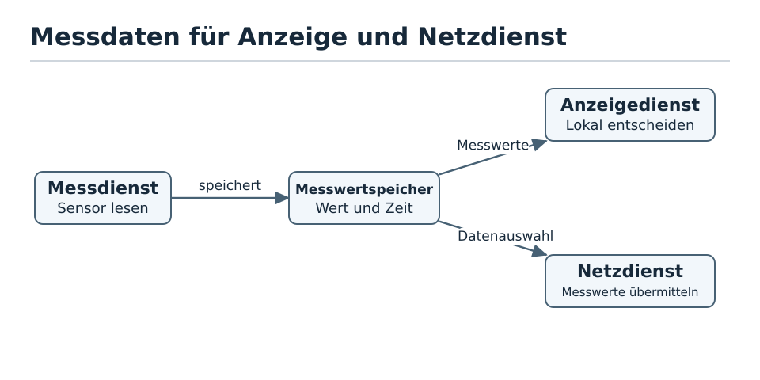

# M8-L5 – Betriebssysteme und vernetzte Geräte {#L5}

**Kursbereich:** M8 – Systeme und Softwareprojekte

**Niveau:** Sekundarstufe II (erhöht)

**Vorwissen:** [M1-L2 – Hardware, Software und Betriebssystem](M1-L2.md), [M8-L3 – Nebenläufigkeit und konsistente Änderungen](M8-L3.md), [M4-L3 – Daten schützen und Konten absichern](M4-L3.md)

**Lernziel:** Prozesse, Rechte und Gerätelebenszyklus an einem Sensornetz einordnen.

## Wenn die Verbindung ausfällt {#S1}

Ein Gewächshausmodell meldet mit einer lokalen Anzeige, ob es zu warm wird. Zusätzlich kann ein Netzdienst ausgewählte Messdaten an ein entferntes Dashboard übermitteln. Bei unterbrochener Internetverbindung soll die Warnanzeige weiter funktionieren. Bei defektem Sensor soll sie den letzten bekannten Wert als veraltet kennzeichnen, sobald er zu alt für eine Warnentscheidung ist. Die beiden Fälle verlangen verschiedene Reaktionen.

## Prozesse, Zugriffsrechte und lokale Entscheidungen {#S2}

Ein **Programm** beschreibt ausführbare Anweisungen. Ein **Prozess** ist eine laufende Instanz mit Ausführungszustand und zugeordneten Ressourcen, etwa Speicher und offenen Dateien. Das **Betriebssystem** teilt Rechenzeit zu und setzt auf einem geeigneten System Zugriffsrechte durch. Zwei Prozesse können deshalb verschiedene Rechte für denselben Messwertspeicher haben.

{alt="Der Messdienst liest den Sensor und aktualisiert den Messwertspeicher. Anzeige und Netzdienst lesen daraus über getrennte Pfade. Der Netzdienst steuert die Anzeige nicht."}

Im Modell darf der Messdienst den Sensor lesen und den lokalen Messwertspeicher aktualisieren. Der Anzeigedienst darf daraus lesen und die lokale Anzeige schalten. Der getrennte Netzdienst darf auf ausgewählte Messwerte lesend zugreifen und sie übertragen. Er erhält kein Schreibrecht für Grenzwerte oder Anzeige. Das **Prinzip der geringsten Rechte** gibt jedem Dienst die Berechtigungen, die er für seine Aufgabe benötigt.

## Datenfrische unabhängig vom Internet prüfen {#S3}

Wir werten ganzzahlige Sekunden einer lokalen Zeitbasis aus, die während des Versuchs vorwärtsläuft. Eine Probe mit Messwert und Zeitstempel ist höchstens 2 Sekunden lang frisch, gemessen durch die Altersbedingung `0 <= now - sampled_at <= 2`. Bei einer frischen Probe gilt ab 30 °C `WARN` und darunter `OK`. Ohne frische Probe gilt `STALE`. Das Modell setzt gültige, endliche Messwerte voraus.

```python
def local_status(now, sample):
    if sample is None:
        return "STALE"
    sampled_at, temperature = sample
    age = now - sampled_at
    if not 0 <= age <= 2:
        return "STALE"
    return "WARN" if temperature >= 30 else "OK"


last_sample = (8, 31)
assert local_status(8, last_sample) == "WARN"
assert local_status(10, last_sample) == "WARN"
assert local_status(11, last_sample) == "STALE"
assert local_status(12, (12, 29)) == "OK"
assert local_status(5, None) == "STALE"
```

Bei Sekunde 8 misst der Sensor 31 °C. Das Internet fällt bei Sekunde 9 aus. Bei Sekunde 10 ist dieselbe Probe noch frisch. Die Anzeige warnt weiter, obwohl das Dashboard keine aktuellen Daten empfängt. Ohne neue Sensorprobe meldet die lokale Anzeige bei Sekunde 11 veraltete Daten. Eine neue frische Probe von 29 °C bei Sekunde 12 liefert wieder `OK`, auch wenn das Internet noch ausgefallen ist.

## Selbstkontrolle {#S4}

### Aufgaben

1. Die letzte Probe wurde bei Sekunde 20 erhoben und zeigt 30 °C. Der Internetanschluss fällt aus. Welche Zustände meldet die lokale Anzeige bei Sekunde 22 und Sekunde 23 ohne neue Probe?
2. Der Netzdienst hat in einem Entwurf Schreibrechte für gespeicherte Messwerte und Grenzwerte. Schlage passendere Rechte und zwei Entscheidungen für das Ende der Gerätenutzung vor.

### Lösungen

1. Bei Sekunde 22 ist die Probe 2 Sekunden alt und damit noch frisch. Genau 30 °C erfüllt die Warnbedingung, also meldet die Anzeige `WARN`. Bei Sekunde 23 ist die Probe 3 Sekunden alt. Es folgt `STALE`.
2. Lesezugriff auf die zur Übermittlung benötigten Daten genügt. Schreibrechte am Messwertspeicher braucht nur der Messdienst. Der Grenzwert gehört zur geschützten lokalen Konfiguration. Beim Ausmustern kann das Team gespeicherte Messwerte gemäß der vereinbarten Aufbewahrung archivieren oder löschen und die Netzzugänge des Geräts widerrufen.

## Annahmen, Fehler und Grenzen {#S5}

Ein lokaler Regelpfad hilft bei unterbrochener Internetverbindung, sofern Sensor und Anzeige lokal erreichbar bleiben. Gegen Stromausfall oder einen Sensor, der fälschlich plausible neue Werte meldet, bietet das Modell allein keinen Schutz. Nach einem Neustart beginnt die Prüfung ohne gültige Probe. Zur Geräteplanung gehören außerdem ein unterstützter Updateweg und eine Entscheidung, wann ein Gerät ohne Sicherheitsaktualisierungen aus dem Netz genommen oder ersetzt wird.

## Zusammenfassung {#S6}

Das Betriebssystem teilt Ressourcen zu und unterstützt die Trennung von Prozessrechten. Lokale Entscheidungen können unabhängig vom Internet bleiben. Ein eigener Zustand für veraltete Messdaten zeigt, wann die Anzeige keinen belastbaren Temperaturstatus mehr kennt.

## Quellen und weiterführende Hinweise {#S7}

### Weiterführend (intern)

- [M9-L1 – Daten auswerten und Schlüsse begrenzen](M9-L1.md)

### Quellen (extern)

- [Bayern – Staatsinstitut für Schulqualität und Bildungsforschung (ISB) – LehrplanPLUS Gymnasium 12 – Informatik, erhöhtes Niveau](https://www.lehrplanplus.bayern.de/fachlehrplan/gymnasium/12/informatik/erhoeht) · Bezug zur Lektion: Inf12 LB5 · Prozesse, Rechte und Gerätelebenszyklus an einem Sensornetz einordnen · Zuletzt abgerufen: 2026-11-22 · Inhaltlich geprüft: 2026-11-22
- [Bayern – Staatsinstitut für Schulqualität und Bildungsforschung (ISB) – LehrplanPLUS Gymnasium 13 – Informatik, erhöhtes Niveau](https://www.lehrplanplus.bayern.de/fachlehrplan/gymnasium/13/informatik/erhoeht) · Bezug zur Lektion: Inf13 LB1 · Prozesse, Rechte und Gerätelebenszyklus an einem Sensornetz einordnen · Zuletzt abgerufen: 2026-11-22 · Inhaltlich geprüft: 2026-11-22
