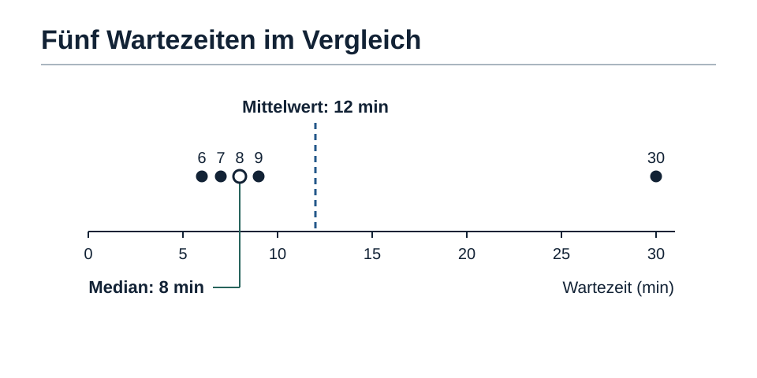

# M9-L1 – Daten auswerten und Schlüsse begrenzen {#L1}

**Kursbereich:** M9 – Datenanalyse, KI und Verantwortung

**Niveau:** Sekundarstufe I (Kern)

**Vorwissen:** [M2-L4 – Vom Messsignal zur Tabelle](M2-L4.md)

**Lernziel:** Eine Verteilung zusammenfassen und Korrelation von Ursache unterscheiden.

## Warum eine Zahl nicht alles sagt {#S1}

Fünf Personen warten an derselben Haltestelle unterschiedlich lange auf den Bus. Könntest du allein mit der Aussage „Im Mittel warten wir zwölf Minuten“ entscheiden, wann du losgehen solltest? Dafür möchtest du auch wissen, ob fast alle um zwölf Minuten warten oder ob eine einzelne lange Wartezeit den Durchschnitt anhebt.

## Mittelwert, Median und Streuung {#S2}

Der **arithmetische Mittelwert** ist die Summe aller Werte geteilt durch ihre Anzahl. Der **Median** ist der mittlere Wert der sortierten Liste. Bei einer geraden Anzahl nimmst du den Mittelwert der beiden mittleren Werte. Der Median teilt die sortierten Beobachtungen in zwei Hälften. Beide Kennzahlen haben hier die Einheit Minuten.

Ein **Ausreißer** ist ein auffälliger Wert im Vergleich zu den anderen Beobachtungen. Auffällig bedeutet noch nicht falsch. Im Punktdiagramm siehst du die einzelnen Messwerte und den Abstand zwischen der zusammenliegenden Gruppe und der längsten Wartezeit.

{alt="Auf der Zeitskala liegen vier Messpunkte bei 6, 7, 8 und 9 Minuten, ein Punkt bei 30. Der Median ist 8 Minuten, der Mittelwert 12 Minuten."}

## Fünf Wartezeiten auswerten {#S3}

Die Zeiten sind `6, 7, 8, 9, 30` Minuten. Ihre Summe ist 60 Minuten. Der Mittelwert ist `60 / 5 = 12` Minuten. Der dritte sortierte Wert und damit der Median ist 8 Minuten. Die **Spannweite**, also der Abstand vom kleinsten bis zum größten Wert, beträgt `30 − 6 = 24` Minuten.

```python
from statistics import mean, median

minutes = [6, 7, 8, 9, 30]
assert mean(minutes) == 12
assert median(minutes) == 8
assert max(minutes) - min(minutes) == 24
```

Vier von fünf Wartezeiten liegen zwischen 6 und 9 Minuten. Wenn die 30 Minuten etwa wegen eines ausgefallenen Busses korrekt sind, beschreiben sie ein reales Risiko. Falls ein Messprotokoll dagegen eindeutig zeigt, dass irrtümlich ab dem Verlassen des Hauses gemessen wurde, ist der Wert mit den anderen Messungen nicht vergleichbar. Eine Korrektur braucht diese Begründung.

## Selbstkontrolle {#S4}

### Aufgaben

1. Am Folgetag wurden `6, 7, 8, 9, 10` Minuten beobachtet. Berechne Mittelwert, Median und Spannweite. Welche Kennzahl bleibt gleich?
2. An Regentagen sind die Wartezeiten in einem größeren Datensatz tendenziell länger. Nenne einen möglichen dritten Faktor und beschreibe einen faireren Vergleich.

### Lösungen

1. Die Summe ist 40, der Mittelwert 8 Minuten, der Median ebenfalls 8 Minuten und die Spannweite `10 − 6 = 4` Minuten. Nur der Median bleibt gegenüber dem ersten Tag gleich.
2. Die Uhrzeit kann mit dem beobachteten Wetter zusammenhängen, wenn viele Regenmessungen zufällig in der Hauptverkehrszeit stattfanden. Vergleiche dieselbe Haltestelle und dieselbe Fahrtrichtung in vergleichbaren Zeitfenstern bei Regen und trockenem Wetter. Dadurch lässt sich der Einfluss der Uhrzeit besser begrenzen. Für eine Kausalaussage müssten weitere plausible Einflüsse geprüft werden.

## Typische Fehler und Grenzen {#S5}

Eine **Korrelation** bezeichnet einen statistischen Zusammenhang. Sie kann Hinweise auf eine Ursache liefern. Dieselbe Beobachtung kann aber auch durch eine dritte Einflussgröße, die Auswahl der Messfälle oder Zufall entstehen. Bei nur fünf Beobachtungen lässt sich ein Muster zudem leicht überinterpretieren. Halte deshalb Messort, Zeitraum, Einheit und Auswahlregel fest. Gib bei auffälligen Werten an, wie du sie geprüft hast.

## Zusammenfassung {#S6}

Der Mittelwert berücksichtigt die Größe jedes Messwerts. Für den Median zählt die Position in der sortierten Liste. Ein Punktdiagramm und die Zahl der Beobachtungen helfen bei der Einordnung beider Kennzahlen. Eine Erklärung für ein beobachtetes Muster braucht zusätzliche Belege.

## Quellen und weiterführende Hinweise {#S7}

### Weiterführend (intern)

- [M9-L2 – Maschinelles Lernen mit einem kleinen Modell](M9-L2.md)

### Quellen (extern)

- [Gesellschaft für Informatik e. V. – Bildungsstandards Informatik für die Sekundarstufe I](https://informatikstandards.de/fileadmin/FA/IBS/user_upload/GI-Bildungsstandards_Informatik_Sek_I__2025__-_blau.pdf) · Bezug zur Lektion: §5.1, §5.5 · Eine Verteilung zusammenfassen und Korrelation von Ursache unterscheiden · Zuletzt abgerufen: 2026-11-22 · Inhaltlich geprüft: 2026-11-22
