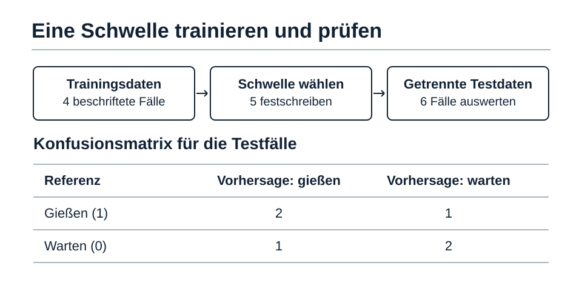

# M9-L2 – Maschinelles Lernen mit einem kleinen Modell {#L2}

**Kursbereich:** M9 – Datenanalyse, KI und Verantwortung

**Niveau:** Sekundarstufe II (grundlegend)

**Vorwissen:** [M9-L1 – Daten auswerten und Schlüsse begrenzen](M9-L1.md), [M3-L4 – Listen, Funktionen und Zerlegung](M3-L4.md)

**Lernziel:** Training und Test trennen und Folgen einer Schwellenentscheidung prüfen.

## Eine Entscheidung aus Beispielen lernen {#S1}

Ein fiktiver Schulgarten will mit einem Trockenheitswert zwischen 1 und 9 abschätzen, wann eine Pflanze gegossen werden sollte. Zu jedem Beispiel bestimmt das Garten-Team im direkten Vergleich unabhängig vom Sensorwert, ob Gießen nötig ist. Ein Verfahren, das anhand solcher Paare aus Eingabe und bekanntem Zielwert lernt, heißt **überwachtes Lernen**.

## Training und Test {#S2}

Das kleine Modell hat einen Parameter: den **Schwellenwert**. Ein Trockenheitswert ab der Schwelle ergibt die Vorhersage `1` für „gießen“, darunter `0` für „warten“. Das Training wählt aus den Kandidaten 4, 5 und 6 die Schwelle mit den wenigsten Fehlern auf den Trainingsdaten. Bei Gleichstand gilt die kleinere Schwelle. Die Testdaten bleiben bis zur Bewertung getrennt.

Die **Konfusionsmatrix** stellt bekannte Zielwerte und Vorhersagen gegenüber. Ein **falsch positives** Ergebnis empfiehlt Gießen, obwohl die Referenz „warten“ lautet. Ein **falsch negatives** Ergebnis empfiehlt Warten, obwohl Gießen nötig ist.

{alt="Vier Trainingsfälle führen zur Schwelle 5. Sechs separate Testfälle ergeben zwei richtig positive, einen falsch positiven, einen falsch negativen und zwei richtig negative Fälle."}

## Eine Schwelle wählen und prüfen {#S3}

Auf den Trainingsfällen `(2, 0), (4, 0), (6, 1), (8, 1)` erzeugt Schwelle 4 einen Fehler beim Wert 4. Schwellen 5 und 6 trennen diese vier Fälle richtig. Die Gleichstandsregel wählt 5. Anschließend entstehen im Test zwei richtig positive Fälle (7 und 9), ein falsch positiver (6), ein falsch negativer (4) und zwei richtig negative (3 und 2). Die **Trefferquote** ist `4 / 6`, also rund 67 %.

```python
train = [(2, 0), (4, 0), (6, 1), (8, 1)]
test = [(3, 0), (4, 1), (6, 0), (7, 1), (9, 1), (2, 0)]


def predict(score, threshold):
    return int(score >= threshold)


def training_errors(threshold):
    return sum(predict(score, threshold) != actual for score, actual in train)


threshold = min((4, 5, 6), key=lambda value: (training_errors(value), value))
counts = {(a, p): 0 for a in (0, 1) for p in (0, 1)}
for score, actual in test:
    counts[actual, predict(score, threshold)] += 1

assert threshold == 5
assert counts == {(0, 0): 2, (0, 1): 1, (1, 0): 1, (1, 1): 2}
assert sum(predict(score, 7) == actual for score, actual in test) == 5
```

## Selbstkontrolle {#S4}

### Aufgaben

1. Welche Kategorie hat der Testfall `(4, 1)` bei Schwelle 5? Welche Folge könnte der Fehler haben?
2. Schaut ein Team auf dieselben Testdaten, stellt Schwelle 7 ein und erhält danach fünf statt vier richtige Antworten, was muss es vor einer neuen Aussage zur Trefferquote tun?

### Lösungen

1. Die Vorhersage ist `0` bei bekanntem Wert `1`, also falsch negativ. Die Pflanze könnte zu lange trocken bleiben.
2. Derselbe Test hat jetzt die Wahl der Schwelle beeinflusst. Das Team muss Schwelle 7 festschreiben und auf neuen, noch unberührten Fällen prüfen. Die fünf richtigen Antworten auf den bereits betrachteten Fällen beschreiben nur diese Fälle.

## Typische Fehler und Grenzen {#S5}

Ein Sensorwert fasst die Lage stark zusammen. Wert 6 kann in einem Trainingsbeispiel Gießen bedeuten, in einem Testbeispiel aber Warten. Unterschiedliche Substrate oder Pflanzenarten könnten eine Rolle spielen. Die Daten sind konstruiert und klein. Eine höhere Trefferquote allein entscheidet zudem nicht, welcher Fehler im Einsatz schwerwiegender wäre. Für Modellwahl und Auswertung sollten die Fehlerarten getrennt betrachtet werden.

## Zusammenfassung {#S6}

Trainingsdaten bestimmen die Schwelle. Getrennte Testdaten zeigen, welche Wirkungen die festgelegte Schwelle bei neuen Fällen hat. Die Konfusionsmatrix macht sichtbar, wie sich Fehler auf die beiden Entscheidungstypen verteilen.

## Quellen und weiterführende Hinweise {#S7}

### Weiterführend (intern)

- [M9-L3 – Bias, generative KI und Verifikation](M9-L3.md)

### Quellen (extern)

- [Gesellschaft für Informatik e. V. – Bildungsstandards Informatik für die Sekundarstufe I](https://informatikstandards.de/fileadmin/FA/IBS/user_upload/GI-Bildungsstandards_Informatik_Sek_I__2025__-_blau.pdf) · Bezug zur Lektion: §5.1 · Training und Test trennen und Folgen einer Schwellenentscheidung prüfen · Zuletzt abgerufen: 2026-11-22 · Inhaltlich geprüft: 2026-11-22
- [Bayern – Staatsinstitut für Schulqualität und Bildungsforschung (ISB) – LehrplanPLUS Gymnasium 11 – spät beginnende Informatik](https://www.lehrplanplus.bayern.de/fachlehrplan/gymnasium/11/informatik/mug_swg_sg) · Bezug zur Lektion: Inf11 LB4 · Training und Test trennen und Folgen einer Schwellenentscheidung prüfen · Zuletzt abgerufen: 2026-11-22 · Inhaltlich geprüft: 2026-11-22
- [Google for Developers – Datasets: Dividing the original dataset](https://developers.google.com/machine-learning/crash-course/overfitting/dividing-datasets) · Bezug zur Lektion: Training, validation and test sets · Training und Test trennen und Folgen einer Schwellenentscheidung prüfen · Zuletzt abgerufen: 2026-11-22 · Inhaltlich geprüft: 2026-11-22
- [Google for Developers – Classification: Accuracy, recall, precision, and related metrics](https://developers.google.com/machine-learning/crash-course/classification/accuracy-precision-recall) · Bezug zur Lektion: Accuracy · Training und Test trennen und Folgen einer Schwellenentscheidung prüfen · Zuletzt abgerufen: 2026-11-22 · Inhaltlich geprüft: 2026-11-22
