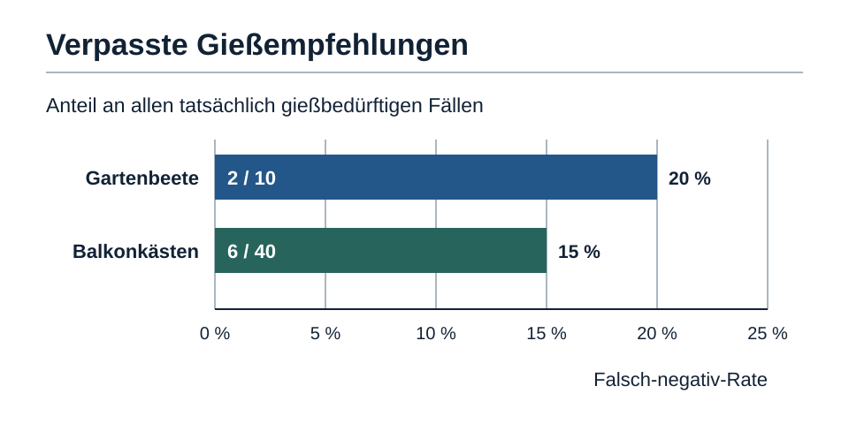

# M9-L3 – Bias, generative KI und Verifikation {#L3}

**Kursbereich:** M9 – Datenanalyse, KI und Verantwortung

**Niveau:** Sekundarstufe II (grundlegend)

**Vorwissen:** [M9-L2 – Maschinelles Lernen mit einem kleinen Modell](M9-L2.md)

**Lernziel:** Unterschiedliche Fehlerquoten und unbelegte KI-Ausgaben beurteilen.

## Wen trifft ein Modellfehler? {#S1}

Ein Schulgarten testet die Gießempfehlung aus der vorigen Lektion für zwei Pflanzgruppen. Bei den Balkonkästen werden mehr nötige Gießempfehlungen versäumt als bei den Gartenbeeten. Welche Gruppe ist stärker von verpassten Gießempfehlungen betroffen? Das lässt sich erst mit der Zahl der tatsächlich gießbedürftigen Fälle für jede Gruppe beurteilen.

## Eine Fehlerquote pro Gruppe berechnen {#S2}

Betrachtet werden ausschließlich tatsächlich positive Fälle. Unter ihnen zählt das Team die **falsch negativen** Vorhersagen. Für Gartenbeete sind es 2 von 10, für Balkonkästen 6 von 40. Die **Falsch-negativ-Rate** ist die Zahl verpasster Empfehlungen geteilt durch die Zahl der tatsächlich positiven Fälle. Sie beträgt für die Gartenbeete `2 / 10 = 20 %`, für die Balkonkästen `6 / 40 = 15 %`. In diesen Daten hat die Gruppe mit weniger verpassten Empfehlungen die höhere Quote.

{alt="Gartenbeete: 2 verpasste Empfehlungen bei 10 positiven Fällen, 20 Prozent. Balkonkästen: 6 bei 40, 15 Prozent. Beide Balken beginnen bei null."}

Ein Unterschied kann auf **Bias** hinweisen, etwa wenn ein Sensor für einen Standort eingerichtet wurde und der andere bei der Entwicklung kaum vorkam. Prüfe mögliche Ursachen wie Stichprobengröße, Sensorposition, Substrat und Qualität der Referenzkennzeichnung. Die Fehlerquote beschreibt zunächst die beobachteten Fälle.

## Eine KI-Auskunft mit einem Beleg vergleichen {#S3}

Ein generatives KI-System erzeugt neue Ausgaben wie Text. Es kann nützlich formulieren und zugleich eine plausible Behauptung ohne tragfähigen Beleg liefern. Im Übungsfall behauptet die KI: „Die Datensätze der Balkonkästen und der Beete hatten je 40 gießbedürftige Fälle.“ Als Quelle nennt sie „Sensorbericht, Tabelle 2“. Das Garten-Team prüft die genaue Stelle im bereitgestellten Übungsbericht:

| Tabelle 2 · Eintrag | Gartenbeete | Balkonkästen |
| --- | ---: | ---: |
| Gießbedürftige Testfälle | 10 | 40 |
| Davon versäumte Empfehlungen | 2 | 6 |

Der Bericht existiert im Übungsfall. Die zitierte Tabelle belegt die Aussage über die Balkonkästen und widerspricht der Aussage über die Beete. Eine belastbare Korrektur lautet: „Bei den Beeten waren 10 Testfälle gießbedürftig, bei den Balkonkästen waren es 40 (Sensorbericht, Tabelle 2).“

## Selbstkontrolle {#S4}

### Aufgaben

1. Bei den Beeten wird ein weiterer bisher richtig erkannter positiver Fall fälschlich als „warten“ eingestuft. Berechne die geänderte Falsch-negativ-Rate. Wie groß ist ihr Abstand zur unveränderten Rate der Balkonkästen in Prozentpunkten?
2. Ein generiertes Protokoll sagt: „Bei den Balkonkästen waren sechs Fälle positiv.“ Welche zwei Angaben aus Tabelle 2 wurden dabei verwechselt?

### Lösungen

1. Der Nenner bleibt 10, der Zähler steigt auf 3. Die Rate beträgt 30 %. Der Abstand zu 15 % beträgt 15 Prozentpunkte.
2. Sechs von 40 tatsächlich positiven Fällen wurden vom Modell verpasst. Sechs ist die Zahl der falsch negativen Vorhersagen. 40 ist die Zahl der tatsächlich positiven Fälle.

## Typische Fehler und Grenzen {#S5}

In den Nenner gehen ausschließlich tatsächlich positive Fälle ein. Gibt es in einer Gruppe keinen positiven Fall, ist die Rate für diese Gruppe nicht definiert. Teilt man durch alle Testfälle, beantwortet man eine andere Frage. Bei nur zehn positiven Fällen ändert ein Fehler die Quote um zehn Prozentpunkte. Für eine belastbare Beurteilung braucht es weitere vergleichbar erfasste Fälle. Beim Quellenvergleich müssen Dokument, Fundstelle und konkreter Inhalt stimmen. Ein glaubwürdig klingender Dokumenttitel allein genügt nicht.

## Zusammenfassung {#S6}

Untersuche Fehler mit dem zur Frage passenden Nenner. Prüfe danach, ob Unterschiede auch bei vergleichbar erhobenen neuen Fällen auftreten. Behandle eine KI-Auskunft als prüfbare Behauptung und halte die tatsächlich stützende Fundstelle fest.

## Quellen und weiterführende Hinweise {#S7}

### Weiterführend (intern)

- [M9-L4 – Teilhabe, Rechte und Nachhaltigkeit](M9-L4.md)

### Quellen (extern)

- [Gesellschaft für Informatik e. V. – Bildungsstandards Informatik für die Sekundarstufe I](https://informatikstandards.de/fileadmin/FA/IBS/user_upload/GI-Bildungsstandards_Informatik_Sek_I__2025__-_blau.pdf) · Bezug zur Lektion: §5.5 · Unterschiedliche Fehlerquoten und unbelegte KI-Ausgaben beurteilen · Zuletzt abgerufen: 2026-11-22 · Inhaltlich geprüft: 2026-11-22
- [Bayern – Staatsinstitut für Schulqualität und Bildungsforschung (ISB) – LehrplanPLUS Gymnasium 13 – Informatik, grundlegendes Niveau](https://www.lehrplanplus.bayern.de/fachlehrplan/gymnasium/13/informatik/grundlegend) · Bezug zur Lektion: Inf13 LB4 · Unterschiedliche Fehlerquoten und unbelegte KI-Ausgaben beurteilen · Zuletzt abgerufen: 2026-11-22 · Inhaltlich geprüft: 2026-11-22
- [Google for Developers – Classification: Accuracy, recall, precision, and related metrics](https://developers.google.com/machine-learning/crash-course/classification/accuracy-precision-recall) · Bezug zur Lektion: Recall · Unterschiedliche Fehlerquoten und unbelegte KI-Ausgaben beurteilen · Zuletzt abgerufen: 2026-11-22 · Inhaltlich geprüft: 2026-11-22
- [National Institute of Standards and Technology – Artificial Intelligence Risk Management Framework: Generative Artificial Intelligence Profile](https://nvlpubs.nist.gov/nistpubs/ai/NIST.AI.600-1.pdf) · Bezug zur Lektion: §2.2 Confabulation · Unterschiedliche Fehlerquoten und unbelegte KI-Ausgaben beurteilen · Zuletzt abgerufen: 2026-11-22 · Inhaltlich geprüft: 2026-11-22
