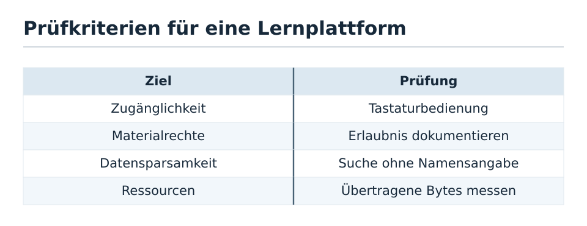

# M9-L4 – Teilhabe, Rechte und Nachhaltigkeit {#L4}

**Kursbereich:** M9 – Datenanalyse, KI und Verantwortung

**Niveau:** Sekundarstufe II (grundlegend)

**Vorwissen:** [M4-L3 – Daten schützen und Konten absichern](M4-L3.md), [M9-L1 – Daten auswerten und Schlüsse begrenzen](M9-L1.md)

**Lernziel:** Barrierefreiheit, Urheberschaft, Datenminimierung und Ressourcenfolgen abwägen.

## Eine Plattform für verschiedene Lernende {#S1}

Eine Klasse veröffentlicht auf einer fiktiven Schulplattform Lernkarten. Der Entwurf zeigt eine Karte als Bild, lädt automatisch ein Vorschauvideo und fordert bei jeder Suche einen Namen. Wie lässt sich dasselbe Lernziel mit einer Seite erreichen, die auch bei wenig Datenvolumen, mit Tastatur und mit Vorlesesoftware gut nutzbar ist?

## Anforderungen als Tests formulieren {#S2}

**Barrierefreiheit** betrachtet, ob Menschen mit unterschiedlichen Fähigkeiten und Hilfsmitteln das Angebot nutzen können. Ein beschreibender Text für eine informative Grafik gibt den Kern des Bildes wieder. Bei komplexen Grafiken ergänzt eine benachbarte Texttabelle die Einzelwerte. Verlässliche Tastaturbedienung zeigt sich etwa daran, dass man mit Tabulator und Eingabetaste die Suche und Lernkarten erreichen und öffnen kann. Eine sichtbare Fokusmarkierung zeigt, welches Element als Nächstes aktiviert wird.

**Datenminimierung** fragt, welche Angaben für einen festgelegten Zweck erforderlich sind. Zur Stichwortsuche reichen hier Suchbegriffe. Für jedes fremde Lernmaterial sollte die Gruppe vor einer Veröffentlichung klären, welche Erlaubnis oder Lizenz gilt und welche Namensnennung verlangt wird. Ein Link auf eine Fundstelle dokumentiert die Herkunft. Die Wiederverwendung richtet sich nach den geltenden Bedingungen.

{alt="Die Tabelle ordnet vier Zielen Tests zu: Tastaturbedienung, Nutzungsrechte dokumentieren, Stichwortsuche ohne Namensangabe und übertragene Bytes erfassen."}

## Zwei Vorschauentwürfe vergleichen {#S3}

Im angenommenen Test lädt Entwurf A bei jedem Seitenaufruf ein Video mit 6 MB. Entwurf B lädt nur ein Vorschaubild mit 80 kB. Beide bieten eine zugängliche Schaltfläche zum freiwilligen Abspielen. Mit Dezimaleinheiten sind 80 kB gleich 0,08 MB. Bei 1.000 Aufrufen ohne Zwischenspeicherung oder freiwilliges Abspielen werden übertragen:

| Entwurf | Datenmenge für 1.000 Aufrufe |
| --- | ---: |
| Automatisch geladenes Video | 6.000 MB = 6 GB |
| Standbild | 80 MB |

In diesem Szenario spart der zweite Entwurf `6.000 − 80 = 5.920` MB an Übertragung für die Vorschau. Wird jedes Video im zweiten Entwurf anschließend doch geladen, kommen dort zusätzlich zum Video noch 80 MB für die Vorschauen hinzu. Miss deshalb im Test sowohl übertragene Bytes als auch die tatsächlich gestarteten Videos. Bytes beschreiben Datenmenge. Energieverbrauch und Umweltwirkung hängen von weiteren Faktoren wie Gerät, Netz, Zwischenspeicherung und Nutzung ab.

## Selbstkontrolle {#S4}

### Aufgaben

1. Eine Lernkarte enthält ein Diagramm als Bild und der einzige Downloadknopf ist nur mit der Maus erreichbar. Formuliere zwei Verbesserungen mit je einer konkreten Prüfung.
2. Die Klasse soll ihren Entwurf in einer Woche veröffentlichen. Für ein Foto fehlt der Nutzungsnachweis, für die Suche wird ein Klarname gespeichert und das Vorschauvideo hat keinen bestätigten Lernzweck. Mache einen begründeten Plan.

### Lösungen

1. Den Kerngedanken des Diagramms als Alt-Text angeben und die genauen Werte als Texttabelle hinterlegen. Mit Vorlesesoftware prüfen, ob beides verständlich ist. Den Download als üblichen fokussierbaren Link mit sichtbarem Fokus gestalten und mit Tab sowie Eingabetaste ohne Maus testen.
2. Das Foto bis zur Klärung durch ein geeignetes eigenes oder freigegebenes ersetzen und die Herkunft dokumentieren. Die Stichwortsuche ohne Namensfeld und Namensspeicherung testen. Das automatische Vorschauvideo durch ein kleines Standbild ersetzen und eine freiwillige Wiedergabe nur bei belegtem Bedarf anbieten. Für jeden Punkt eine Zuständigkeit und einen Abnahmetest vereinbaren.

## Typische Fehler und Grenzen {#S5}

Ein gutes Ergebnis bei einem automatischen Zugänglichkeitstest ersetzt keine repräsentative Prüfung mit Tastatur und assistiver Technik. Legitime Gründe für einen Login hängen vom jeweiligen Zweck ab. Auch eine gemessene kleinere Datei belegt für sich allein keine konkrete Verringerung von Emissionen. Halte zu jedem Vergleich Annahmen und Messgrenzen fest.

## Zusammenfassung {#S6}

Leite Entscheidungen aus dem Lernzweck ab. Dokumentiere Anforderungen und ihre Prüfmethode getrennt für Zugänglichkeit, Materialrechte, Datensparsamkeit und Ressourcenverbrauch. Die vier Fragen können bei derselben technischen Entscheidung zu unterschiedlichen Anforderungen führen.

## Quellen und weiterführende Hinweise {#S7}

### Weiterführend (intern)

- [M10-L1 – Operatoren und begründete Modellwahl](M10-L1.md)

### Quellen (extern)

- [Gesellschaft für Informatik e. V. – Bildungsstandards Informatik für die Sekundarstufe I](https://informatikstandards.de/fileadmin/FA/IBS/user_upload/GI-Bildungsstandards_Informatik_Sek_I__2025__-_blau.pdf) · Bezug zur Lektion: §5.5 · Barrierefreiheit, Urheberschaft, Datenminimierung und Ressourcenfolgen abwägen · Zuletzt abgerufen: 2026-11-22 · Inhaltlich geprüft: 2026-11-22
- [Bildungsserver Berlin-Brandenburg · Senatsverwaltung Berlin und MBJS Brandenburg – Rahmenlehrplan Teil C – Informatik, Wahlpflichtfach, Jahrgangsstufen 7–10](https://bildungsserver.berlin-brandenburg.de/fileadmin/bbb/unterricht/rahmenlehrplaene/Rahmenlehrplanprojekt/amtliche_Fassung/Teil_C_Informatik_2015_11_10.pdf) · Bezug zur Lektion: §3.3 · Barrierefreiheit, Urheberschaft, Datenminimierung und Ressourcenfolgen abwägen · Zuletzt abgerufen: 2026-11-22 · Inhaltlich geprüft: 2026-11-22
- [W3C Web Accessibility Initiative – Understanding Success Criterion 1.1.1: Non-text Content](https://www.w3.org/WAI/WCAG22/Understanding/non-text-content.html) · Bezug zur Lektion: Non-text Content · Barrierefreiheit, Urheberschaft, Datenminimierung und Ressourcenfolgen abwägen · Zuletzt abgerufen: 2026-11-22 · Inhaltlich geprüft: 2026-11-22
- [W3C Web Accessibility Initiative – Understanding Success Criterion 2.1.1: Keyboard](https://www.w3.org/WAI/WCAG22/Understanding/keyboard.html) · Bezug zur Lektion: SC 2.1.1 · Barrierefreiheit, Urheberschaft, Datenminimierung und Ressourcenfolgen abwägen · Zuletzt abgerufen: 2026-11-22 · Inhaltlich geprüft: 2026-11-22
- [W3C Web Accessibility Initiative – Understanding Success Criterion 2.4.7: Focus Visible](https://www.w3.org/WAI/WCAG22/Understanding/focus-visible.html) · Bezug zur Lektion: SC 2.4.7 · Barrierefreiheit, Urheberschaft, Datenminimierung und Ressourcenfolgen abwägen · Zuletzt abgerufen: 2026-11-22 · Inhaltlich geprüft: 2026-11-22
